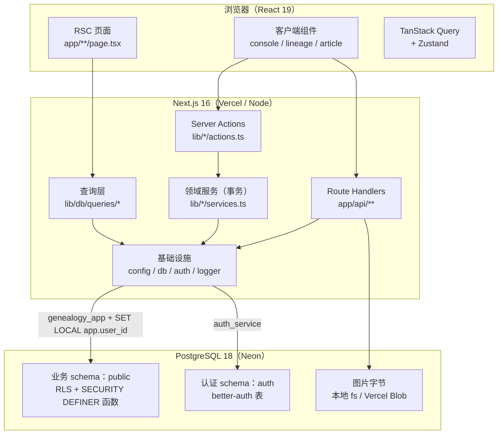

# 云谱（gramps）文档

本目录是**唯一文档入口**。云谱是面向家族修谱场景的在线谱牒编纂平台：组织在云端建立「云谱空间」，录入世系、撰写谱文、编排谱书目录。工程形态是**模块化单体**：单个 Next.js 16 应用同时承载 RSC 页面、Server Action 写入口与只读 Route Handler，所有业务域共用一个 PostgreSQL。

文档以 `main` 分支当前代码为准；函数签名与逐列 DDL 以源码为唯一真相源。

## 文档地图

| 文档 | 内容 | 适合谁 |
| --- | --- | --- |
| [overview.md](overview.md) | 产品定位、范围、技术栈、成功度量 | 所有人，第一份 |
| [architecture.md](architecture.md) | 分层、请求生命周期、依赖方向、部署 | 架构评审、新人 |
| [data-model.md](data-model.md) | 实体、约束、RLS、删除语义 | 改表 / 排查数据 |
| [api.md](api.md) | 四条通道、Route Handler、Server Action、返回契约 | 接口对接 |
| [glossary.md](glossary.md) | 领域术语 | 写规格 / 读代码 |
| [nfr.md](nfr.md) | 可度量阈值、容量口径 | 性能 / 容量评审 |
| [roadmap.md](roadmap.md) | 编排与状态 | 规划 / 交付 |
| [infrastructure.md](infrastructure.md) | 配置、双连接、权限守卫、日志、限流 | 平台 / 后端 |
| [development.md](development.md) | 本地启动、命令、测试、CI、排障 | 第一次跑起来 |
| [modules/](modules/README.md) | 领域导读：认证组织、谱系、谱文媒体 | 功能开发 |
| [contracts/](contracts/README.md) | 错误码、权限矩阵、Action 契约 | 接口 / 前端 |
| [adr/](adr/README.md) | 架构决策 | 改动前查历史 |
| [runbooks/](runbooks/README.md) | 发布、回滚、排障 | 值班 / 运维 |

## 阅读路线

| 我要做的事 | 顺序 |
| --- | --- |
| 第一次加入 | overview → architecture → development |
| 新增页面 / Action | architecture → api → modules → contracts |
| 改数据表 / 迁移 | data-model → development（迁移章节）→ runbooks |
| 开发谱系功能 | data-model → modules/lineage → api |
| 开发谱文 / 图片 | data-model → modules/article-media → api |
| 排查权限问题 | modules/auth-org-project → data-model（RLS）→ architecture（事务） |
| 部署 / 值班 | development → runbooks → nfr |

## 架构一图流

核心闭环：

1. **读**：RSC 直接调用 `lib/db/queries/*`，在同一组织作用域事务中由 RLS 过滤。
2. **写**：客户端调用 Server Action → Zod 校验 → `withOrgWrite()` 开启事务并二次鉴权 → 领域 service 写入 → `revalidateWholeConsole()` 失效快照。
3. **二进制**：图片经 Route Handler 上传/读取，元数据（`pathname`）存于谱文 JSON。

## 文档约定

- **一个事实只有一个家**：产品意图在 `overview`，结构与依赖在 `architecture`，表与不变量在 `data-model`，接口在 `api`，错误码与权限矩阵在 `contracts`，阈值在 `nfr`。
- 文中路径均相对于仓库根目录；函数签名以源码为准。
- 「未实现 / 明确不做」会显式标注，避免把路线图当成现状。
- 新增或改名文档后跑 `pnpm docs:check`；门禁默认即失败，无需额外开关。
