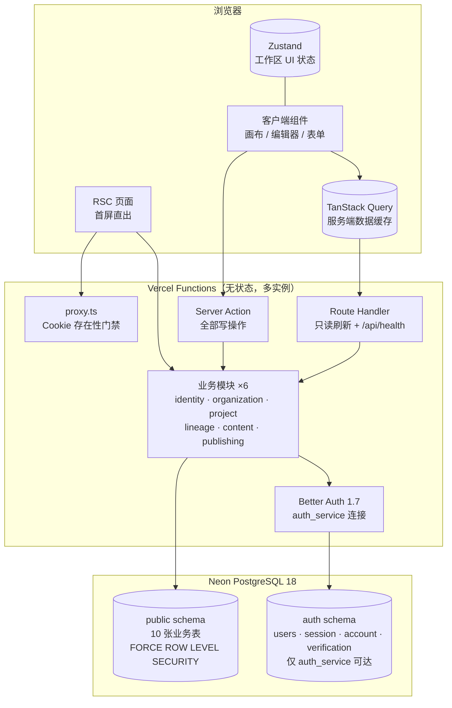

# 架构总览

> **回答什么问题**：这个系统长什么样？读哪一份能回答我的问题？
> **读者**：所有人（第一份该读的架构文档）　**长度上限**：2 页
> **本文档为新增**：不包含原 `architect.md` 的章节，是拆分后的导航与一页纸摘要。
> **目标 vs 现状**：本文描述目标架构。与当前实现的差异只以 [实现状态](../implementation-status.md) 为准。

---

## 1. 一页纸

### 1.1 系统形态

**模块化单体（Modular Monolith）**：一个 Next.js 16 应用承载全部业务，6 个业务模块共享一个 PostgreSQL 18 数据库。没有微服务、没有消息队列、没有后台任务、没有独立缓存层。

```
                    ┌──────────────────────────┐
                    │   谱系编纂 SaaS（本系统）  │
                    └────────────┬─────────────┘
                                 │
              ┌──────────────────┼──────────────────┐
              │                  │                  │
        ┌─────▼─────┐     ┌──────▼──────┐    ┌──────▼──────┐
        │  编纂者    │     │   Vercel    │    │  运维        │
        │ (浏览器)   │     │ Next.js +   │    │ (日志/探针)  │
        └───────────┘     │ 自定义域名   │    └─────────────┘
                          └──────┬──────┘
                                 │ pg.Pool + attachDatabasePool（业务 pooled / 认证 direct）
                          ┌──────▼──────┐
                          │    Neon     │
                          │ PostgreSQL  │
                          │    18+      │
                          └─────────────┘
```

**M1 没有匿名访问者。** 所有页面都需要登录——没有分享页，没有公开 API。M2 引入分享后才出现「族内读者」这个角色。

### 1.2 运行时容器



### 1.3 一次写请求的路径

```
用户提交表单
  │
  ├─ action.ts        Zod 校验 → 得到 input
  ├─ requireOrgContext(orgSlug)   未登录 401 / 非成员 404
  ├─ assertPermission(ctx, 'xxx.write')
  ├─ withOrg(ctx, tx => ...)
  │    └─ SET LOCAL ROLE app_rw + 注入 claims → RLS 生效
  │         └─ xxxService.xxx(tx, ctx, input)      业务
  ├─ revalidateTag(`lineage:${id}`)
  └─ return { ok: true, data }       失败返回 { ok: false, error }
```

M1 只有两步：**业务 → 失效缓存**。M2 引入编辑锁后，前面会插入「锁校验」一步。

---

## 2. 十条要点

| # | 要点 | 详见 |
|---|---|---|
| 1 | 模块化单体，单一 Next.js 应用，6 个业务模块，每张表只有一个 owner | [03-components](./03-components.md) |
| 2 | 隔离三层：应用层 `WHERE` + RLS `organization_isolation` + 复合外键 | [05-data](./05-data.md) · [data-model §12](../data-model.md) |
| 3 | 首屏由 RSC 服务端直读，写操作走 Server Action，客户端 TanStack Query 只做缓存 | [04-runtime](./04-runtime.md) |
| 4 | 零后台任务、零消息队列、零缓存层——没有消费者就不建基础设施 | [08-evolution](./08-evolution.md) |
| 5 | UUIDv7 主键（库内生成）；`organization.slug` / `project.ref` 为 20 位公开 ID，只用于 URL | [05-data](./05-data.md) |
| 6 | 软删 + **部分**唯一索引；`app_rw` 无 `DELETE` 权限，物理删除在数据库层被挡住 | [05-data](./05-data.md) |
| 7 | 世系用邻接表 + `ltree` 物化路径；**配偶不入路径**，靠 `spouse_of_id` 挂在血亲上 | [05-data](./05-data.md) |
| 8 | 自托管 Better Auth：数据库会话 + scrypt 密码；`app_rw` / `auth_service` 双角色边界；不依赖外部 IdP | [06-crosscutting](./06-crosscutting.md) |
| 9 | 目标 10 张业务表；当前实现 11 张（含 `activity_logs`，它不是审计表） | [实现状态](../implementation-status.md) |
| 10 | 托管：Vercel（应用）+ Neon（数据库）；本地 Docker 只跑 PostgreSQL | [02-context](./02-context.md) |

---

## 3. 架构不做什么

以下都是**刻意排除**的，不是遗漏。引入前请先看对应的 ADR 与触发条件。

| 不做 | 理由 | 触发条件 |
|---|---|---|
| 微服务、事件驱动、多 region 双活 | 1–3 人团队，运维成本远超收益 | 单模块团队 > 3 人，或单模块部署频率影响其他模块 |
| 实时协同（CRDT / OT） | M1 连编辑锁都不做 | M4 |
| 缓存层 | RSC 缓存足够 | 某查询 p95 > 200ms 且 QPS > 50 |
| 外部搜索索引 | `pg_trgm` 在十万级够用 | `node` 单表 > 500 万行或搜索 p95 > 300ms |
| 编辑锁 | 锁需要表 + 心跳 + fencing + UI 只读态 | 客户反馈覆盖影响使用 → 提前到 M2 首批 |
| 审计表 | 软删 + 结构化日志 + PITR 兜底 | 出现合规或纠纷追溯需求 |
| 后台任务 | 邀请过期靠查询判断 | 首次出现真正的定时需求（如隐私数据清理） |
| 公开 REST API | 没有外部消费者 | 出现第三方集成 |

详见 [01-drivers §1.3](./01-drivers.md) 与 [08-evolution](./08-evolution.md)。

---

## 4. 文档索引

| 文档 | 回答什么问题 | 原 `architect.md` 章节 |
|---|---|---|
| [01-drivers](./01-drivers.md) | 是什么力量决定了这个架构？目标、约束、非目标 | §1 |
| [02-context](./02-context.md) | 系统边界在哪？部署成什么样？ | §2 · §3 · §10 |
| [03-components](./03-components.md) | 代码怎么分层？模块边界与依赖方向？ | §4 · §7 |
| [04-runtime](./04-runtime.md) | 一次读/写请求怎么走？前端怎么渲染？ | §5 · §6 |
| [05-data](./05-data.md) | 数据怎么存、怎么隔离、怎么保持一致？ | §8 |
| [06-crosscutting](./06-crosscutting.md) | 配置、错误、日志、安全、可观测性 | §9 |
| [07-quality](./07-quality.md) | 承诺什么质量？怎么验证？ | §11 |
| [08-evolution](./08-evolution.md) | 下一步做什么？什么信号触发？有哪些已知风险？ | §12 · §14 |
| [decisions/](../decisions/README.md) | 为什么这么选？放弃了什么？ | §13 |

> **章节编号约定**：拆分后各文件的章节编号**保持原样**（例如 `02-context.md` 里仍是 §2、§3、§10），因此其他文档中「architect §3.2」这类引用可以直接对应到「02-context §3.2」。
