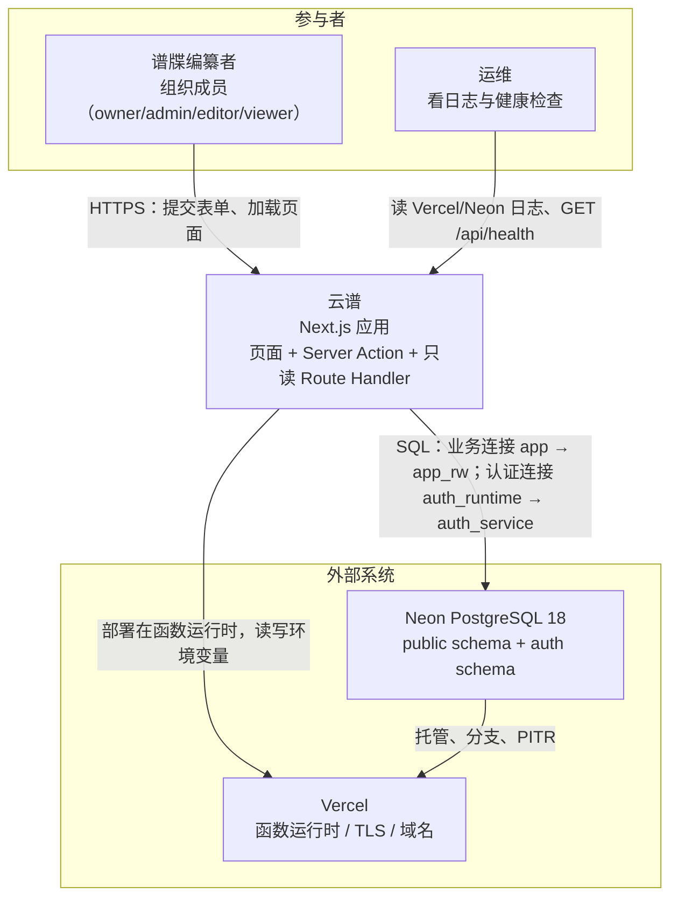
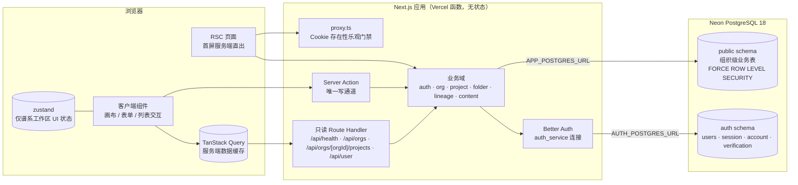

# 架构总览

> **回答什么问题**：这个系统长什么样？边界在哪？
> **读者**：所有人（第一份）　**长度上限**：4 页
> **目标 vs 现状**：本文描述当前实现（as-is）。目标设计见 [PRD](../prd.md) 与 [decisions](../decisions/README.md)。

---

## 系统定位

云谱是一个**谱牒编纂工具**：组织（云谱空间）→ 项目两层的控制台，加上谱系与人丁的编纂工作区。使用者是修谱工作室与家族内部协作成员——他们登录后在一个云谱空间里建项目、录人丁、维护世系、查看活动流。

形态上是**模块化单体**：一个 Next.js 应用承载全部业务（页面、Server Action、只读 Route Handler），所有业务域共用一个 PostgreSQL；没有微服务、没有消息队列、没有后台任务、没有独立缓存层。托管在 Vercel（应用）+ Neon（数据库）。

---

## 范围

**在这个系统里**

| 能力 | 落地位置 |
|---|---|
| 账号：邮箱密码注册登录、会话、改密、删号 | `lib/auth/`、`app/(login)/sign-in`、`app/(login)/sign-up` |
| 云谱空间：建组织、成员与角色、邀请链接、活动流 | `app/(dashboard)/dashboard/org/[orgSlug]`、`lib/db/services.ts` |
| 项目：项目列表、项目设置、公开 `ref` 路由 | `app/(dashboard)/dashboard/project/[projectRef]`、`lib/project/` |
| 分类树：文件夹层级 | `lib/folder/`、`lib/db/queries/folders.ts` |
| 谱系与人丁：录入、移动、删除、世系表、检查器、搜索、字辈、按代渲染窗口 | `lib/lineage/`、`components/lineage/` |
| 打印：谱系工作区上的 `print:` 样式，不是独立路由 | `components/lineage/lineage-shell.tsx` |
| 只读刷新接口与健康检查 | `app/api/` |

**不在这个系统里**

| 不做的能力 | 说明 |
|---|---|
| 邮箱验证、找回密码、改邮箱、邮件发送 | 邮箱只读，忘记密码走人工处理 |
| `/api/auth/*` 与浏览器 auth client | 认证只从 Server Action 调 `auth.api.*` |
| 后台任务、队列、定时器 | 部署模型里没有消费者也没有调度器 |
| 匿名可访问的业务页面、分享页、公开 API | 只有营销首页、登录、注册对外 |
| 回收站 UI、编辑锁、分享、媒体上传 | 见 [13-风险与演进规划](./13-风险与演进规划.md) |
| i18n 框架 | 界面全简体中文，品牌「云谱」 |
| 谱文编辑、谱书编目编辑 | 表已落库，页面是占位 EmptyState，没有查询函数与 Action（见 [03-逻辑视图-模块设计](./03-逻辑视图-模块设计.md)） |

---

## 系统上下文（C4-L1）

- **Better Auth 不是外部系统**：它是应用内嵌的库（`lib/auth/better-auth.ts`），自己持有 `auth` schema 的表，不依赖任何外部身份提供方。
- 唯一的外部依赖是 **Neon**（数据库）与 **Vercel**（运行时）。两者都不可用即全站不可用，没有降级路径。

---

## 运行时容器

| 容器 | 跑什么 | 连接方式 |
|---|---|---|
| 浏览器 | RSC 首屏结果、客户端组件、TanStack Query 缓存、谱系工作区 zustand store | HTTP/2 + React Flight；只读刷新走 Route Handler 的 JSON |
| Next.js 应用 | 页面渲染、Server Action、4 个只读 Route Handler、Better Auth | 两条独立连接串：业务 `APP_POSTGRES_URL`、认证 `AUTH_POSTGRES_URL` |
| Neon PostgreSQL | 业务表（`public`，RLS 强制）+ 认证表（`auth`） | PostgreSQL wire protocol；Vercel 上用 `pg` + `attachDatabasePool`，本地/CI 用 `postgres.js` |
| Vercel 平台 | 函数运行时、TLS、自定义域名、日志 | 提供环境变量；无持久化本地磁盘 |

细节见 [06-部署视图-部署架构](./06-部署视图-部署架构.md) 与 [05-接口与集成设计](./05-接口与集成设计.md)。

---

## 十条要点

1. **模块化单体**：一个 Next.js 应用、一个数据库，按业务域垂直切片，每张表只有一个 owner（[03-逻辑视图-模块设计](./03-逻辑视图-模块设计.md)）。
2. **隔离三层**：应用层按成员关系过滤 + 数据库 RLS（策略调 `auth.has_org_role`）+ 复合外键；RLS 是兜底，不是替代品（[04-数据视图-数据架构](./04-数据视图-数据架构.md)）。
3. **读走 RSC、写走 Server Action**：首屏服务端直接查库，客户端 TanStack Query 只做缓存与失效，不手写 `fetch`（[07-运行视图-关键流程](./07-运行视图-关键流程.md)）。
4. **零后台任务、零队列、零缓存层**：没有消费者就不建基础设施（[decisions/0005](../decisions/0005-zero-background-jobs.md)）。
5. **双连接双角色**：业务连接 `app` 在事务内 `SET LOCAL ROLE app_rw`；认证连接 `auth_runtime` 固定 `auth_service`。两个连接不能混用。
6. **UUIDv7 主键由数据库生成**；`organization.slug` / `project.ref` 是 20 位公开 ID，只用于 URL，**不是授权凭证**。
7. **业务表软删**（`deleted_at`，查询默认 `isNull`），成员与邀请是**硬删除**；没有回收站 UI，业务删除不可恢复。
8. **自托管 Better Auth**：数据库会话（7 天过期、1 天滑动续期）、密码 scrypt 且应用不接触哈希、关闭 cookie cache。
9. **世系用邻接表 + `ltree` 物化路径**（`lineage.ts` 的 `node.path`）；移动子树是改路径，不是递归改父指针。
10. **两道架构门禁**：单文件 ≤400 行（存量豁免只许缩不许涨）与 `process.env` 只在 `lib/config.ts` 读，由 `pnpm arch:check` 执行；依赖方向三条由 Biome `noRestrictedImports` 拦截。

---

## 架构刻意不做什么

以下都是**刻意排除**，不是遗漏。引入前先看对应 ADR，并确认触发条件真的出现了。

| 不做 | 理由 | 什么条件下重新考虑 |
|---|---|---|
| 后台任务 / 队列 / 定时器 | 部署模型里没有消费者与调度器；邀请过期靠查询判断 | 出现需要分钟级以上异步处理的需求（如批量导入、隐私数据清理） |
| 匿名可访问的业务页面与分享 | 没有外部消费者，且公开页会把租户隔离暴露到无会话上下文 | 出现「族内读者」这类明确的外部读者需求 |
| 编辑锁 | 需要锁表 + 心跳 + fencing + UI 只读态，成本高于冲突概率 | 出现实际的并发覆盖事故，或有客户明确提出 |
| 回收站 | 数据层已软删，缺的是 UI 与恢复流程 | 误删求助成为常态，或有客户在合同里要求 |
| i18n 框架 | 单语言产品，界面全中文 | 出现非中文用户或海外交付需求 |
| 浏览器 auth client | 会话与租户写只从 Server Action 走，避免两套认证路径 | 需要跨域或第三方前端接入 |
| 微服务 / 事件驱动 / 多 region | 小团队，运维成本远超收益 | 单模块团队规模超过 3 人，或部署频率互相阻塞 |
| 独立缓存层（Redis 等） | RSC 与函数内缓存够用 | 某查询 p95 与 QPS 同时越过阈值，且实测缓存能改善 |

判断依据与取舍记录见 [02-架构目标与约束](./02-架构目标与约束.md)、[11-技术选型与决策记录](./11-技术选型与决策记录.md) 与 [13-风险与演进规划](./13-风险与演进规划.md)。
