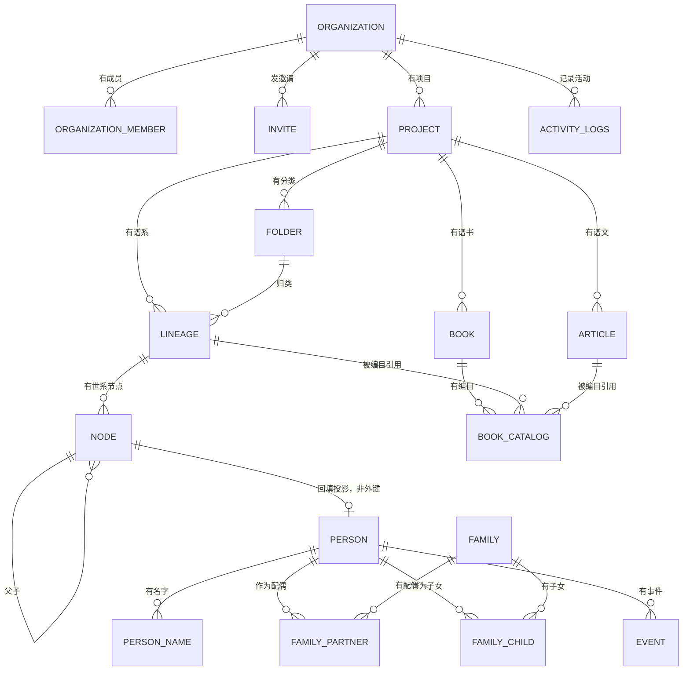

# 逻辑视图：模块设计

> **回答什么问题**：代码怎么分层？模块边界在哪？依赖只允许朝哪个方向？事务边界怎么定？
> **读者**：开发　**长度上限**：6 页
> **目标 vs 现状**：本文描述当前实现（as-is）。目标设计见 [PRD](../prd.md) 与 [decisions](../decisions/README.md)。

---

## 分层

四层，依赖只朝下。跨层调用是当前代码里最常见的隐性退化。

```
app/**/page.tsx · app/api/**/route.ts      ← 入口层：路由、RSC 页面、Route Handler
        ↓
lib/<domain>/actions.ts                    ← 应用层：Server Action、入参校验、权限、事务编排
        ↓
lib/db/queries/<domain>.ts                 ← 查询层：只读查询与单表写
        ↓
lib/db/drizzle.ts · lib/db/auth-db.ts      ← 连接层：两个连接单例 + withOrg 事务
        ↓
PostgreSQL（业务 app_rw / 认证 auth_service）
```

| 层 | 职责一句话 | 禁止事项一句话 |
|---|---|---|
| 入口层 | 解析 URL 与 scope，取首屏数据，渲染或转发 | 不直接拼 SQL、不手写权限判断、不做多步写 |
| 应用层 | 校验入参、`hasPermission`、编排事务、返回 `ActionState` | 不在一个 Action 里串多个独立事务，不把异常堆栈抛给 UI |
| 查询层 | 组织级过滤、`isNull(deletedAt)`、Drizzle 查询构造 | 不 import Action，不读 `auth.*`，不开事务 |
| 连接层 | 两个连接单例、`withOrg` 内 `SET LOCAL ROLE`、`SET LOCAL` 上下文 | 不在连接层写业务逻辑，不用会话级 `SET` |

**为什么只有四层**：读路径不引入 repository 抽象——`lib/db/queries/` 就是仓储层；写路径不引入 service 三层文件——多步写放在 `*-services.ts` 里。理由见 [decisions/0009](../decisions/0009-dependency-and-runtime-stance.md)。

---

## 目录结构

只列到二级。**没有 `src/modules` 目录**，也不使用 `*.service.ts` / `*.repo.ts` 后缀。

```
app/                  路由与页面（路由组见下）
components/           控制台框架、谱系工作区、组织/项目面板、营销页、shadcn 基础组件
lib/                  服务端逻辑（域目录 + db + 横切工具）
hooks/                客户端 React hook
tests/                Vitest 单测 + 真实 PostgreSQL 集成测试 + Playwright E2E
scripts/              文档/架构/部署校验脚本
data/                 运维 CLI（事实层回填与对账，不经应用运行时）
docs/                 文档集（单一事实来源见 ../README.md）
```

`app/` 内部按路由组分区：`(marketing)` 首页、`(login)` 登录注册、`(dashboard)/dashboard` 控制台、`api` 只读接口。

`lib/` 内部两级：

| 目录 | 里面有什么 |
|---|---|
| `lib/auth/` | Better Auth 实例、会话 context、`access-control.ts`（角色与权限矩阵）、`permissions.ts`（`hasPermission` / `getOrgRoleInTx`）、`actions/`、限流、Zod schema |
| `lib/db/` | `schema/` 按域拆分的表定义、`queries/` 按域拆分的查询、`services.ts` 多步事务、`backfill/` 事实层回填与对账、`migrations/` |
| `lib/<domain>/` | `auth` 之外只有 `org`、`project`、`folder`、`lineage` 四个域目录，放该域的 Action 与事务服务 |
| `lib/genealogy/` | 分类/谱系/人丁的 Zod schema（名字是历史原因，不是独立域） |
| 横切文件 | `api.ts`（Route Handler 包装）、`config.ts`（唯一读环境变量的文件）、`errors.ts`（`ActionState` 错误码）、`ids.ts`（公开 ID）、`logger.ts`、`query-keys.ts`、`fetcher.ts`、`server/request-context.ts`、`ui/status.ts` |

---

## 模块职责与所有权

按**业务能力 + 数据所有权**切分，不按技术层切分。每张表有且只有一个 owner；跨域读数据调用 owner 域导出的查询函数，不直接 join 别人的表。

| 域 | 拥有的表 | 入口文件 |
|---|---|---|
| `auth` | `auth.users`、`auth.session`、`auth.account`、`auth.verification` | `lib/auth/better-auth.ts`、`lib/auth/context.ts`、`lib/auth/actions/` |
| `organization` | `organization`、`organization_member`、`invite`、`activity_logs` | `lib/org/actions.ts`、`lib/org/members.ts`、`lib/org/invitations.ts`、`lib/db/queries/organizations.ts`、`lib/db/queries/activity.ts` |
| `project` | `project` | `lib/project/actions.ts`、`lib/db/services.ts`、`lib/db/queries/projects.ts` |
| `folder` | `folder` | `lib/folder/actions.ts`、`lib/folder/services.ts`、`lib/db/queries/folders.ts` |
| `lineage` | `lineage`、`node` | `lib/lineage/actions.ts`、`lib/lineage/services.ts`、`lib/lineage/node-services.ts`、`lib/db/queries/lineages.ts`、`lib/db/queries/nodes.ts` |
| `content` | `article` | 表已落库；没有 Action，也没有查询函数引用它 |
| `publishing` | `book`、`book_catalog` | 表已落库；没有 Action，也没有查询函数引用它 |
| 事实层 | `person`、`person_name`、`family`、`family_partner`、`family_child`、`event` | `lib/db/backfill/fact-layer.ts`、`data/backfill-fact-layer.ts`（只有回填 CLI 写，页面与 Action 都读 `node`） |

**三个所有权特例**：

- `organization_member` 与 `invite` 的写由 Better Auth 的 `auth_service` 角色执行，应用层只读；业务代码不得用 `withOrg` 写这两张表。
- `activity_logs` 是产品活动流，不是审计日志。账号级事件的 `organization_id` 为空，因此它既是组织域数据也是账号域数据。
- 事实层六张表是 `node` 的派生投影，唯一写入方是回填 CLI；它们的存在理由是 [decisions/0003](../decisions/0003-tree-storage-ltree.md) 之后的数据形态迁移，不是第二套读写模型。

---

## 依赖方向规则

三条自动拦截，三条靠评审。

| 规则 | 执行方式 |
|---|---|
| 客户端组件不得 import `@/lib/db/*`（含 `schema/*` 子路径）与 `drizzle-orm` | `biome.json` `noRestrictedImports`，`pnpm check` 变红 |
| `lib/db/**` 不得 import `next/*` | 同上（基础设施层不依赖框架运行时） |
| `lib/db/queries/**` 不得 import `@/lib/*/actions` | 同上（查询层不反向依赖应用层） |
| 业务连接只由 `lib/db/drizzle.ts` 建立，认证连接只由 `lib/db/auth-db.ts` 建立 | 评审 + 两个连接的角色不同，混用会在运行时失败 |
| `lib/<domain>` 不得 import `app/` 或 `components/` | 评审 |
| 业务代码不得访问 `auth.*`，也不得 import `lib/db/auth-db.ts` | 运行时权限边界（`app_rw` 无表权限）+ 评审 |

另有两条结构性门禁，不是依赖规则但同样在 CI 里变红：单文件 ≤400 行（`scripts/check-file-size.mjs`，存量豁免清单只许缩不许涨）、`process.env` 只在 `lib/config.ts` 读（`scripts/check-env-access.mjs`）。

**新增规则前先确认它能在 CI 里变红**——写在文档里但拦不住的规则，等于没有规则。可拦截手段的取舍见 [08-非功能性设计](./08-非功能性设计.md)。

---

## 领域模型

只画关系与基数，不画字段。



图里两条容易看错的边：`node` 的自引用是邻接表父子关系（树结构另有 `ltree` 路径列做子树查询）；事实层的 `person` / `family` / `event` 与 `node` 是投影关系，不是并列的第二套模型。

**同一批人在库里有两份表示，但只有一份是活的**：`node` 是当前唯一的读写载体（8 个 `*InTransaction` 服务、画布、检查器、移动删除全走它）；事实层六表只有回填 CLI 写，应用没有任何读写路径。连接两者的 `person.legacy_node_id` 是普通列**不是外键**，配一条「一个 `node` 最多一个人、软删即释放」的部分唯一索引，回填因此可重跑。

字段级定义、索引、约束与 RLS 策略见 [数据模型](../data-model.md)；数据流与一致性见 [04-数据视图-数据架构](./04-数据视图-数据架构.md)。

---

## 事务边界

三条规则：

1. 一个写入口一个事务。
2. 事务由 Action 或 `*-services.ts` 打开，同一业务流程只开一次。
3. `*Tx` 变体只接收已有事务，不再开新事务。

| 场景 | 在哪开事务 | 例子 |
|---|---|---|
| 单步 CRUD | `withOrgWrite` 包住查询函数 | 改谱系名、改人丁姓名、移动文件夹 |
| 多步组织写 | `lib/db/services.ts` 或 `lib/org/*.ts` 的单个事务函数 | 注册即建默认组织、接受邀请、成员变更、删号 |
| 谱系移动与删除 | `lib/lineage/services.ts`、`lib/lineage/node-services.ts` | 移动子树改 `ltree` 路径、删人丁并处理子女与配偶引用 |
| 事实层回填 | CLI 自己开事务（不走 `withOrg`） | `data/backfill-fact-layer.ts` 用迁移角色直连，分块提交 |

`withOrgWrite(userId, orgId, permission, fn)` 把「开组织范围事务 + 事务内复权」合成一步，权限不足时返回拒绝值而不是抛异常，Action 据此返回中文文案。事务内的权限复核用 `getOrgRoleInTx(tx, userId, orgId)`——事务外的角色读取在事务内可能已过期。

失败路径见 [07-运行视图-关键流程](./07-运行视图-关键流程.md)。

---

## 代码组织约定

**默认垂直切片**：一个域一个目录，schema / query / action / 页面就近放。只有满足以下任一条件才抽独立 service：

1. 同一规则被 ≥2 个入口调用；
2. 需要跨模块共享事务；
3. 需要被后台任务复用（当前后台任务为零，这一条现在不会触发）。

| 对象 | 规则 | 示例 |
|---|---|---|
| 文件 | kebab-case | `rate-limit.ts` |
| React 组件文件 | PascalCase 或 kebab-case（现存两种并存） | `Button.tsx`、`members-panel.tsx` |
| 函数 / 变量 | camelCase | `getOrgRoleInTx` |
| 类型 | PascalCase，不加 `I` 前缀 | `ActionState` |
| 常量 | SCREAMING_SNAKE | `ORG_ROLES` |
| 数据库列 | snake_case | `organization_id` |

**不为了「以后可能用到」提前拆目录**：目录结构跟着已存在的调用方长，不跟着预测长。这一条的直接后果是 `lib/genealogy/` 只有 schema 与常量两个文件、`lib/project/` 只有 Action 与常量——它们没有独立的 service 层。

**新增业务实体的落点**：表定义进 `lib/db/schema/<domain>.ts`，查询进 `lib/db/queries/<domain>.ts`，Action 进 `lib/<domain>/actions.ts`，页面进 `app/(dashboard)/`。完整清单见 [guides/add-a-feature](../guides/add-a-feature.md)。
