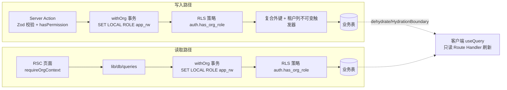

# 数据视图：数据架构

> **回答什么问题**：数据存在哪？怎么隔离？怎么保持一致？活多久？
> **读者**：开发 · 运维　**长度上限**：6 页
> **目标 vs 现状**：本文描述当前实现（as-is）。目标设计见 [PRD](../prd.md) 与 [decisions](../decisions/README.md)。

字段级定义（列、类型、索引、策略体、数据字典）只在 [数据模型](../data-model.md) 一处；本文件只写架构层取舍。

---

## 存储选型

| 关注点 | 现在是什么 | 为什么 |
|---|---|---|
| 数据库 | PostgreSQL 18 或更高 | 主键用内置 `uuidv7()`（无需扩展、天然有序）；世系用 `ltree` 物化路径 |
| ORM | Drizzle，迁移由 `drizzle-kit` 生成 SQL 后人工 review | 迁移是可读 SQL，DBA 不在团队里也能审；schema 与 SQL 不双写 |
| 生产托管 | Neon（分支 + PITR） | 无专职运维；分支用于迁移演练，PITR 是软删之外的唯一恢复手段 |
| 本地 | Docker PostgreSQL + `next dev` | 本地与 CI 用同一套迁移，不引入 SQLite 分支 |
| 驱动 | 本地/CI 用 `postgres.js`；Vercel 用 `pg` 的 `Pool` + `attachDatabasePool` | 生产走 Neon pooled endpoint，需要平台侧连接池回收 |
| 会话存储 | `auth.session` 表 + `better-auth.session_token` Cookie | 数据库会话可即时撤销；关闭 cookie cache |
| 富文本 | PostgreSQL `jsonb` | 只有一个写者与一个读者，不需要独立文档存储 |
| 媒体字节 | 无对象存储 | 没有上传功能，M2 再定 |
| 扩展 | `ltree`、`pg_trgm`、`btree_gist` | 树路径、谱文检索、`node` 的 GiST 路径索引 |
| 超时 | `app_rw`：`statement_timeout` 10s、`idle_in_transaction_session_timeout` 30s、`lock_timeout` 5s | 一个慢查询不能占死连接池；锁等待超时优先于语句超时 |

---

## 表分组

四组。**表的总数不写在这里**——迁移清单以 `lib/db/migrations/meta/_journal.json` 为准，手抄清单在这个仓库翻车过三次。

| 分组 | 表 | 一句话职责 |
|---|---|---|
| 认证 | `auth.users`、`auth.session`、`auth.account`、`auth.verification` | Better Auth 的核心表，归认证服务所有；密码以 scrypt 存在 `auth.account`，应用代码不接触哈希 |
| 组织与成员 | `organization` | 云谱空间；`slug` 是 20 位公开 ID，`status` 表示 active/suspended/closed，`deleted_at` 表示归档 |
| 组织与成员 | `organization_member` | 成员与角色，四角色之一；硬删除，不可恢复 |
| 组织与成员 | `invite` | 邀请链接；7 天过期、一次性、禁止邀请 `owner`；硬删除 |
| 组织与成员 | `activity_logs` | 产品活动流，不是审计日志；账号级事件的 `organization_id` 为空 |
| 内容 | `project` | 云谱空间下的项目；`ref` 是 20 位公开 ID |
| 内容 | `folder` | 分类树，`kind` 区分谱系/谱文/谱书分类；`parent_id` 自引用 |
| 内容 | `lineage` | 谱系；冗余 `node_count` 由写入方在同一事务维护 |
| 内容 | `node` | 人丁；`parent_id` 邻接表 + `path` 物化路径（`ltree`），父子必须同组织同谱系 |
| 内容 | `article` | 谱文；有表、有 `pg_trgm` 检索索引，没有读写路径 |
| 内容 | `book`、`book_catalog` | 谱书与编目；编目对 `article`/`lineage` 的引用是真外键，`cover_spec` 与 `hide` 是已预建的结构 |
| 事实层 | `person`、`person_name` | 人丁与多姓名（谱名、字、号、讳）；`primary_name_id` 是不可延迟的复合外键，所以带主名的人丁要三步写入 |
| 事实层 | `family`、`family_partner`、`family_child` | 家庭、配偶（`blood`/`spouse`）、子女（`parentage_type`）；「至多一个 `blood` 配偶」由触发器执行 |
| 事实层 | `event` | 事件（生、卒、葬、婚、迁、职业）与属性；日期是多列语义而非单一时间戳 |

事实层六张表是 `node` 的派生投影，唯一写入方是回填 CLI，`person.legacy_node_id` 作为回到 `node` 的锚点。模块归属与「谁拥有哪张表」见 [03-逻辑视图-模块设计](./03-逻辑视图-模块设计.md)。

---

## 隔离三层

缺一不可，任何一层都不能用「有另一层」作为省略理由。

- **应用层**：所有组织级查询带 `orgId` 条件，并在 `withOrg` 事务内执行——事务里先 `SET LOCAL ROLE app_rw`，再 `set_config('request.jwt.claims', …)` 注入当前用户，RLS 才有主体可判。
- **数据库层**：组织级表 `ENABLE` + `FORCE ROW LEVEL SECURITY`，每表三条策略（SELECT 含 `viewer`，INSERT/UPDATE 只含 `owner`/`admin`/`editor`），统一调 `auth.has_org_role(...)`。`app_rw` 无 `DELETE` 授权。
- **Schema 层**：复合外键 `(organization_id, <父 id>)` 让跨组织引用无法成立；租户列由 `app.forbid_tenant_move()` 触发器锁死，改归属列报 SQLSTATE `42501`。

| 连接角色 | 登录角色 | 能做什么 |
|---|---|---|
| `app_rw` | `app` | 业务表读写（无 `DELETE`）、`auth` schema 无表权限；受 RLS 约束 |
| `auth_service` | `auth_runtime` | `auth.*` 与 `organization`/`organization_member`/`invite` 的写权限；用显式放行策略写这几张表 |
| 迁移角色 | 运维直连 | 执行 DDL；查询前 `SET LOCAL ROLE app_rw` 降权验证 |

**RLS 是兜底，不是替代品**：`WITH CHECK` 只看新值，无法比较新旧行，所以「双组织用户把整行搬到另一个组织」由租户列不可变触发器挡住，而不是 RLS。理由见 [decisions/0006](../decisions/0006-rls-isolation.md) 与 [decisions/0016](../decisions/0016-tenant-columns-immutable.md)。

**运行期不使用 `BYPASSRLS`**：降权发生在每个请求的事务里，不是靠连接串上的超级用户。

---

## 一致性与约束

| 约束 | 落在哪 | 违反时的行为 |
|---|---|---|
| 成员唯一 | `(organization_id, user_id)` 唯一索引 | 冲突转中文提示，不重试成重复数据 |
| 单组织仅一个 `owner` | 部分唯一索引 + 应用层预检 + 最后 owner 保护触发器 | 直接改库也挡得住；应用层先预检给出可读文案 |
| 角色取值 | `CHECK` 约束 | `23514` 转中文提示 |
| 待处理邀请唯一 | `(organization_id, lower(email))` 部分唯一 | 重复邀请会取消旧 pending 再插入新行 |
| 活动邮箱唯一 | `auth.users` 上的部分唯一索引 | `23505` 转中文提示 |
| 跨组织引用 | 复合外键 | `23503` 转中文提示，不留半行 |
| 租户列不可变 | `app.forbid_tenant_move()` + 每表一个触发器 | SQLSTATE `42501` |
| 至多一个 `blood` 配偶 | `app.check_family_blood_side()` 触发器 | 只约束上界，下界故意不约束 |
| 软删行不参与唯一 | 部分唯一索引带 `deleted_at IS NULL` | 删除后可重建同名记录 |

**多步写**在单个事务内完成，失败整体回滚，不留半成品；没有补偿任务、没有重试队列（[decisions/0005](../decisions/0005-zero-background-jobs.md)）。

**软删分组**：同一事务内软删的行共享 `deleted_at`（`now()` 取事务开始时间），运维可以按时间戳整组恢复，见 [数据模型](../data-model.md) 的软删除与恢复章节。

---

## 数据流

读和写都经过 `withOrg`，差别只在读不需要复权；权限判定在应用层（`hasPermission`）与数据库层（RLS）各做一次，前者给用户可读文案，后者是兜底。流程细节见 [07-运行视图-关键流程](./07-运行视图-关键流程.md)。

---

## 生命周期

| 数据 | 创建 | 软删 / 硬删 | 恢复可能 |
|---|---|---|---|
| 业务表（`project`、`folder`、`lineage`、`node`、`article`、`book`、`book_catalog`、事实层六表） | 正常写入 | 软删：写 `deleted_at`，查询默认 `isNull` | 有：改回 `deleted_at` 即恢复，但没有回收站 UI，只能运维操作 |
| `organization` | 注册即建个人组织 | `deleted_at` 表示归档，不物理删除 | 有 |
| `organization_member`、`invite` | 邀请/加入 | **硬删除** | 无 |
| `activity_logs` | 写操作时插入 | 无软删列 | 不适用 |
| `auth.session` | 登录 | 7 天过期、1 天滑动续期、关闭 cookie cache；改密撤销其他会话 | 不适用 |
| `auth.users` | 注册 | 删号走 Better Auth，删前检查是否为唯一 owner | 无 |
| 事实层 | `pnpm data:backfill:fact --org <uuid>` 回填 | 跟随 `node` 的软删状态 | 有：重跑回填与 `pnpm data:reconcile:fact` 对账 |

**软删永不物理删除**是显式决策（[decisions/0004](../decisions/0004-soft-delete-forever.md)），它同时意味着数据处置能力是缺口：账号注销后谱系数据仍保留，而数据主体（族人）与账号所有者不是同一人。这条风险登记在 [13-风险与演进规划](./13-风险与演进规划.md)。

**回填与对账**两个 CLI 以迁移角色直连、启动时断言连接不是超级用户也不是 `BYPASSRLS`，只能人工执行；它们不经过应用运行时，因此不受 `withOrg` 保护，靠的是显式组织参数。

---

## 容量与增长口径

口径写「按什么单位估」，不写编造的数字。

| 维度 | 口径 | 现状风险 |
|---|---|---|
| 组织数 | 按账号数估，注册即建个人组织 | 每个账号固定多一个组织，组织数下限等于用户数 |
| 单组织成员数 | 按邀请上限估，没有硬上限 | 成员列表走 Better Auth 的 `listMembers` 全量返回，没有分页 |
| 单谱系人丁数 | 按单谱系 `node` 行数估 | 人丁检索在客户端全量匹配，超过约 5000 后体验先坏（[decisions/0011](../decisions/0011-search-boundary-node-client-article-trgm.md)） |
| 组织内人丁总量 | 按组织下全部 `node` 行数估 | 决定是否需要外部搜索索引；当前没有 |
| 活动日志增长 | 按写操作次数估 | **没有归档与保留期策略**，表只增不减 |
| 事实层双写体积 | 按 `person`+`family`+`event` 行数估 | 回填期间与 `node` 双写，存储体积接近翻倍；`node` 退役前一直是两份 |
| 连接数 | 按 Vercel 函数实例数 × 每实例池上限估 | 生产每实例池 `max: 5`（`attachDatabasePool` 交给平台冻结/恢复）；实例数上升时先撞 Neon 连接上限，需要 pooler |
| 事务时长 | 按 `statement_timeout` 10s 估 | 回填与对账是长事务，只能走 CLI 直连，不进请求路径 |
