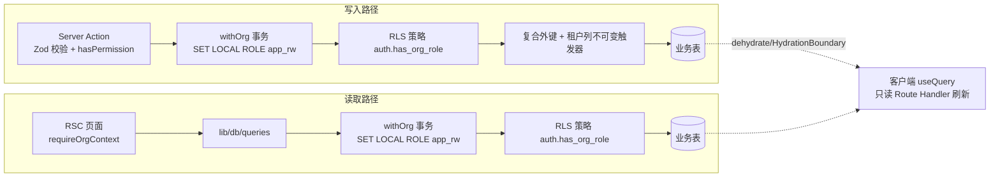
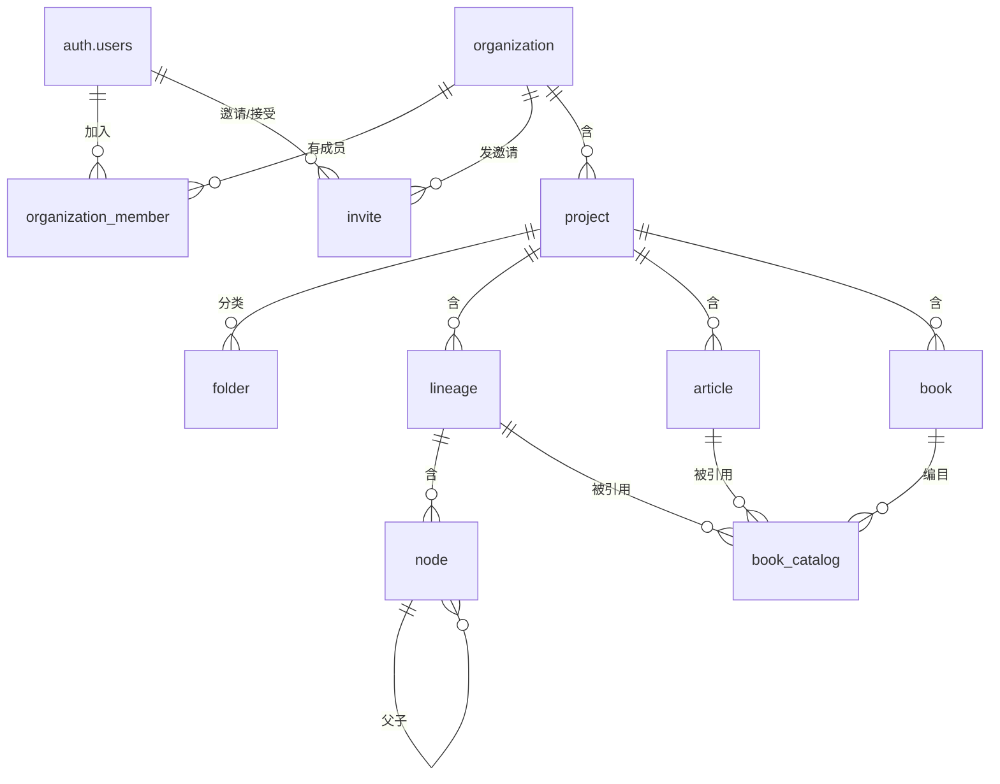

# 数据视图：数据架构

> **回答什么问题**：数据存在哪、怎么隔离、怎么保持一致、活多久？表和列到底长什么样？
> **读者**：开发 · 运维　**长度上限**：25 页（以表与列定义为主）
> **目标 vs 现状**：当前实现（as-is）：已建表的逐列定义。未来表只在 §18 用「M2 会增加」这类明确措辞标注，不混入正文；目标设计见 [11-需求与实现状态](./11-需求与实现状态.md) 与 [decisions](../decisions/README.md)。

**本文件是表、列、索引、RLS 策略、软删与迁移约定的唯一来源。** 其他文档需要这些事实时链接到这里，不复制；抄一份过去的唯一后果是两份都过期。

---

## 目录

- [1. 这份文档怎么读](#1-这份文档怎么读)
- [2. 存储模型总览](#2-存储模型总览)
- [3. 数据流图](#3-数据流图)
- [4. 约定](#4-约定)
- [5. 实体关系](#5-实体关系)
- [6. 组织域](#6-组织域)
- [7. 身份域](#7-身份域)
- [8. 项目域](#8-项目域)
- [9. 谱系域](#9-谱系域)
- [10. 内容域](#10-内容域)
- [11. 出版域](#11-出版域)
- [12. 审计与追溯](#12-审计与追溯)
- [13. 关键索引（非穷举）](#13-关键索引非穷举)
- [14. 软删除](#14-软删除)
- [15. 隔离与 RLS](#15-隔离与-rls)
- [16. 一致性与事务边界](#16-一致性与事务边界)
- [17. 容量与增长口径](#17-容量与增长口径)
- [18. 演进与 M2 预告](#18-演进与-m2-预告)
- [19. 数据字典](#19-数据字典)

---

## 1. 这份文档怎么读

**覆盖什么**：`public` schema 下 17 张组织级业务表的表结构（列、类型、默认值、`CHECK`）、索引与唯一约束、RLS 策略与授权、租户列不可变触发器、软删除与整组恢复、迁移规范、逐字段取值。这些事实只写在这里。

**不覆盖什么**：

| 不在这里 | 在哪 |
|---|---|
| 模块边界、依赖方向、概念层 ER 与域模型 | [03-逻辑视图-模块设计](./03-逻辑视图-模块设计.md) |
| Server Action / Route Handler 的入参出参、`ActionState` 契约与错误码 | [05-接口与集成设计](./05-接口与集成设计.md) |
| 一次读写的步骤顺序、失败与重试路径 | [07-运行视图-关键流程](./07-运行视图-关键流程.md) |
| 威胁模型、认证与会话语义、每条防线为什么不可绕过 | [09-安全架构](./09-安全架构.md) |
| 容量瓶颈排序、性能承诺与配额 | [08-非功能性设计](./08-非功能性设计.md) |
| 备份 / 恢复与故障处置的操作步骤 | [06-部署视图-部署架构](./06-部署视图-部署架构.md)、[guides/runbooks](../guides/runbooks.md) |
| 哪张表建到什么程度、哪些功能还没实现 | [11-需求与实现状态](./11-需求与实现状态.md) |
| 加表 / 加迁移的完整步骤、命令与环境变量 | [guides/add-a-feature](../guides/add-a-feature.md)、[13-本地开发与命令](./13-本地开发与命令.md) |

**与相邻文档的分界**（同一件事不写两处）：

- [03-逻辑视图-模块设计](./03-逻辑视图-模块设计.md) 管「谁拥有哪张表、模块之间能不能互相 join」；本文件管「表长什么样、约束是什么」。
- [05-接口与集成设计](./05-接口与集成设计.md) 管「对外契约」；本文件管「契约背后的列、索引与约束」。
- [07-运行视图-关键流程](./07-运行视图-关键流程.md) 管「一次操作按什么顺序走」；本文件管「这些步骤落在哪些表、哪条约束会拒绝它」。
- [09-安全架构](./09-安全架构.md) 管「为什么这条防线不可绕过」；本文件管「防线具体是哪个策略体、哪个触发器、哪个复合外键」。

**四层数据模型分别在哪**：概念层（有哪些数据主体、边界在哪）由 §2 的「一句话职责」列加 [03-逻辑视图-模块设计](./03-逻辑视图-模块设计.md) 的 ER 图承担；逻辑层（表、键、关系、约束类别）是 §5、§15、§16；物理层（列、类型、默认值、索引、`CHECK`、策略体）在 §6–§11、§13、§15，逐字段取值在 §19；迁移与演进在 §18。

**按目的读**：

| 你要做的事 | 读 |
|---|---|
| 改表、加列、加索引 | §4 约定 → 对应域（§6–§11）→ §18 迁移规范 |
| 判断某条越权路径能否成立 | §15 隔离与 RLS → §16 一致性与事务边界 |
| 删数据、恢复数据 | §14 软删除 |
| 查某个枚举有哪些取值 | §19 数据字典 |
| 看整体有哪些数据、怎么增长 | §2 存储模型总览 → §3 数据流图 → §17 容量与增长口径 |

**事实与代码冲突时以代码为准**：表结构以 `lib/db/schema/` 与 `lib/db/migrations/**` 为准；迁移清单以 `lib/db/migrations/meta/_journal.json` 为准，本文不手抄迁移编号。本文过期就是缺陷，发现请直接改这里。

---

## 2. 存储模型总览

### 2.1 存储选型

| 关注点 | 现在是什么 | 为什么 |
|---|---|---|
| 数据库 | PostgreSQL 18 或更高 | 主键用内置 `uuidv7()`（无需扩展、天然有序）；世系用 `ltree` 物化路径 |
| ORM | Drizzle，迁移由 `drizzle-kit` 生成 SQL 后人工 review | 迁移是可读 SQL，DBA 不在团队里也能审；schema 与 SQL 不双写 |
| 生产托管 | Neon（分支 + PITR） | 无专职运维；分支用于迁移演练，PITR 是软删之外的唯一恢复手段 |
| 本地 | Docker PostgreSQL + `next dev` | 本地与 CI 用同一套迁移，不引入 SQLite 分支 |
| 驱动 | 本地/CI 用 `postgres.js`；Vercel 用 `pg` 的 `Pool` + `attachDatabasePool` | 生产走 Neon pooled endpoint，需要平台侧连接池回收 |
| 会话存储 | `auth.session` 表 + `better-auth.session_token` Cookie | 数据库会话可即时撤销；关闭 cookie cache |
| 富文本 | PostgreSQL `jsonb` | 只有一个写者与一个读者，不需要独立文档存储 |
| 媒体字节 | 无对象存储 | 没有上传功能，M2 再定 |
| 扩展 | `ltree`、`pg_trgm`、`btree_gist` | 树路径、谱文检索、`node` 的 GiST 路径索引 |
| 超时 | `app_rw`：`statement_timeout` 10s、`idle_in_transaction_session_timeout` 30s、`lock_timeout` 5s | 一个慢查询不能占死连接池；锁等待超时优先于语句超时 |

字符集 UTF-8；所有时间列用 `timestamptz`（理由见 §4.4）。

### 2.2 表分组

按**数据的架构特征**分组，不按代码域分组——完整的按域模块视图是 [03-逻辑视图-模块设计](./03-逻辑视图-模块设计.md) 的事。分组只看三个问题：**谁写它、隔离靠什么、删了能不能回来**；这三件事决定「出事故时归谁修、能恢复成什么样」。

表的总数是 **17 张组织级业务表**（16 张业务表 + `activity_logs`），另有 4 张 `auth.*` 表在独立 schema、不参与业务计数；迁移文件与编号以 `lib/db/migrations/meta/_journal.json` 为准，本文不手抄。

| 分组 | 表 | 谁写 | 隔离与生命周期特征 | 一句话职责 |
|---|---|---|---|---|
| 认证 | `auth.users`、`auth.session`、`auth.account`、`auth.verification` | Better Auth（`auth_service`） | 独立 `auth` schema，不参与业务三层隔离 | 会话与凭据；密码以 scrypt 存在 `auth.account`，应用代码不接触哈希 |
| 租户根 | `organization` | `auth_service` | `slug` 是 20 位公开 ID；`deleted_at` 表示归档，不物理删 | 云谱空间，唯一的隔离边界 |
| 租户根 | `organization_member`、`invite` | `auth_service` | **硬删除**，不可恢复 | 四角色成员关系；邀请 7 天过期、一次性、禁止邀请 `owner` |
| 租户业务 | `project`、`folder` | `app_rw`（`withOrg`） | 软删；`ref` 是 20 位公开 ID | 项目与分类树（`folder.kind` 区分谱系/谱文/谱书，`parent_id` 自引用） |
| 租户业务 | `lineage`、`node` | `app_rw`（`withOrg`） | 软删；父子必须同组织同谱系（复合外键） | 谱系与人丁；`node` 是邻接表 + `ltree` 物化路径，`lineage.node_count` 由写入方同事务维护 |
| 租户业务 | `article`、`book`、`book_catalog` | 当前没有写入路径 | 软删；编目对 `article`/`lineage` 的引用是真外键 | 谱文、谱书与编目；`cover_spec` 与 `hide` 是已预建的结构 |
| 事实层投影 | `person`、`person_name` | 只有回填 CLI | 软删跟随 `node`；租户列是 `(organization_id, project_id)` | 人丁与多姓名（谱名、字、号、讳）；`primary_name_id` 不可延迟，带主名的人丁要三步写入 |
| 事实层投影 | `family`、`family_partner`、`family_child` | 只有回填 CLI | 同上；「至多一个 `blood` 配偶」由触发器执行 | 家庭、配偶（`blood`/`spouse`）、子女（`parentage_type`） |
| 事实层投影 | `event` | 只有回填 CLI | 同上；日期是多列语义而非单一时间戳 | 生、卒、葬、婚、迁、职业等事件与属性 |
| 横切 | `activity_logs` | 各域的写入方 | 无软删列、无保留期；`organization_id` 可为空 | 产品活动流，不是审计日志 |

**读这张表的顺序**：先看「谁写」——它决定这份数据出事时归谁修；再看生命周期——`organization_member`、`invite`、`auth.users` 是仅有的「删了就没了」的三张表，其余都能靠改回 `deleted_at` 恢复（§14）。

事实层六张表是 `node` 的派生投影，唯一写入方是回填 CLI，`person.legacy_node_id` 作为回到 `node` 的锚点；它们的租户列是项目级、没有 `lineage_id`，理由见 [03-逻辑视图-模块设计](./03-逻辑视图-模块设计.md) 的领域模型一节。

**两处清单、两个轴**：本节按「谁写 / 隔离 / 生命周期」切分，§5.2 按「表属于哪个 owner 域」切分。前者回答「出事归谁修、删了能不能回来」，后者回答「改这张表该找哪个模块、谁能 join 它」——只有 17 行，服务的是找路，不是架构取舍。

---

## 3. 数据流图



读和写都经过 `withOrg`，差别只在读不需要复权；权限判定在应用层（`hasPermission`）与数据库层（RLS）各做一次，前者给用户可读文案，后者是兜底。流程细节见 [07-运行视图-关键流程](./07-运行视图-关键流程.md)；每一道闸拒绝时返回什么见 §16，策略体本身见 §15，软删与恢复见 §14。

---

## 4. 约定

### 4.1 命名

| 对象 | 规则 | 示例 |
|---|---|---|
| 表 | 单数、`snake_case`、不加前缀 | `lineage`、`book_catalog` |
| 列 | `snake_case` | `organization_id`、`node_count` |
| 主键 | 恒为 `id` | `id` |
| 外键 | `<被引用表单数>_id` | `lineage_id`、`book_id` |
| 布尔 | `is_` / `has_` 前缀 | `is_alive`、`hide` |
| 时间 | `<动作>_at` | `created_at`、`deleted_at` |
| 索引 | `idx_<表>_<列>` / `uk_<表>_<语义>` | `idx_node_lineage`、`uk_project_ref` |
| 约束 | `ck_<表>_<语义>` | `ck_node_sex` |

**禁止**：大小写混用、拼音命名、`tbl_` 前缀、复数表名。

### 4.2 主键

全表使用 `uuid`，**UUIDv7 由数据库原生生成**（时间有序，索引友好）：

```sql
id uuid PRIMARY KEY DEFAULT uuidv7()
```

`uuidv7()` 是 PostgreSQL 18 内置函数，不再依赖应用层生成或随机 UUID。部署前置为 PostgreSQL 18+；迁移前先执行 `SELECT uuidv7();` 自检。

16 张业务表、`activity_logs` 与 4 张 `auth.*` 表的主键都使用上面的默认值。

### 4.3 公共列

**14 张软删业务实体表**（organization/project/folder/lineage/node/article/book/book_catalog/person/person_name/family/family_partner/family_child/event）统一包含：

| 列 | 类型 | 说明 |
|---|---|---|
| `organization_id` | `uuid NOT NULL` | 隔离键，**每张业务实体表必须有** |
| `created_at` | `timestamptz NOT NULL DEFAULT now()` | |
| `created_by` | `uuid NOT NULL` | 创建人，不设外键（用户可能被删除） |
| `updated_at` | `timestamptz` | 首次写入为 `NULL` |
| `deleted_at` | `timestamptz` | 软删除标记，见 §14 |

`auth.*` 位于独立 schema，不使用上述公共列，只保留 Better Auth 所需字段（§7.1）。`organization_member` 与 `invite` 是硬删除，不含软删列；`activity_logs` 是产品活动流，不含 `deleted_at`，账号级事件 `organization_id` 为空。

M1 **没有乐观锁列**。并发写入是 last-write-wins，见 [11-需求与实现状态](./11-需求与实现状态.md) §5.5 与 §6.3 缺口 3。

### 4.4 类型选择

| 场景 | 用 | 不用 | 理由 |
|---|---|---|---|
| 枚举 | `text` + `CHECK` | PG `enum` | 加值要 `ALTER TYPE`，且 Drizzle 支持弱 |
| 短整型枚举 | `smallint` + `CHECK` | `int` | 语义明确、省空间 |
| 结构化配置 | `jsonb` | `json` | 可索引 |
| 富文本 | `jsonb`（ProseMirror） | `text` HTML | 结构可校验、可迁移 |
| 树路径 | `ltree` | `text` 逗号分隔 | 原生祖先/后代查询 |

### 4.5 两条硬约定

| 约定 | 规则 | 依据 |
|---|---|---|
| 租户列不可变 | `organization_id` 与上一级容器列（`project_id`、`lineage_id`、`book_id`）写入后不能 `UPDATE`；要换归属只能新建一行再迁移数据。由 `app.forbid_tenant_move()` 触发器兜底，改归属列报 SQLSTATE `42501` | [ADR 0016](../decisions/0016-tenant-columns-immutable.md)、§15.7 |
| `data/` 脚本绕过 RLS | `data/` 下的运维 CLI 以迁移角色直连（`POSTGRES_URL_DIRECT`，回退 `POSTGRES_URL_NON_POOLING`、`POSTGRES_URL`），启动时断言当前角色有 `rolsuper` 或 `rolbypassrls`，否则在写入前退出。它们不经过 `withOrg`，因此**不能**从应用请求或 Server Action 里调用，只能由人显式执行 | `data/backfill-fact-layer.ts`、`data/reconcile-fact-layer.ts` |

---

## 5. 实体关系

> 下图是 **node 时代**的视图：P1 的写路径仍然只写 `node`（父子与配偶都在这一棵树里），事实层是它的投影。
> 事实层六张表（§9.3–9.8）没有画进来——两边唯一的连接是 `person.legacy_node_id`，而事实层还没有读路径；
> 它们的字段、约束与回填分层约定见 §9.3–9.9，等 P2 的 `person_placement` 落地、关系稳定后再补一张事实层图。



### 5.1 层级与隔离

```
auth.*                            ← Better Auth 表，独立 auth schema，不参与组织隔离
organization                      ← 隔离边界（RLS 生效范围）
├── organization_member           ← 成员关系，RLS 的根
├── invite
├── activity_logs                 ← 产品活动流；账号级事件 org 为空
└── project                       ← 云谱空间（组织内分组，不独立隔离）
    ├── folder
    ├── lineage ── node
    ├── person ── person_name     ← 事实层：人丁与姓名
    ├── family ── family_partner
    │         └── family_child
    ├── event                     ← 事实层：事件，挂 person 或 family
    ├── article
    └── book ── book_catalog
```

**只有 `organization` 是隔离边界。** `project` 是分组，没有独立的权限或 RLS 策略。

### 5.2 表归属

| # | 表 | 中文 | 所属模块 |
|---|---|---|---|
| 1 | `organization` | 组织 | `organization` |
| 2 | `organization_member` | 组织成员 | `organization` |
| 3 | `invite` | 邀请 | `organization` |
| 4 | `project` | 云谱空间 | `project` |
| 5 | `folder` | 分类 | `project` |
| 6 | `lineage` | 谱系 | `lineage` |
| 7 | `node` | 人丁（当前读写源） | `lineage` |
| 8 | `person` | 人丁（事实层） | `lineage` |
| 9 | `person_name` | 人丁姓名 | `lineage` |
| 10 | `family` | 家庭 | `lineage` |
| 11 | `family_partner` | 家庭配偶 | `lineage` |
| 12 | `family_child` | 家庭子女 | `lineage` |
| 13 | `event` | 事件 | `lineage` |
| 14 | `article` | 谱文 | `content` |
| 15 | `book` | 谱书 | `publishing` |
| 16 | `book_catalog` | 编目 | `publishing` |
| 17 | `activity_logs` | 产品活动流 | `organization` |

每张表有且只有一个 owner 域。跨域读取调用 owner 域导出的查询函数，不直接 join 别人的表。

上表是 **16 张业务表**；加上 `activity_logs` 共 **17 张组织级业务表**。另有 4 张 `auth.*` 表，位于独立的 `auth` schema，由 Better Auth 管理，不属于业务表计数，也不参与组织的三层隔离。

`node` 与 `person`/`family`/`event` 是同一批人丁的两种表示：`node` 把关系、姓名、生卒葬压在一行里（§9.2），事实层拆成六张规范化表（§9.3–§9.8），用 `person.legacy_node_id` 记录回填来源。两套表示并存期间 `node` 仍是读写源，事实层只做回填与对账；读写切换属于单独的读写计划，当前建到什么程度见 [实现状态](./11-需求与实现状态.md)。

**M2 会增加的表**：`share_link`（分享）、`delete_batch`（回收站批次）、`resource_lock`（编辑锁）、`media`（媒体）。**M3** 增加 `edition`（排版版本）。M1 不建，避免空表。

---

## 6. 组织域

### 6.1 organization

```sql
-- 20 位公开 ID：取 UUIDv4 的 32 位 hex 前 20 位（约 80 bit 随机）
CREATE FUNCTION public.generate_public_id() RETURNS text
LANGUAGE sql VOLATILE AS $$
  SELECT substr(replace(gen_random_uuid()::text, '-', ''), 1, 20);
$$;

CREATE TABLE organization (
  id         uuid PRIMARY KEY DEFAULT uuidv7(),
  slug       text NOT NULL DEFAULT public.generate_public_id(),
  name       text NOT NULL,
  logo       text,
  metadata   text,
  status     text NOT NULL DEFAULT 'active'
             CHECK (status IN ('active','suspended','closed')),
  created_at timestamptz NOT NULL DEFAULT now(),
  updated_at timestamptz NOT NULL DEFAULT now(),
  deleted_at timestamptz
);

CREATE UNIQUE INDEX uk_organization_slug ON organization (slug)
  WHERE deleted_at IS NULL;
```

| 列 | 说明 |
|---|---|
| `slug` | URL 第一段。20 位 `[0-9a-z]` 随机公开 ID（列默认值 `public.generate_public_id()`），全局唯一（部分索引，排除软删），**不可修改**。不是授权凭证；解析时必须同时按当前用户成员关系过滤 |
| `name` | 显示名。注册时默认取邮箱前缀 |
| `logo` | 组织图标 URL，Better Auth organization 插件字段；当前 UI 未使用 |
| `metadata` | Better Auth 组织元数据。适配器写入前 `JSON.stringify()`，只有字符串才解析回来，因此列类型是 `text` 而非 `jsonb` |
| `updated_at` | 由 Better Auth 组织更新写入；应用层不直接写该表 |
| `status` | `suspended` 时全部写操作拒绝（`ORG_SUSPENDED`），只读放行 |

`organization.slug` 与 `project.ref` 共用 `public.generate_public_id()`。函数返回 20 位 hex（`[0-9a-z]` 的子集），碰撞概率可忽略，由唯一索引兜底；客户端永远不传入公开 ID。`app_rw` 需要该函数的 `EXECUTE` 权限；默认 PUBLIC 权限即可，收紧权限时必须显式授予。

---

## 7. 身份域

### 7.1 auth.users / auth.session / auth.account / auth.verification

自托管 Better Auth 的表，位于独立 `auth` schema，不属于 17 张组织级业务表。它们不参与组织隔离；业务运行时角色 `app_rw` 没有表权限，认证连接固定 `role=auth_service`。

```sql
CREATE TABLE auth.users (
  id             uuid PRIMARY KEY DEFAULT uuidv7(),
  email          text NOT NULL,
  name           text NOT NULL,
  email_verified boolean NOT NULL DEFAULT false,
  image          text,
  created_at     timestamptz NOT NULL DEFAULT now(),
  updated_at     timestamptz NOT NULL DEFAULT now()
);

CREATE UNIQUE INDEX uk_auth_users_email ON auth.users (lower(email));
```

| 表 | 说明 |
|---|---|
| `auth.users` | 账号、邮箱、显示名；邮箱唯一且只读（无验证、无改邮箱） |
| `auth.session` | 数据库会话；`expires_at` 7 天、`updateAge` 1 天；`active_organization_id` 记录当前组织 |
| `auth.account` | 登录凭据；邮箱密码账号的 `provider_id = 'credential'`，`password` 为 Better Auth 的 scrypt 哈希 |
| `auth.verification` | Better Auth 通用验证记录；M1 未启用邮箱验证与找回密码 |

**为什么叫 `users` 而不是 `user`**：`user` 是 PostgreSQL 保留字，未加引号无法作为表名。

**注意**：`auth.users` 没有 `deleted_at` 与 `token_version`。删除账号会真实删除用户并级联删除会话；撤销其他设备会话由 Better Auth 的 `revokeOtherSessions` 或删除 `auth.session` 完成。

### 7.2 organization_member（硬删除）

```sql
CREATE TABLE organization_member (
  id              uuid PRIMARY KEY DEFAULT uuidv7(),
  organization_id uuid NOT NULL REFERENCES organization(id) ON DELETE CASCADE,
  user_id         uuid NOT NULL REFERENCES auth.users(id) ON DELETE CASCADE,
  role            text NOT NULL CHECK (role IN ('owner','admin','editor','viewer')),
  created_at      timestamptz NOT NULL DEFAULT now()
);

CREATE UNIQUE INDEX uk_org_member_organization_user
  ON organization_member (organization_id, user_id);

CREATE UNIQUE INDEX uk_org_member_single_owner
  ON organization_member (organization_id)
  WHERE role = 'owner';

CREATE INDEX idx_org_member_user ON organization_member (user_id);
```

成员由 Better Auth organization 插件管理，使用**硬删除**：移除成员或离开组织会直接删行，不保留 `deleted_at`。重新邀请同一用户是新的成员行。`idx_org_member_user` 是**全库最热的索引**：每次请求的组织解析都要用它。`organization_member` 同时也是 RLS 策略的根，见 §15.4。

`trg_org_member_last_owner_delete` / `trg_org_member_last_owner_update` 在数据库层阻止删除或降级最后一个 owner。

### 7.3 invite（Better Auth invitation，硬删除）

```sql
CREATE TABLE invite (
  id              uuid PRIMARY KEY DEFAULT uuidv7(),
  organization_id uuid NOT NULL REFERENCES organization(id) ON DELETE CASCADE,
  email           text NOT NULL,
  role            text NOT NULL CHECK (role IN ('admin','editor','viewer')),
  status          text NOT NULL DEFAULT 'pending'
                    CHECK (status IN ('pending','accepted','rejected','canceled')),
  expires_at      timestamptz NOT NULL,
  created_at      timestamptz NOT NULL DEFAULT now(),
  inviter_id      uuid NOT NULL REFERENCES auth.users(id) ON DELETE CASCADE
);

CREATE UNIQUE INDEX uk_invite_pending_email
  ON invite (organization_id, lower(email))
  WHERE status = 'pending';

CREATE INDEX idx_invite_expiry ON invite (expires_at) WHERE status = 'pending';
```

| 列 | 说明 |
|---|---|
| `id` | 邀请 ID，直接出现在链接 `/sign-up?invite=<id>` 中；7 天过期、一次性 |
| `email` | 被邀请邮箱；同一组织同一邮箱在 pending 状态下唯一 |
| `status` | `pending` / `accepted` / `rejected` / `canceled`；重新邀请会取消旧的 pending |
| `inviter_id` | 邀请人；禁止邀请 `owner` |

邀请由 Better Auth organization 插件创建与接受；链接只在创建时返回一次，不发邮件。过期判断由 Better Auth 与查询共同完成。

### 7.4 注册触发器：默认组织

FR-ORG-1 要求「注册成功后就有默认组织」。实现方式是在 `auth.users` 插入后自动建组织；注册入口不直接写 `organization` / `organization_member`。

```sql
CREATE OR REPLACE FUNCTION public.handle_new_user()
RETURNS trigger
LANGUAGE plpgsql
SECURITY DEFINER
SET search_path = public, auth, pg_temp
AS $$
DECLARE
  v_org_id     uuid;
  v_local_part text;
BEGIN
  v_local_part := nullif(split_part(coalesce(new.email, ''), '@', 1), '');

  INSERT INTO organization (name)
  VALUES (coalesce(nullif(new.name, ''), v_local_part, '我的家族'))
  RETURNING id INTO v_org_id;

  INSERT INTO organization_member (organization_id, user_id, role)
  VALUES (v_org_id, new.id, 'owner');

  RETURN new;
END;
$$;

CREATE TRIGGER trg_auth_user_created
  AFTER INSERT ON auth.users
  FOR EACH ROW EXECUTE FUNCTION public.handle_new_user();
```

| 设计点 | 说明 |
|---|---|
| `SECURITY DEFINER` | 触发器需要写入 `organization` / `organization_member`，这两张表开了 `FORCE RLS`。函数 owner 是 `auth_service`，可绕过 RLS |
| `SET search_path = public, auth, pg_temp` | 防止 `search_path` 注入，SECURITY DEFINER 函数的强制要求 |
| `slug` 用 20 位随机公开 ID | 由列默认值 `public.generate_public_id()` 生成；约 80 bit 随机，唯一索引兜底碰撞；不可读但稳定 |
| `name` 取用户显示名或邮箱前缀 | 用户看到的是可读名称而不是随机 slug，降低困惑 |
| 主键默认值 | 组织的 `id` 与成员行的 `id` 都由 `DEFAULT uuidv7()` 生成，触发器不手写 ID |
| 同一事务 | 触发器在 `auth.users` 插入的同一事务内执行。组织建失败 → 注册失败，不会出现「有账号没组织」的半残状态 |
| 用户可改 | `name` 可由 owner 修改；`slug` 是 URL 标识，不可修改（FR-ORG-7） |

**为什么不在应用层做**：注册入口未来可能增加邀请接受、第三方登录回调等路径；把「有账号必有默认组织」放在触发器里，任何写入 `auth.users` 的路径都会自动满足，且不需要调用方记得多写两条 INSERT。

**M1 无验证邮件**：`auth.users` 插入后即可登录，不存在「等待确认」的中间状态，触发器只需处理账号与组织。

**测试要求**：注册后立即查询 `organization_member`，必须有且仅有 1 行 `role = 'owner'`。这条要在集成测试里断言。

---

## 8. 项目域

### 8.1 project

```sql
CREATE TABLE project (
  id                uuid PRIMARY KEY DEFAULT uuidv7(),
  organization_id   uuid NOT NULL REFERENCES organization(id) ON DELETE RESTRICT,
  ref               text NOT NULL DEFAULT public.generate_public_id(),
  name              text NOT NULL,
  surname           text,
  theme_name        text,
  countries_regions text,
  hall_code         text,
  status            text NOT NULL DEFAULT 'in_progress',
  importance        smallint NOT NULL DEFAULT 1,
  notes             text,
  created_at        timestamptz NOT NULL DEFAULT now(),
  created_by        uuid NOT NULL,
  updated_at        timestamptz,
  deleted_at        timestamptz,
  UNIQUE (organization_id, id),
  CHECK (status in ('planning', 'in_progress', 'completed')),
  CHECK (importance between 1 and 5)
);

CREATE UNIQUE INDEX uk_project_ref ON project (ref)
  WHERE deleted_at IS NULL;
CREATE INDEX idx_project_organization ON project (organization_id)
  WHERE deleted_at IS NULL;
```

| 列 | 说明 |
|---|---|
| `ref` | URL 第二段（`/dashboard/project/[projectRef]`）。20 位 `[0-9a-z]` 随机公开 ID，全局唯一、不可修改。展示用 `name`；目标模型不保存可读项目 slug |
| `name` | 项目名，创建时 ≤24 字符 |
| `surname` | 姓氏「陈」，创建后不可修改；历史行可空 |
| `theme_name` | 主题名「陈氏族谱」，创建后不可修改；历史行可空 |
| `status` | 项目状态：`planning`（筹备中）/ `in_progress`（进行中）/ `completed`（已完成） |
| `importance` | 重要等级 1–5，默认 1 |
| `notes` | 备注，可空 |
| `hall_code` | 郡望堂号「颍川堂」，仅在设置页维护 |

**M1 没有 `settings`**。版式配置（FR-PROJ-4）不在范围内，没有渲染就没有消费者。M2 加 `settings jsonb`，纯加法。

`UNIQUE (organization_id, id)` 是冗余约束，唯一作用是让子表能用复合外键 `(organization_id, project_id)`，从 schema 层杜绝跨组织引用。

### 8.2 folder

```sql
CREATE TABLE folder (
  id              uuid PRIMARY KEY DEFAULT uuidv7(),
  organization_id uuid NOT NULL,
  project_id      uuid NOT NULL,
  kind            smallint NOT NULL CHECK (kind IN (0,1,2)),
  parent_id       uuid,
  name            text NOT NULL,
  sort            int NOT NULL DEFAULT 0,
  created_at      timestamptz NOT NULL DEFAULT now(),
  created_by      uuid NOT NULL,
  deleted_at      timestamptz,
  FOREIGN KEY (organization_id, project_id) REFERENCES project (organization_id, id)
    ON DELETE RESTRICT
);

CREATE INDEX idx_folder_project ON folder (organization_id, project_id, kind)
  WHERE deleted_at IS NULL;
```

`kind`：`0`=谱系、`1`=谱文、`2`=谱书。一个 project 下三种分类树互相独立。

`parent_id` **不设外键**：分类树深度不超过 3 层，删除时由事务服务统一处理，加自引用外键会让删除顺序约束变复杂。这是已登记缺口（评审 P0-1）：跨 project 的父节点在 DB 层合法，不要声称 schema 层已完全阻断跨组织引用。

**删除分类不删内容**：子分类一并软删，直属内容置 `folder_id = NULL` 变成「未分类」。

---

## 9. 谱系域

### 9.1 lineage

```sql
CREATE TABLE lineage (
  id               uuid PRIMARY KEY DEFAULT uuidv7(),
  organization_id  uuid NOT NULL,
  project_id       uuid NOT NULL,
  folder_id        uuid,
  name             text NOT NULL,
  surname          text NOT NULL,
  hall_code        text,
  generation_words jsonb,
  region           text,
  notes            text,
  node_count       int NOT NULL DEFAULT 0,
  created_at       timestamptz NOT NULL DEFAULT now(),
  created_by       uuid NOT NULL,
  updated_at       timestamptz,
  deleted_at       timestamptz,
  FOREIGN KEY (organization_id, project_id) REFERENCES project (organization_id, id)
    ON DELETE RESTRICT,
  UNIQUE (organization_id, id)
);

CREATE UNIQUE INDEX uk_lineage_name ON lineage (organization_id, project_id, name)
  WHERE deleted_at IS NULL;
CREATE INDEX idx_lineage_project ON lineage (organization_id, project_id)
  WHERE deleted_at IS NULL;
```

| 列 | 说明 |
|---|---|
| `generation_words` | 字辈，`["元","亨","利","贞"]` |
| `region` | 谱系地区，自由文本，≤100 字；可空（历史数据） |
| `notes` | 谱系备注，≤500 字；可空 |
| `node_count` | 人丁数冗余计数，供列表展示；不做任何限制判断 |

`hang_rule`（世次编号规则 `{start, step, format}`）已由 `0010` 迁移删除，不再参与计算：世次直接存 `node.generation`（默认取父节点的 `generation + 1`），字辈表存 `lineage.generation_words`。

`node_count` 的一致性由 service 层维护：所有增删人丁的操作在同一事务内 `UPDATE lineage SET node_count = node_count ± n`。CI 有一条对账测试，比对 `node_count` 与真实 `COUNT(*)`。

### 9.2 node（人丁）

```sql
CREATE TABLE node (
  id              uuid PRIMARY KEY DEFAULT uuidv7(),
  organization_id uuid NOT NULL,
  lineage_id      uuid NOT NULL,

  -- 关系（边是带租户列的复合外键，见下方 CONSTRAINT 段）
  parent_id       uuid,
  spouse_of_id    uuid,
  role            text NOT NULL DEFAULT 'blood' CHECK (role IN ('blood','spouse')),
  path            ltree,          -- 深度 = nlevel(path) - 1，不另存列
  generation      int NOT NULL,   -- 世次，存列：允许 世次 ≥ 树深
  sort            int NOT NULL DEFAULT 0,

  -- 姓名
  name            text NOT NULL,
  surname         text NOT NULL,
  full_name       text NOT NULL,
  sex             smallint NOT NULL CHECK (sex IN (0,1)),
  courtesy        text,
  name_prefix     text,

  -- 生平
  is_alive        boolean NOT NULL DEFAULT true,
  birth_text      text,
  death_text      text,
  birth_year      int,
  death_year      int,
  burial_place    text,
  biography       text,

  created_at      timestamptz NOT NULL DEFAULT now(),
  created_by      uuid NOT NULL,
  updated_at      timestamptz,
  deleted_at      timestamptz,
  FOREIGN KEY (organization_id, lineage_id) REFERENCES lineage (organization_id, id)
    ON DELETE RESTRICT,
  UNIQUE (organization_id, id),
  -- 0009：复合边的外键目标
  UNIQUE (organization_id, lineage_id, id),
  -- 0009 / 0011：父子与配偶边必须同组织同谱系
  CONSTRAINT fk_node_parent_same_lineage FOREIGN KEY (parent_id, organization_id, lineage_id)
    REFERENCES node (id, organization_id, lineage_id) ON DELETE RESTRICT,
  CONSTRAINT fk_node_spouse_same_lineage FOREIGN KEY (spouse_of_id, organization_id, lineage_id)
    REFERENCES node (id, organization_id, lineage_id) ON DELETE RESTRICT,
  CONSTRAINT ck_node_spouse_has_no_path CHECK (
    (role = 'spouse' AND path IS NULL AND spouse_of_id IS NOT NULL)
    OR (role = 'blood' AND path IS NOT NULL)
  ),
  -- 0024：世次允许 ≥ 树深，但不能比树深浅
  CONSTRAINT ck_node_generation_gte_tree_depth CHECK (
    generation >= CASE WHEN path IS NULL THEN 1 ELSE nlevel(path) END
  )
);

CREATE INDEX idx_node_lineage_path  ON node USING gist (organization_id, lineage_id, path);
CREATE INDEX idx_node_parent        ON node (organization_id, parent_id);
-- no trigram index on node: person search matches in memory, see ADR 0011
CREATE INDEX idx_node_alive         ON node (organization_id, lineage_id)
  WHERE deleted_at IS NULL;
```

**`path` 与 `role` 的关系**是这张表最关键的约束：

| role | `path` | `spouse_of_id` | 含义 |
|---|---|---|---|
| `blood` | 非空 | `NULL` | 血亲，`path` 表达世代路径 |
| `spouse` | `NULL` | 非空 | 配偶，**不进血亲路径** |

配偶不参与 `path` 的原因：`ltree` 路径是单亲（父系）世代链，若配偶入路径，`path` 会分叉，祖先/后代查询退化成图遍历。配偶通过 `spouse_of_id` 挂在血亲节点上，渲染时与配偶节点并排显示。

`sex`：`0`=男、`1`=女。**`node.attributes` 列已在 `0010` 删除**：人丁的自定义字段不再压在 `node` 的 `jsonb` 里，由事实层承担——字、号、讳走 `person_name.name_type`（§9.4），职业、学历一类走 `event` 的 `attribute` 事件（§9.8）。

**M1 没有 `avatar_media_id`**。媒体上传不在范围内。

**边的复合外键（已补齐）**：`parent_id` 与 `spouse_of_id` 都是带租户列的复合外键——`0009` 的 `fk_node_parent_same_lineage`、`0011` 的 `fk_node_spouse_same_lineage`，目标键是 `node (id, organization_id, lineage_id)`（配套唯一约束 `uk_node_org_lineage_id`）。**为什么必须是复合外键而不是单列 `REFERENCES node(id)`**：单列外键只能保证「父节点这一行存在」，不能保证「父节点在同一组织同一谱系」；一个同时属于两个组织的用户可以把自己的 `parent_id` 指向另一个组织的人丁，跨组织引用就成立了，而且这条越界在应用层不报错。带上 `organization_id`、`lineage_id` 后，越界引用在 schema 层直接 `23503`，不依赖任何一层代码记得校验。同一模式也用在 `folder.parent_id`（`uk_folder_org_project_id` + `fk_folder_parent_same_project`）与 `book_catalog.parent_id`（`uk_book_catalog_org_book_id` + `fk_catalog_parent_same_book`）。另：`mother_id` 列已在 `0010` 删除，`node` 不再有母系链接，母子关系由事实层的 `family_child` 表达。

### 9.3 person（人丁，事实层）

```sql
CREATE TABLE person (
  id                   uuid PRIMARY KEY DEFAULT uuidv7(),
  organization_id      uuid NOT NULL,
  project_id           uuid NOT NULL,

  -- 状态
  sex                  text NOT NULL,
  living_status        text NOT NULL,
  living_status_locked boolean NOT NULL DEFAULT false,
  privacy_level        text NOT NULL,
  name_status          text NOT NULL,

  -- 关联
  primary_name_id      uuid,      -- 主名，三步写入，见下
  merged_into_id       uuid,      -- 合并目标，同项目
  sort_key             text,
  legacy_node_id       uuid,      -- 回填来源 node.id，不是外键

  created_at           timestamptz NOT NULL DEFAULT now(),
  created_by           uuid NOT NULL,
  updated_at           timestamptz,
  deleted_at           timestamptz,

  CONSTRAINT uk_person_organization_project_id UNIQUE (organization_id, project_id, id),
  CONSTRAINT ck_person_sex CHECK (sex IN ('male','female','other','unknown')),
  CONSTRAINT ck_person_living_status CHECK (living_status IN ('living','deceased','unknown')),
  CONSTRAINT ck_person_privacy_level CHECK (privacy_level IN ('public','restricted','private')),
  CONSTRAINT ck_person_name_status CHECK (name_status IN ('known','unknown','partial')),
  CONSTRAINT ck_person_not_self_merged CHECK (merged_into_id IS DISTINCT FROM id),
  FOREIGN KEY (organization_id, project_id) REFERENCES project (organization_id, id)
    ON DELETE RESTRICT,
  FOREIGN KEY (organization_id, project_id, merged_into_id)
    REFERENCES person (organization_id, project_id, id) ON DELETE RESTRICT
);

CREATE UNIQUE INDEX uk_person_legacy_node ON person (organization_id, project_id, legacy_node_id)
  WHERE deleted_at IS NULL AND legacy_node_id IS NOT NULL;
CREATE INDEX idx_person_project ON person (organization_id, project_id, deleted_at);
CREATE INDEX idx_person_merged  ON person (organization_id, project_id, merged_into_id);

-- 手写在 0017：主名是循环引用，且必须复合，见下
ALTER TABLE person ADD CONSTRAINT fk_person_primary_name
  FOREIGN KEY (organization_id, id, primary_name_id)
  REFERENCES person_name (organization_id, person_id, id) ON DELETE RESTRICT;
CREATE INDEX idx_person_primary_name ON person (organization_id, id, primary_name_id);
```

**`primary_name_id` 是不可延迟（`NOT DEFERRABLE`）的复合外键**，所以一个人丁只能分三步写入，永远不能一条 `INSERT` 连名字一起写：

1. `INSERT INTO person (...)`，`primary_name_id` 留 `NULL`；
2. `INSERT INTO person_name (person_id, ...)`；
3. `UPDATE person SET primary_name_id = <刚插入的姓名 id>`。

三步必须在同一事务里。复合键 `(organization_id, id, primary_name_id) → person_name (organization_id, person_id, id)` 同时挡住两种错：指向**别人**的姓名、指向**别的组织**的姓名。目标唯一键 `uk_person_name_organization_person_id` 因此必须是非部分索引（部分索引不能当外键目标）。

`legacy_node_id` 是回填锚点，**不是外键**：它指向 `node.id`，而 `node` 行可以被软删、将来会被退役；用外键会让 `node` 的清理卡住事实层。`uk_person_legacy_node` 保证同一项目内一个 `node` 最多回填出一个人丁（部分索引，软删后可以重填）。

`merged_into_id` 指向同项目的另一个人丁（合并重复人丁），`ck_person_not_self_merged` 禁止自己指向自己；软删与合并都靠 `UPDATE`，所以这两列保持可写。

### 9.4 person_name（人丁姓名）

```sql
CREATE TABLE person_name (
  id              uuid PRIMARY KEY DEFAULT uuidv7(),
  organization_id uuid NOT NULL,
  project_id      uuid NOT NULL,
  person_id       uuid NOT NULL,

  name_type       text NOT NULL,          -- 14 种，见 §19
  custom_type     text,                   -- name_type='other' 时必填
  full_name       text,                   -- 可空：失名、只知"某氏"
  surname         text,
  given_name      text,
  name_prefix     text,
  name_suffix     text,
  surname_prefix  text,
  nickname        text,
  pinyin          text,
  romanized       text,
  language        varchar(35),
  sort_order      smallint NOT NULL DEFAULT 0,

  created_at      timestamptz NOT NULL DEFAULT now(),
  created_by      uuid NOT NULL,
  updated_at      timestamptz,
  deleted_at      timestamptz,

  CONSTRAINT uk_person_name_organization_person_id
    UNIQUE (organization_id, person_id, id),
  CONSTRAINT ck_person_name_type CHECK (name_type IN (
    'birth','courtesy','art','posthumous','temple','childhood','maiden',
    'married','aka','religious','professional','school','official','other')),
  CONSTRAINT ck_person_name_custom_type
    CHECK (name_type <> 'other' OR custom_type IS NOT NULL),
  FOREIGN KEY (organization_id, project_id, person_id)
    REFERENCES person (organization_id, project_id, id) ON DELETE RESTRICT
);

CREATE UNIQUE INDEX uk_person_name_type_order
  ON person_name (organization_id, person_id, name_type, sort_order)
  WHERE deleted_at IS NULL;
CREATE INDEX idx_person_name_person ON person_name (organization_id, person_id, sort_order);
```

一个人丁可以有多个名字（谱名、字、号、讳、法名……），`name_type` + `sort_order` 排序。`full_name` 可空是刻意的：旧数据里存在"某氏"这类只有姓氏、没有全名的人丁，回填时写 `full_name = NULL` 并把 `person.name_status` 置为 `unknown`，不编造姓名。

`uk_person_name_type_order` 是**部分**唯一索引：软删一个名字之后，可以再补一个同类型同序号的，不会被历史行挡住。`uk_person_name_organization_person_id` 相反，必须覆盖所有行，因为它是 `fk_person_primary_name` 的外键目标。

### 9.5 family（家庭）

```sql
CREATE TABLE family (
  id              uuid PRIMARY KEY DEFAULT uuidv7(),
  organization_id uuid NOT NULL,
  project_id      uuid NOT NULL,
  union_type      varchar(20) NOT NULL DEFAULT 'unknown',
  sort            integer NOT NULL DEFAULT 0,
  notes           text,

  created_at      timestamptz NOT NULL DEFAULT now(),
  created_by      uuid NOT NULL,
  updated_at      timestamptz,
  deleted_at      timestamptz,

  CONSTRAINT uk_family_organization_project_id UNIQUE (organization_id, project_id, id),
  CONSTRAINT ck_family_union_type CHECK (union_type IN ('marriage','cohabitation','unknown')),
  FOREIGN KEY (organization_id, project_id) REFERENCES project (organization_id, id)
    ON DELETE RESTRICT
);

CREATE INDEX idx_family_project ON family (organization_id, project_id, deleted_at);
```

一个 `family` 是一次结合（婚姻、同居或未知），配偶在 `family_partner`，子女在 `family_child`。只知一方配偶的家庭是合法的：旧数据里"某人之子、母不详"回填出来就是一个只有一个 partner 的家庭。`union_type` 默认 `unknown`——旧数据不写婚姻性质，猜一个比留空更糟。

### 9.6 family_partner（家庭配偶）

```sql
CREATE TABLE family_partner (
  id              uuid PRIMARY KEY DEFAULT uuidv7(),
  organization_id uuid NOT NULL,
  project_id      uuid NOT NULL,
  family_id       uuid NOT NULL,
  person_id       uuid NOT NULL,
  role            text NOT NULL,                    -- blood / spouse
  partner_order   smallint NOT NULL DEFAULT 1,
  status          varchar(20) NOT NULL DEFAULT 'unknown',

  created_at      timestamptz NOT NULL DEFAULT now(),
  created_by      uuid NOT NULL,
  updated_at      timestamptz,
  deleted_at      timestamptz,

  CONSTRAINT uk_family_partner_organization_project_id
    UNIQUE (organization_id, project_id, id),
  CONSTRAINT ck_family_partner_role CHECK (role IN ('blood','spouse')),
  CONSTRAINT ck_family_partner_status
    CHECK (status IN ('current','divorced','widowed','separated','unknown')),
  FOREIGN KEY (organization_id, project_id) REFERENCES project (organization_id, id)
    ON DELETE RESTRICT,
  FOREIGN KEY (organization_id, project_id, family_id)
    REFERENCES family (organization_id, project_id, id) ON DELETE RESTRICT,
  FOREIGN KEY (organization_id, project_id, person_id)
    REFERENCES person (organization_id, project_id, id) ON DELETE RESTRICT
);

CREATE UNIQUE INDEX uk_family_partner_family_person
  ON family_partner (organization_id, family_id, person_id)
  WHERE deleted_at IS NULL;
CREATE INDEX idx_family_partner_person ON family_partner (organization_id, project_id, person_id);
```

`role = 'blood'` 表示这一方是**本谱血亲**，`spouse` 表示姻亲（外姓配偶）。这条区分决定"往上追哪一边"，也是下面那条规则的对象。

**至多一个 `blood` 配偶，但不是 `CHECK`。** 它要读项目开关、要跨行计数，`CHECK` 做不到，所以由 `app.check_family_blood_side()` + `trg_family_partner_blood_side`（`BEFORE INSERT OR UPDATE`，`0019`）执行：

- `role <> 'blood'` 或 `deleted_at IS NOT NULL` 直接返回，不算数；
- 读 `project.allow_consanguineous_marriage`（`0018` 新增的列，默认 `false`），为 `true` 时直接放行——近亲婚配是合法的录入口径，不是数据错误；
- 否则取 `pg_advisory_xact_lock(hashtextextended(organization_id || ':' || family_id, 0))`，数同一家庭里其它**未删除**的 `blood` 配偶；已有 ≥1 个就报 `23514`，消息 `family <id> already has a blood partner`，hint 指向那个开关。

**下界故意不约束**：不要求每个家庭至少一个 `blood` 配偶。"先录配偶、后补血亲"是合法的中间状态，把它写成约束会让正常录入失败；缺血亲由 P9 的 `validation_issue` 检查器报，不在写路径上拦。

**回填如何把子女分到家庭（tiering）。** `node` 只有 `parent_id`，没有"母亲"字段，所以回填只能按该血亲的配偶数分层，
子女全部挂在同一个家庭上：

| 该血亲的配偶数 | 写出的家庭 | 子女挂在哪 | 计入 loss report |
|---|---|---|---|
| `0`，无子女 | 不写 | — | — |
| `0`，有子女 | 一个只有血亲 partner 的家庭 | 全部挂这里 | `noMotherAtAll` += 子女数 |
| `1` | 一个家庭：血亲 + 该配偶 | 全部挂这里 | — |
| `>1`，无子女 | 每个配偶一个家庭 | — | — |
| `>1`，有子女 | 每个配偶一个家庭（不带子女）+ 一个只有血亲 partner 的家庭 | 全部挂到后者 | `unknownMother` += 子女数 |

**只有一位配偶时的静默推断**：`|S| = 1` 那一行把**每个**子女都挂到这位配偶名下，等于断言"唯一记录在册的妻子是所有这些孩子的母亲"。
如果她其实是续弦、前妻没有记录，这个断言就是错的，而且**没有任何计数器会记下它**：事实层在 P2 的 `person_placement` 落地之前表达不了"母亲另有其人"。
这是 P1 已知并接受的丢失，不是 bug。

**已知缺口**：开关只在写入时读。把 `allow_consanguineous_marriage` 从 `true` 改回 `false` 不会回查已有数据——已经存在的两个 `blood` 配偶会留着，而且此后任何 `UPDATE`（包括改 `status`、软删之外的更新）都会撞上 `23514`。这条与"翻转开关后如何收拾存量"一起留给 P9 的检查器与设置界面。

### 9.7 family_child（家庭子女）

```sql
CREATE TABLE family_child (
  id              uuid PRIMARY KEY DEFAULT uuidv7(),
  organization_id uuid NOT NULL,
  project_id      uuid NOT NULL,
  family_id       uuid NOT NULL,
  person_id       uuid NOT NULL,
  parentage_type  varchar(20) NOT NULL DEFAULT 'birth',
  is_primary      boolean NOT NULL DEFAULT true,
  sort            integer NOT NULL DEFAULT 0,

  created_at      timestamptz NOT NULL DEFAULT now(),
  created_by      uuid NOT NULL,
  updated_at      timestamptz,
  deleted_at      timestamptz,

  CONSTRAINT uk_family_child_organization_project_id
    UNIQUE (organization_id, project_id, id),
  CONSTRAINT ck_family_child_parentage_type
    CHECK (parentage_type IN ('birth','adoptive','foster','step','traditional','unknown')),
  FOREIGN KEY (organization_id, project_id) REFERENCES project (organization_id, id)
    ON DELETE RESTRICT,
  FOREIGN KEY (organization_id, project_id, family_id)
    REFERENCES family (organization_id, project_id, id) ON DELETE RESTRICT,
  FOREIGN KEY (organization_id, project_id, person_id)
    REFERENCES person (organization_id, project_id, id) ON DELETE RESTRICT
);

CREATE UNIQUE INDEX uk_family_child_family_person
  ON family_child (organization_id, family_id, person_id)
  WHERE deleted_at IS NULL;
CREATE INDEX idx_family_child_person ON family_child (organization_id, project_id, person_id);
```

`is_primary` 标记"主父母家庭"：一个人丁可能因为再婚出现在多个家庭里，默认取主家庭作父子/母子关系的展示口径。`parentage_type` 区分亲生、过继、养、继、传统（兼祧等）、未知。

**回填只写 `birth`**：`node` 里没有过继/入赘的信息，`data/backfill-fact-layer.ts` 一律写 `parentage_type = 'birth'`。所以在 P2 的 `person_placement.succession_type` 落地之前，旧数据里过继、入赘的关系会被标成亲生——这是已知的表述损失，不是回填 bug。

### 9.8 event（事件）

```sql
CREATE TABLE event (
  id              uuid PRIMARY KEY DEFAULT uuidv7(),
  organization_id uuid NOT NULL,
  project_id      uuid NOT NULL,

  -- 主体：二选一
  person_id       uuid,
  family_id       uuid,

  -- 分类
  event_kind      text NOT NULL DEFAULT 'event',   -- event / attribute
  event_type      text NOT NULL,                   -- 54 种，无默认值
  custom_type     text,                            -- event_type='custom' 时必填
  gedcom_tag      text,

  -- 内容
  title           text,
  value           text,
  description     text,

  -- 日期
  date_original   text,                            -- 原文，可空
  date_start      date,
  date_end        date,
  date_precision  text,                            -- 仅用于显示
  date_qualifier  text NOT NULL DEFAULT 'unknown',
  calendar        text NOT NULL DEFAULT 'gregorian',
  date_cn         jsonb,

  -- 年龄与地点
  age_text        text,
  age_years       smallint,
  age_basis       text,
  place_original  text,

  created_at      timestamptz NOT NULL DEFAULT now(),
  created_by      uuid NOT NULL,
  updated_at      timestamptz,
  deleted_at      timestamptz,

  CONSTRAINT uk_event_organization_project_id UNIQUE (organization_id, project_id, id),
  -- 54 个取值，完整列表见 lib/genealogy/constants.ts 与 0020 迁移
  CONSTRAINT ck_event_type CHECK (event_type IN (…54 个取值…)),
  CONSTRAINT ck_event_kind CHECK (event_kind IN ('event','attribute')),
  CONSTRAINT ck_event_kind_matches_type CHECK (
    (event_kind = 'attribute') = (event_type IN (
      'occupation','education','residence','title','nationality','property',
      'religion','caste','physical_description','national_id_number',
      'number_of_children','number_of_marriages','social_security_number','fact'))
  ),
  CONSTRAINT ck_event_subject_exactly_one CHECK (num_nonnulls(person_id, family_id) = 1),
  CONSTRAINT ck_event_custom_type CHECK (event_type <> 'custom' OR custom_type IS NOT NULL),
  CONSTRAINT ck_event_age_pair CHECK ((age_years IS NULL) = (age_basis IS NULL)),
  CONSTRAINT ck_event_date_qualifier CHECK (date_qualifier IN (
    'exact','about','estimated','calculated','before','after','between','period','unknown')),
  CONSTRAINT ck_event_date_precision CHECK (
    date_precision IS NULL OR date_precision IN ('day','month','year','decade','century')),
  CONSTRAINT ck_event_calendar CHECK (calendar IN (
    'gregorian','julian','hebrew','french_r','chinese_lunar','other')),
  CONSTRAINT ck_event_date_original_not_blank CHECK (
    date_original IS NULL OR btrim(date_original) <> ''),

  -- 日期形状，0021 手写，见下
  CONSTRAINT ck_event_date_point CHECK (
    date_qualifier NOT IN ('exact','about','estimated','calculated')
    OR (date_start IS NOT NULL AND date_end IS NOT NULL AND date_start <= date_end)),
  CONSTRAINT ck_event_date_before CHECK (
    date_qualifier <> 'before' OR (date_start IS NULL AND date_end IS NOT NULL)),
  CONSTRAINT ck_event_date_after CHECK (
    date_qualifier <> 'after' OR (date_start IS NOT NULL AND date_end IS NULL)),
  CONSTRAINT ck_event_date_between CHECK (
    date_qualifier NOT IN ('between','period')
    OR (date_start IS NOT NULL AND date_end IS NOT NULL AND date_start <= date_end)),
  CONSTRAINT ck_event_date_unknown CHECK (
    date_qualifier <> 'unknown' OR (date_start IS NULL AND date_end IS NULL)),

  FOREIGN KEY (organization_id, project_id) REFERENCES project (organization_id, id)
    ON DELETE RESTRICT,
  FOREIGN KEY (organization_id, project_id, person_id)
    REFERENCES person (organization_id, project_id, id) ON DELETE RESTRICT,
  FOREIGN KEY (organization_id, project_id, family_id)
    REFERENCES family (organization_id, project_id, id) ON DELETE RESTRICT
);

CREATE INDEX idx_event_subject ON event (organization_id, project_id, person_id, date_start);
CREATE INDEX idx_event_family  ON event (organization_id, project_id, family_id);
CREATE INDEX idx_event_type    ON event (organization_id, project_id, event_type);
```

**主体二选一**：事件要么属于一个人丁（生、卒、葬、迁、职业……），要么属于一个家庭（婚姻、离婚）。`ck_event_subject_exactly_one` 用 `num_nonnulls(person_id, family_id) = 1` 保证恰好一个。两个复合外键都是 `MATCH SIMPLE`（默认），`person_id` 为 `NULL` 时整条外键被跳过，所以"家庭事件"不会被人丁外键拦住。

**日期语义。** 这七列的分工是这张表最容易读错的地方：

| 源数据 | `date_original` | `date_start` | `date_end` | `date_precision` | `date_qualifier` |
|---|---|---|---|---|---|
| 只有年份（旧数据 `birth_year = 1900`） | `NULL` | `1900-01-01` | `1900-12-31` | `year` | `exact` |
| 只有原文（`"康熙三年"`，无法换算） | `康熙三年` | `NULL` | `NULL` | `NULL` | `unknown` |
| 原文 + 可解析年份 | 原文 | 年首 | 年末 | `year` | `exact` |
| 确切一天 | 原文或 `NULL` | `D` | `D` | `day` | `exact` |
| 只有上界（`"before 1691"`） | 原文或 `NULL` | `NULL` | 边界日 | 视精度 | `before` |
| 只有下界（`"after 1691"`） | 原文或 `NULL` | 边界日 | `NULL` | 视精度 | `after` |
| 无日期 | `NULL` | `NULL` | `NULL` | `NULL` | `unknown` |

规则逐条：

- **`date_original` 只存原文，可空，绝不从年份反推。** 事件可能只知道葬地、卒年失考（"葬地已知、卒年失考"），也可能只知道年份；把年份格式化成 `"1900"` 写进原文列，等于把机器推断伪装成史料。`NOT NULL` 会逼出这种伪造，所以这一列没有非空约束。
- **空白原文被拒绝**：`ck_event_date_original_not_blank`（`0023`）挡掉 `''` 和纯空白，避免"有值但等于没值"的行。
- **只有年份的源数据落在年份精度**：`date_start`/`date_end` 取该年首末日，`date_precision = 'year'`，`date_qualifier = 'exact'`，`date_original IS NULL`。这是唯一允许从年份造边界的地方——边界是**精度**声明，不是原文。
- **"没有日期"只有一种编码**：`date_qualifier = 'unknown'` 且 `date_start`、`date_end` 都为 `NULL`（`ck_event_date_unknown`）。不要用 `1900-01-01` 之类的哨兵值。
- **单日事实**：`exact` + `date_start = date_end`，这是唯一表示"就是这一天"的形状。
- **`exact` + `date_start <> date_end` 与 `between` 形状相同**，schema 层分辨不出来。要消掉这个歧义得改约束或加列，属于 P3/P4 的日期语义收口，P1 先记录不改。
- **`date_precision` 只用于显示**，不与边界绑定：`ck_event_date_precision` 只校验取值，允许 `date_precision = 'year'` 配一个跨十年的区间。展示层不要拿它反推边界。
- 九种 `date_qualifier` 各自被上面的形状约束覆盖（点状四种共用 `ck_event_date_point`，`before`/`after`/`between`+`period`/`unknown` 各一条）。**新增第十种会静默逃逸**——加取值时必须同时加约束，`0021` 的注释写了这一条。
- 超出 PostgreSQL `date` 范围的年份（`0`、`10000`）不会让回填失败，而是记进**回填**的 `lossReport.yearOutOfRange`（对账没有 loss report，它只比较计数）。有原文时事件保留：`date_original` = 原文、`date_qualifier = 'unknown'`、两界 `NULL`；没有原文时这个年份什么都说明不了，该人丁**不写事件**——"没得说就不写"与其它空日期是同一条规则。
- `date_cn` 存农历原文结构（`raw`、`era`、`year`、`month`、`leap`、`day`、`ganzhi`、`shichen`），P1 只原样保存，**不做农历换公历**；`calendar` 记录原文用的是哪种历。

`age_years` 与 `age_basis` 必须成对出现（`ck_event_age_pair`）：只给岁数不给依据（"据墓碑"、"据族谱"）无法复核。

### 9.9 六张事实层表的共同规则

- **隔离**：六张表全部 `ENABLE` + `FORCE ROW LEVEL SECURITY`，策略形状与其它业务表一致——`<table>_select` 对 `owner/admin/editor/viewer`，`<table>_insert` 与 `<table>_update` 对 `owner/admin/editor`，全部走 `auth.has_org_role(organization_id, …)`。策略的权威定义在 `0017`/`0019`/`0021`。
- **没有 `DELETE` 授权**：`app_rw` 只有 `SELECT`/`INSERT`/`UPDATE`。六张表**全部软删**，删除一律 `UPDATE ... SET deleted_at = now()`；物理删除只有运维按 §14.3 处理。所以唯一性都用部分索引表达（`WHERE deleted_at IS NULL`），见 §14.2。
- **租户列不可变**：`trg_person_tenant_immutable`、`trg_person_name_tenant_immutable`、`trg_family_tenant_immutable`、`trg_family_partner_tenant_immutable`、`trg_family_child_tenant_immutable`、`trg_event_tenant_immutable` 各钉 `organization_id` + `project_id`（§15.7）。`person_name.person_id`、`family_partner.family_id`/`person_id`、`family_child.family_id`/`person_id` 保持可写：改父、换人、把配偶挪到另一个家庭都是合法的结构修改，跨组织由复合外键挡住。
- **回填锚点**：`person.legacy_node_id` 记录这一行来自哪个 `node`，回填按它写入。对账**不读**这一列：它从 `node` 重算十四项计数，再与事实层比较（清单是 `lib/db/backfill/reconcile-fact-layer.ts` 的 `RECONCILE_CHECKS`）。十四项分三类。**字面不变量**（期望恒为 `0`，不依赖回填的任何约定）：`primary_name_links`、`orphan_children`、`contentless_events`、`event_subjects`。**与 `node` 对账**（两边各自数 `node`，约定不同也不会一起错）：`persons`、`primary_names`、`courtesy_names`、`person_deleted_state`。**重写分层与日期约定**（把回填的规则用 SQL 再写一遍，只能发现两个实现之间的漂移，**不是**第二份事实来源，约定本身错了它们会一起错）：`families`、`partners`、`child_edges` 与 `birth_events`、`death_events`、`burial_events`——`node` 既没有母亲链接，也没有第二处日期语义，分层与"什么算一条事件"都是回填自己定的约定。软删只覆盖 `person`（`person_deleted_state`），家庭与事件不查软删状态；事件主体是总数检查，把事件整体改挂到另一个人丁上它看不出来。两个脚本的调用约定见 §4.5。

---

## 10. 内容域

### 10.1 article（谱文）

```sql
CREATE TABLE article (
  id              uuid PRIMARY KEY DEFAULT uuidv7(),
  organization_id uuid NOT NULL,
  project_id      uuid NOT NULL,
  folder_id       uuid,
  title           text NOT NULL,
  kind            text,
  content         jsonb NOT NULL,
  plain_text      text,
  created_at      timestamptz NOT NULL DEFAULT now(),
  created_by      uuid NOT NULL,
  updated_at      timestamptz,
  deleted_at      timestamptz,
  FOREIGN KEY (organization_id, project_id) REFERENCES project (organization_id, id)
    ON DELETE RESTRICT,
  UNIQUE (organization_id, id)
);

CREATE INDEX idx_article_project ON article (organization_id, project_id)
  WHERE deleted_at IS NULL;
CREATE INDEX idx_article_search ON article USING gin (plain_text gin_trgm_ops);
```

| 列 | 说明 |
|---|---|
| `content` | ProseMirror JSON，**不是 HTML**。渲染走统一序列化器 |
| `plain_text` | 从 `content` 提取的纯文本，只用于检索 |
| `kind` | 自由文本：像赞 / 谱序 / 凡例 / 传记 |

**M1 没有 `version`**。自动保存是 last-write-wins，两人同时编辑会互相覆盖。这是 [11-需求与实现状态](./11-需求与实现状态.md) §6.3 缺口 3，M2 加编辑锁后解决。

---

## 11. 出版域

### 11.1 book（谱书）

```sql
CREATE TABLE book (
  id              uuid PRIMARY KEY DEFAULT uuidv7(),
  organization_id uuid NOT NULL,
  project_id      uuid NOT NULL,
  folder_id       uuid,
  name            text NOT NULL,
  title           text NOT NULL,
  surname         text NOT NULL,
  hall_code       text,
  volume_no       text,
  author          text,
  compiled_at     text,
  cover_spec      jsonb NOT NULL,
  back_cover_spec jsonb,
  sort            int NOT NULL DEFAULT 0,
  created_at      timestamptz NOT NULL DEFAULT now(),
  created_by      uuid NOT NULL,
  updated_at      timestamptz,
  deleted_at      timestamptz,
  FOREIGN KEY (organization_id, project_id) REFERENCES project (organization_id, id)
    ON DELETE RESTRICT,
  UNIQUE (organization_id, id)
);

CREATE UNIQUE INDEX uk_book_name ON book (organization_id, project_id, name)
  WHERE deleted_at IS NULL;
```

| 列 | 说明 |
|---|---|
| `cover_spec` | `{templateId, vars}`，**不是 HTML**。模板在代码里，数据只存变量 |
| `compiled_at` | 编撰时间，存原文（「乾隆三十年」），不强制日期格式 |

**谱书不存内容**。书的正文由 `book_catalog` 引用谱系和谱文构成，改一次谱系，多本书同时更新。M1 不渲染，但这个结构现在就建对。

### 11.2 book_catalog（编目）

```sql
CREATE TABLE book_catalog (
  id              uuid PRIMARY KEY DEFAULT uuidv7(),
  organization_id uuid NOT NULL,
  book_id         uuid NOT NULL REFERENCES book(id) ON DELETE CASCADE,
  parent_id       uuid REFERENCES book_catalog(id) ON DELETE CASCADE,
  name            text NOT NULL,
  section         smallint NOT NULL CHECK (section IN (1,2,3)),
  article_id      uuid,
  lineage_id      uuid,
  sort            int NOT NULL DEFAULT 0,
  hide            boolean NOT NULL DEFAULT false,
  created_at      timestamptz NOT NULL DEFAULT now(),
  created_by      uuid NOT NULL,
  deleted_at      timestamptz,
  FOREIGN KEY (organization_id, article_id) REFERENCES article (organization_id, id)
    ON DELETE RESTRICT,
  FOREIGN KEY (organization_id, lineage_id) REFERENCES lineage (organization_id, id)
    ON DELETE RESTRICT,
  CONSTRAINT ck_catalog_one_target CHECK (num_nonnulls(article_id, lineage_id) <= 1)
);

CREATE INDEX idx_catalog_book ON book_catalog (organization_id, book_id, sort)
  WHERE deleted_at IS NULL;
CREATE INDEX idx_catalog_article ON book_catalog (organization_id, article_id)
  WHERE article_id IS NOT NULL;
CREATE INDEX idx_catalog_lineage ON book_catalog (organization_id, lineage_id)
  WHERE lineage_id IS NOT NULL;
```

| 列 | 说明 |
|---|---|
| `section` | `1`=开篇、`2`=正文、`3`=附录 |
| `article_id` / `lineage_id` | 两个**可空真外键**，替代多态 `object_id` |

**为什么不用多态 `(target_type, target_id)`**：多态外键无法被数据库校验，删掉谱系后编目会留悬空引用。两个真外键 + `CHECK` 保证最多挂一个目标，`ON DELETE RESTRICT` 保证被引用的谱系/谱文不能删。

---

## 12. 审计与追溯

M1 **不建独立审计表**。写操作的可追溯性由三部分组成：

| 机制 | 提供什么 | 边界 |
|---|---|---|
| 结构化日志 | `request_id`、`organization_id`、`user_id`、动作与结果码 | 只用于运维排查，有保留期，不是业务查询接口 |
| 软删除 | `deleted_at` 保留整行，可按事务时间整组恢复 | 没有恢复 UI；恢复走运维工单（§14.3） |
| 备份 | Neon PITR + 逻辑备份 | 灾难恢复手段，不替代逐条追溯 |

**为什么去掉 `audit_event`**：它需要额外一张表、写入路径、权限收紧与查询界面；M1 的用户是小团队，误删有软删兜底，越权有 RLS 与集成测试。审计表带来的复杂度高于收益。若后续出现合规或纠纷追溯需求，再作为独立模块引入，不阻塞 M1。

**代价**：日志保留期外的「谁在什么时候改了什么」无法逐条回答；需要时只能从 PITR 或备份恢复到临时分支后比对。这条限制写入 [11-需求与实现状态](./11-需求与实现状态.md) §6.3 缺口 6。

---

## 13. 关键索引（非穷举）

完整索引以 `lib/db/migrations/**` 为准（编号见 `lib/db/migrations/meta/_journal.json`）；下表只列服务于关键路径的索引，不是全部。

| 表 | 索引 | 类型 | 服务的查询 |
|---|---|---|---|
| `auth.users` | `uk_auth_users_email` | 唯一（`lower(email)`） | 登录邮箱解析 |
| `auth.session` | `uk_auth_session_token` / `idx_auth_session_user` | 唯一 / B-tree | 会话查找与撤销 |
| `organization` | `uk_organization_slug` | 唯一部分 | URL 解析 |
| `invite` | `uk_invite_pending_email` | 唯一部分（pending） | 同一组织同一邮箱仅一个待处理邀请 |
| `organization_member` | `idx_org_member_user` | B-tree | **每次请求**的组织解析 |
| `organization_member` | `uk_org_member_organization_user` | 唯一 | 同一用户在同一组织只有一条成员行 |
| `organization_member` | `uk_org_member_single_owner` | 唯一部分 | 保证单 owner |
| `project` | `uk_project_ref` | 唯一部分 | URL 解析 |
| `folder` | `idx_folder_project` | B-tree（部分） | 分类树加载 |
| `lineage` | `uk_lineage_name` | 唯一部分 | 同名检查 |
| `node` | `idx_node_lineage_path` | **GiST** | 祖先 / 后代 / 子树 |
| `node` | `idx_node_parent` | B-tree | 父节点查找 |
| `node` | `idx_node_alive` | B-tree（部分） | 未删除节点列表 |
| `node` | `idx_node_spouse_sort` | B-tree `(organization_id, spouse_of_id)`，部分（`deleted_at IS NULL`）（`0014`） | 配偶排序 `max(sort)` 查询，避免谱系内扫描 |
| `node` | ~~`idx_node_search`~~ | ~~GIN trgm~~ | **已删除**（`0013`）：人丁搜索在客户端全量匹配，见 [ADR 0011](../decisions/0011-search-boundary-node-client-article-trgm.md) |
| `person` | `uk_person_legacy_node` | 唯一部分 | 回填幂等：一个 `node` 只回填出一个人丁 |
| `person` | `idx_person_project` | B-tree | 项目内人丁列表 |
| `person` | `idx_person_primary_name` | B-tree | 主名外键的子侧索引，改/删姓名时不扫全表 |
| `person_name` | `uk_person_name_type_order` | 唯一部分 | 同类型同序号不重复（软删后释放） |
| `person_name` | `idx_person_name_person` | B-tree | 一个人丁的全部姓名，按 `sort_order` |
| `family` | `idx_family_project` | B-tree | 项目内家庭列表 |
| `family_partner` | `uk_family_partner_family_person` | 唯一部分 | 同一家庭同一人只有一条配偶行 |
| `family_partner` | `idx_family_partner_person` | B-tree | 按人查家庭 |
| `family_child` | `uk_family_child_family_person` | 唯一部分 | 同一家庭同一子女只有一条 |
| `family_child` | `idx_family_child_person` | B-tree | 按人查父母家庭 |
| `event` | `idx_event_subject` | B-tree | 一个人丁的事件按日期排序 |
| `event` | `idx_event_family` | B-tree | 家庭事件（婚姻、离婚） |
| `event` | `idx_event_type` | B-tree | 按类型筛（生卒葬统计） |
| `article` | `idx_article_search` | **GIN trgm** | 全文检索（FR-ART-5） |
| `book` | `uk_book_name` | 唯一部分 | 同项目书名检查 |
| `book_catalog` | `idx_catalog_book` | B-tree | 编目树加载 |

### 13.1 检索

检索按表分成两条路，见 [ADR 0011](../decisions/0011-search-boundary-node-client-article-trgm.md)：

- **人丁（`node`）在客户端搜索**：`getNodes` 按谱系全量载入，`matchLineagePerson` 在内存里按姓名等字段做子串匹配（FR-LIN-11）。`node` 上**没有** trigram 索引；这是当前实现的事实，不是待办。
- **谱文（`article`）用 `pg_trgm` + GIN**：`idx_article_search`（FR-ART-5），不用 `to_tsvector`：

| 方案 | 中文支持 | 依赖 |
|---|---|---|
| `to_tsvector('simple', ...)` | 整句当一个 token，子串匹配失效 | 无 |
| `pg_trgm` + GIN | trigram 对中文子串可用 | 内置扩展 |
| 外部搜索引擎 | 好 | 多一个服务 |

数据量在十万级，`pg_trgm` 足够。触发条件：`node` 单表超 500 万行或搜索 p95 > 300ms，才考虑引入外部索引；单谱系人丁超约 5000 或 `getNodes` 全量载入不再可行时，先改 ADR 0011 再把服务端查询与索引一起加回。

---

## 14. 软删除

### 14.1 机制

业务实体表带 `deleted_at`，非空即已删除；`organization_member` 与 `invite` 由 Better Auth 管理，是硬删除。**业务实体不做物理删除。**

| 表类别 | 表 | 软删 |
|---|---|---|
| 14 张业务实体表 | `organization`、`project`、`folder`、`lineage`、`node`、`person`、`person_name`、`family`、`family_partner`、`family_child`、`event`、`article`、`book`、`book_catalog` | ✅ 有 `deleted_at` |
| 关系/邀请表 | `organization_member`、`invite` | ❌ **硬删除**（由 Better Auth 管理） |
| 活动流 | `activity_logs` | ❌ 无 `deleted_at`；账号级事件 org 为空 |

`auth.*` 是独立 schema 的认证表，不属于 17 张组织级业务表（§7.1），没有软删。

`app_rw` 不授予 `DELETE` 权限；软删统一走 `UPDATE ... SET deleted_at = now()`。`organization_member` 与 `invite` 的删除由 `auth_service` 执行，是真实删除。

**事实层六张表（`person`、`person_name`、`family`、`family_partner`、`family_child`、`event`）全部软删，且都没有 `DELETE` 授权**：`0017`/`0019`/`0021` 只 `GRANT SELECT, INSERT, UPDATE`，所以"删掉一个人丁"在数据库层只能是 `UPDATE ... SET deleted_at = now()`。它们的唯一约束因此都用部分索引（`WHERE deleted_at IS NULL`），见 §14.2。

M1 **没有回收站界面**（[11-需求与实现状态](./11-需求与实现状态.md) §6.2），但软删保留，原因是：软删是零成本的保险，硬删是不可逆的灾难。

| 场景 | 行为 |
|---|---|
| 用户删除人丁 | 节点及其全部子孙置 `deleted_at`，从界面消失 |
| 用户删除谱系 / 谱文 / 谱书 | 置 `deleted_at` |
| 恢复 | **无界面**。由运维按 §14.3 在数据库层面处理 |

### 14.2 唯一约束必须是部分索引

```sql
-- ❌ 软删后再建同名会撞唯一键
CREATE UNIQUE INDEX uk_book_name ON book (organization_id, project_id, name);

-- ✅ 只约束未删除的行
CREATE UNIQUE INDEX uk_book_name ON book (organization_id, project_id, name)
  WHERE deleted_at IS NULL;
```

每张有软删的表都要检查这一条。漏一个就会在「删了再建同名」时报 23505。

认证与邀请的当前唯一约束：

```sql
-- 邮箱全局唯一（账号删除是硬删除，无需部分索引）
CREATE UNIQUE INDEX uk_auth_users_email ON auth.users (lower(email));

-- 同一组织同一邮箱同时只能有一个 pending 邀请
CREATE UNIQUE INDEX uk_invite_pending_email
  ON invite (organization_id, lower(email))
  WHERE status = 'pending';
```

### 14.3 整组恢复（运维手册）

同一次删除操作的所有行共享**完全相同的 `deleted_at`**——因为 `now()` 返回事务开始时间，一个事务内的多行写入拿到的是同一个值。运维可据此整组恢复：

```sql
-- 1. 先查：这次删除涉及哪些表、多少行
SELECT 'node' AS tbl, count(*) FROM node WHERE deleted_at = $1
UNION ALL SELECT 'lineage', count(*) FROM lineage WHERE deleted_at = $1
UNION ALL SELECT 'article', count(*) FROM article WHERE deleted_at = $1
UNION ALL SELECT 'book',    count(*) FROM book    WHERE deleted_at = $1;

-- 2. 确认无误后恢复
BEGIN;
UPDATE node    SET deleted_at = NULL WHERE deleted_at = $1;
UPDATE lineage SET deleted_at = NULL WHERE deleted_at = $1;
COMMIT;

-- 3. 恢复后重算 node_count
UPDATE lineage l SET node_count = (
  SELECT count(*) FROM node n
  WHERE n.lineage_id = l.id AND n.deleted_at IS NULL
) WHERE l.id = $2;
```

**这个操作必须走工单**，不允许开发直接在生产库执行。恢复前先 `pg_dump` 相关表。

### 14.4 已发布内容不受删除影响

M1 没有分享，这条暂不适用。M2 引入 `share_link` 后需重新设计：编目条目保留、预览页显示占位、分享页对已删内容返回 410。

### 14.5 生命周期与恢复可能

按表给「怎么建、怎么删、能不能回来」的全景；机制细节见 §14.1，整组恢复见 §14.3。

| 数据 | 创建 | 软删 / 硬删 | 恢复可能 |
|---|---|---|---|
| 业务表（`project`、`folder`、`lineage`、`node`、`article`、`book`、`book_catalog`、事实层六表） | 正常写入 | 软删：写 `deleted_at`，查询默认 `isNull` | 有：改回 `deleted_at` 即恢复，但没有回收站 UI，只能运维操作 |
| `organization` | 注册即建个人组织 | `deleted_at` 表示归档，不物理删除 | 有 |
| `organization_member`、`invite` | 邀请/加入 | **硬删除** | 无 |
| `activity_logs` | 写操作时插入 | 无软删列 | 不适用 |
| `auth.session` | 登录 | 7 天过期、1 天滑动续期、关闭 cookie cache；改密撤销其他会话 | 不适用 |
| `auth.users` | 注册 | 删号走 Better Auth，删前检查是否为唯一 owner | 无 |
| 事实层 | 只由回填 CLI 从 `node` 派生（脚本见 [13-本地开发与命令](./13-本地开发与命令.md) 的脚本表） | 跟随 `node` 的软删状态 | 有：重跑回填，另有对账 CLI |

**软删永不物理删除**是显式决策（[decisions/0004](../decisions/0004-soft-delete-forever.md)），它同时意味着数据处置能力是缺口：账号注销后谱系数据仍保留，而数据主体（族人）与账号所有者不是同一人。这条风险登记在 [12-风险与演进规划](./12-风险与演进规划.md)。

**回填与对账**两个 CLI 以迁移角色直连、启动时断言连接角色**是**超级用户或带 `BYPASSRLS`（否则 RLS 会拒绝事实层写入，CLI 直接拒绝启动），只能人工执行；它们不经过应用运行时，因此不受 `withOrg` 保护，靠的是显式组织参数。

---

## 15. 隔离与 RLS

隔离由三层叠起来，缺一不可：应用层 `WHERE organization_id = $1`、数据库层 RLS（`auth.has_org_role`）、schema 层复合外键。**RLS 是兜底，不是替代品**：只靠应用层，一个被篡改的 `organizationId` 就能跨组织；只靠 RLS，用户会同时看到自己所有组织的数据。

三个连接角色分工固定：`app_rw` 业务读写（无 `DELETE`，受 RLS 约束）、`auth_service` 写 `auth.*` 与 `organization`/`organization_member`/`invite`、迁移角色只做 DDL 并在验证查询前 `SET LOCAL ROLE app_rw` 降权。**运行期不使用 `BYPASSRLS`**：降权发生在每个请求的事务里，不是靠连接串上的超级用户。

RLS 的 `WITH CHECK` 只看新值、无法比较新旧行，所以「双组织用户把整行搬到另一个组织」不是 RLS 挡的，是租户列不可变触发器挡的（SQLSTATE `42501`，§15.7；理由见 [decisions/0006](../decisions/0006-rls-isolation.md) 与 [decisions/0016](../decisions/0016-tenant-columns-immutable.md)）。

策略的权威定义在迁移，不在本文；下面给的是「有哪些策略、谁在什么角色下能读/写」的完整清单。

### 15.1 三层防护

| 层 | 机制 | 防什么 |
|---|---|---|
| 1 | 应用层 `WHERE organization_id = $1` | 查错组织 |
| 2 | RLS 按表 SELECT/INSERT/UPDATE 策略（`auth.has_org_role`） | 参数注入跨组织 |
| 3 | 复合外键 `(organization_id, project_id)` | 跨组织引用 |

三层都要有。只靠第 1 层，一个被篡改的 `organizationId` 就能跨组织；只靠第 2 层，用户会同时看到自己所有组织的数据。

### 15.2 运行期必须降权

迁移/管理连接用所有者角色执行 DDL；运行期必须降权到 `app_rw`（业务）或 `auth_service`（认证/租户）。所有业务查询必须在事务内切到受限角色：

```typescript
export async function withOrg<T>(userId: string, fn: (tx: DbTransaction) => Promise<T>) {
  return db.transaction(async (tx) => {
    await tx.execute(sql`SET LOCAL ROLE app_rw`);
    await tx.execute(sql`
      SELECT set_config('request.jwt.claims',
        ${JSON.stringify({ sub: userId, role: 'authenticated' })}, true)
    `);
    return fn(tx);
  });
}
```

> **运行前提不是 BYPASSRLS。** `auth_service` 通过显式 `FOR ALL USING (true)` 策略写 `auth.*` 与组织/成员/邀请；`app_rw` 仍受 RLS 约束。迁移角色只用于 DDL。详见 [ADR 0006](../decisions/0006-rls-isolation.md) 的 2026-10-24 修订。

`app_rw` 建库时创建：`CREATE ROLE app_rw NOLOGIN NOSUPERUSER NOBYPASSRLS`。

运行期登录角色 `app` 由平台侧一次性创建（`LOGIN NOSUPERUSER NOBYPASSRLS NOCREATEDB NOCREATEROLE`），再 `GRANT app_rw TO app`；密码只写入 Neon 与 Vercel 环境变量，不进入迁移文件。生产不要用 Neon 控制台创建该角色——控制台创建的角色会加入 `neon_superuser`。`POSTGRES_URL` 使用 `app`，`POSTGRES_URL_DIRECT` 使用迁移角色，两者分离。

**必须 `SET LOCAL` 不能用 `SET`**：连接是池化的，`SET` 会污染下一个借用该连接的请求，造成角色残留越权。

自定义 `auth.uid()` 从会话变量读取当前用户，不依赖外部认证服务：

```sql
CREATE OR REPLACE FUNCTION auth.uid() RETURNS uuid
LANGUAGE sql STABLE AS $$
  SELECT nullif(current_setting('request.jwt.claims', true)::jsonb ->> 'sub', '')::uuid
$$;
```

`auth` schema 的访问边界：

- `app_rw` 没有 `auth.*` 的表权限，不能直接读密码哈希；
- Better Auth 只通过 `AUTH_POSTGRES_URL`（登录角色 `auth_runtime`，连接固定 `role=auth_service`）读写 `auth.*` 与组织/成员/邀请；
- 业务查询只通过 `APP_POSTGRES_URL`（`app` → `withOrg` 内 `SET LOCAL ROLE app_rw`）访问业务表；`auth.has_org_role()` 是 RLS 的成员判断入口。

### 15.3 策略：基于成员关系，不是 token claim

```sql
CREATE POLICY node_select ON node
  AS PERMISSIVE FOR SELECT TO app_rw
  USING (
    auth.has_org_role(
      organization_id,
      ARRAY['owner', 'admin', 'editor', 'viewer']
    )
  );
```

`auth.has_org_role()` 是 `SECURITY DEFINER` 函数，从 `organization_member` 按 `auth.uid()` 判断成员关系。组织**不写进会话**；当前组织由 `/dashboard/org/[orgSlug]` 或项目 scope 决定。切换组织不需要重签会话；查 `organization_member` 的代价是一次哈希半连接（每用户 1–5 行），换来「切组织零成本」和「改权限立即生效」。

### 15.4 `organization_member` 的策略是 RLS 的根

`organization_member` 的策略如果直接子查询自身会递归（`infinite recursion detected in policy`）；实际用 `auth.has_org_role` 打破递归。`organization_member` 对 `app_rw` 只开 SELECT；写由 `auth_service` 的 `FOR ALL` 策略执行。`organization` 的 SELECT 额外带 `deleted_at IS NULL`。

> 集成测试覆盖：非成员 0 行、viewer 写入被拒、admin 可管理成员、跨组织引用被复合外键拒绝、`app_rw` 无法读取 `auth.users`。详见 [ADR 0001 §3](../decisions/0001-foundation-reset.md)。

**这条策略一旦写错，所有表都会递归报错。** 改动前必须在真库跑一遍 §15.6 的隔离测试。

### 15.5 策略清单

**策略的权威定义在迁移，不在本文。** `project` 是特例（INSERT/UPDATE 只 owner/admin）；`folder`、`lineage`、`node`、`article`、`book`、`book_catalog` 用同一 DO 块（SELECT 四角色，INSERT/UPDATE 三写角色）；`activity_logs` 另有 `user_id = auth.uid() AND (organization_id IS NULL OR has_org_role(...))` 的 SELECT/INSERT 策略。事实层六张表在 `0017`/`0019`/`0021` 里逐表显式写出同一三段式（不套 DO 块），策略名 `<table>_select` / `<table>_insert` / `<table>_update`。新增表复制 `lib/db/migrations/0001_auth_rls.sql` 的三段式策略，不要手写 `FOR ALL` 裸子查询。

**单独写的表**：

| 表 | 策略 |
|---|---|
| `organization` | `deleted_at IS NULL AND auth.has_org_role(id, ARRAY['owner','admin','editor','viewer'])` |
| `organization_member` | `app_rw` 仅 SELECT：`auth.has_org_role(organization_id, …)`；写权限只属于 `auth_service` |
| `invite` | `app_rw` 无策略、无表权限；读写只属于 `auth_service` |
| `activity_logs` | `app_rw` 只 SELECT/INSERT：`user_id = auth.uid()` 且（`organization_id IS NULL` 或 `has_org_role(...)`） |

**`public` schema 的 17 张组织级业务表全部开启并强制 RLS。** `auth.*` 不在 `public` schema，不参与组织隔离；`app_rw` 没有它的表权限，读写只经 Better Auth 的 `auth_service` 连接。

### 15.6 防漏机制

| # | 机制 | 实现 |
|---|---|---|
| 1 | CI 断言每张业务表都开了 RLS | 查 `public` schema 的 `pg_class.relrowsecurity`；白名单只有 `_drizzle_migrations` |
| 2 | 隔离测试 | 用 `app_rw` 且不设 claims 执行查询，必须返回 0 行 |
| 3 | 查询层唯一入口 | 当前评审；Biome `noRestrictedImports` 待接入（评审 P1-12），禁止 `lib/db/drizzle` 被查询层之外的文件导入 |
| 4 | 复合外键 | 跨组织引用在 schema 层不成立 |
| 5 | 注册触发器测试 | 注册后必须有且仅有 1 条 `role = 'owner'` 的成员关系 |
| 6 | 租户列不可变触发器 | `app.forbid_tenant_move()` + 16 个 `trg_<table>_tenant_immutable`（见 §15.7）；`UPDATE` 改归属列报 SQLSTATE `42501`，精确表集合与每张表的参数列表由 `tests/integration/tenant-immutability.test.ts` 断言 |

### 15.7 租户列不可变

`app_rw` 对每张业务表都有 `UPDATE`，而 RLS 的 `UPDATE` 策略分两半：`USING` 只看旧行、`WITH CHECK` 只看新行。同时属于两个组织的用户，旧行上满足 `USING`（他是 A 组织成员）、新行上满足 `WITH CHECK`（他是 B 组织成员），于是 `update project set organization_id = <B>` 在迁移前**成功**——行被搬走，三层防护的根失效。policy 表达不了「比较新旧两行」，所以这条规则由触发器兜底（[ADR 0016](../decisions/0016-tenant-columns-immutable.md)）。

- 函数 `app.forbid_tenant_move()`：`BEFORE UPDATE ... FOR EACH ROW`，要钉住的列名从 `TG_ARGV` 传入，用 `IS DISTINCT FROM` 比较 `to_jsonb(NEW)` / `to_jsonb(OLD)`（`activity_logs.organization_id` 可为 `NULL`）；报错 `column <table>.<col> is immutable`，SQLSTATE `42501`，带 hint。`TG_ARGV` 里的列名在该表上不存在时报 `42703`，避免手写参数写错后那张表静默不受保护。
- 受保护的 16 张表：`organization_member`、`invite`、`project`、`folder`、`lineage`、`node`、`person`、`person_name`、`family`、`family_partner`、`family_child`、`event`、`article`、`book`、`book_catalog`、`activity_logs`，触发器名统一 `trg_<table>_tenant_immutable`。
- 钉住的是**归属列**：`organization_id`，加上上一级容器（`project_id`、`lineage_id`、`book_id`）。结构关系列保持可写——`node.parent_id` / `spouse_of_id`（移动、改父、挂配偶）、`folder.parent_id`、事实层的 `person_name.person_id` / `family_partner.family_id` / `family_child.family_id`，以及 `lineage` / `article` / `book` 的 `folder_id`（重新归类、删除文件夹时解除归类）。把 `folder_id` 也钉住会让「删除文件夹」失败，不是越权。
- **`folder_id` 的残留缺口**：它既没有触发器也没有外键，所以「把内容挪进另一个组织的文件夹」只有应用层 `WHERE organization_id` 一道闸。补法是复合外键 `(organization_id, project_id, folder_id) → folder(organization_id, project_id, id)`，记录在 [ADR 0016](../decisions/0016-tenant-columns-immutable.md) 的「残留缺口（已批准）」。
- **新增组织级表必须挂这个触发器**；漏挂不会报错，只会静默不受保护，靠 §15.6 第 6 行的精确集合与参数列表断言发现。

---

## 16. 一致性与事务边界

| 约束 | 落在哪 | 违反时的行为 |
|---|---|---|
| 成员唯一 | `(organization_id, user_id)` 唯一索引 | 冲突转中文提示，不重试成重复数据 |
| 单组织仅一个 `owner` | 部分唯一索引 + 应用层预检 + 最后 owner 保护触发器 | 直接改库也挡得住；应用层先预检给出可读文案 |
| 角色取值 | `CHECK` 约束 | `23514` 转中文提示 |
| 待处理邀请唯一 | `(organization_id, lower(email))` 部分唯一 | 重复邀请会取消旧 pending 再插入新行 |
| 活动邮箱唯一 | `auth.users` 上的部分唯一索引 | `23505` 转中文提示 |
| 跨组织引用 | 复合外键 | `23503` 转中文提示，不留半行 |
| 跨谱系的人丁边 | `node` 上的 `fk_node_parent_same_lineage` / `fk_node_spouse_same_lineage`（§9.2） | `23503`：父节点、配偶节点必须在同组织同谱系 |
| 租户列不可变 | `app.forbid_tenant_move()` + 每表一个触发器（§15.7） | SQLSTATE `42501` |
| 至多一个 `blood` 配偶 | `app.check_family_blood_side()` 触发器 | 只约束上界，下界故意不约束；`23514` |
| 软删行不参与唯一 | 部分唯一索引带 `deleted_at IS NULL`（§14.2） | 删除后可重建同名记录 |

**多步写**在单个事务内完成，失败整体回滚，不留半成品；没有补偿任务、没有重试队列（[decisions/0005](../decisions/0005-zero-background-jobs.md)）。注册、建组织、接受邀请、成员变更、删号这几条路径放在 `lib/db/services.ts` 或 `lib/<domain>/*-services.ts` 的单个事务里，事务内用锁定读复核角色；不在 Server Action 里串联多个独立写操作。步骤顺序见 [07-运行视图-关键流程](./07-运行视图-关键流程.md)，写法约定见 [guides/add-a-feature](../guides/add-a-feature.md)。

**软删分组**：同一事务内软删的行共享 `deleted_at`（`now()` 取事务开始时间），运维可以按时间戳整组恢复，见 §14.3。

---

## 17. 容量与增长口径

口径写「每类数据按什么增长、什么时候会减」，不写编造的数字。**容量边界与瓶颈排序在 [08-非功能性设计](./08-非功能性设计.md#容量口径) 的「容量口径」一节**，本节只写数据侧的增长驱动，不重复那边的结论。

| 数据 | 增长驱动 | 会不会减 |
|---|---|---|
| `organization` / `organization_member` | 每个账号注册即得一个组织；成员按邀请增长 | 组织归档（`deleted_at`）不释放成员行；成员与邀请是**硬删**，只有移除才减少 |
| `lineage` | 每个项目下按分类树新建 | 软删；`node_count` 随人丁增减 |
| `node` | 每次录入一条人丁 | 软删，永不物理删；单谱系一次全量加载 |
| 事实层六表 | 只由回填 CLI 从 `node` 派生，应用写路径不维护 | 与 `node` **两份数据并存**（不是应用双写），`node` 退役前体积接近翻倍 |
| `activity_logs` | 每次关键写一条 | 没有归档、没有分区、没有保留期清理，只增不减 |
| `article` / `book` / `book_catalog` | 当前没有写入路径，不增长 | — |

---

## 18. 演进与 M2 预告

Schema 只向前长：M1 的表是目标的子集，M2/M3 的新表与新列全部是加法（§18.3）；破坏性变更走「加列（可空）→ 回填 → 加约束/删旧列」三段式，不维护 down 迁移。

### 18.1 迁移规范

| 规则 | 说明 |
|---|---|
| Schema 来源 | Drizzle Schema（TypeScript）是表、列、索引与关系的**落地单一来源**；类型由 `$inferSelect` / `$inferInsert` 推导，不手写行类型 |
| 工具 | Drizzle Kit，`drizzle-kit generate` 产出 SQL，**人工 review 后提交**；扩展、角色、RLS、授权、触发器用 `--custom` 空迁移手写 |
| 命名 | `NNNN_<名字>.sql`：`drizzle-kit generate` 生成随机短语名（如 `0009_lush_black_knight.sql`），手写 custom 迁移用 `NNNN_<动词>_<对象>.sql`（如 `0015_forbid_tenant_move.sql`）；只有 `NNNN` 的顺序有意义，文件名不承载语义 |
| 可回滚 | 不维护 down 迁移；破坏性变更用“加列（可空）→ 回填 → 加约束/删旧列”三段式，异常时用 Neon 分支或 PITR 恢复 |
| 禁止 | 在迁移里写数据修复逻辑（另开 `data/` 脚本，可重复执行）；生产禁用 `drizzle-kit push` |
| 顺序 | 先加列（可空）→ 回填 → 加约束，三步不合并成一个迁移 |
| 生产 | `drizzle-kit migrate` 对 `POSTGRES_URL_DIRECT` 执行，由 `.github/workflows/migrate-production.yml` 在 `lib/db/migrations/**` 变更时单独运行，不与应用启动或 Vercel 构建耦合 |

### 18.2 扩展

当前 `0000_baseline` 一次性安装：

```sql
CREATE EXTENSION IF NOT EXISTS ltree;      -- node.path
CREATE EXTENSION IF NOT EXISTS pg_trgm;    -- 中文模糊检索
CREATE EXTENSION IF NOT EXISTS btree_gist; -- GiST 组合索引中的 uuid 等值列
```

`btree_gist` 只用于需要把 UUID 等值条件与范围/搜索条件放进同一 GiST 索引的场景；没有它，此类索引创建会报 `data type uuid has no default operator class for access method "gist"`。

UUIDv7 由 PostgreSQL 18 的 `uuidv7()` 内置函数提供，不需要额外扩展。Neon 项目创建时选择 18+，本地使用 `postgres:18-alpine`；建库后先执行 `SELECT uuidv7();` 确认版本满足要求。

### 18.3 M2 的加法迁移（预告，M1 不执行）

| 加什么 | 迁移类型 |
|---|---|
| `project.settings` | 加列（`jsonb DEFAULT '{}'`） |
| `article.version` | 加列（默认 0） |
| `node.avatar_media_id` | 加列（可空） |
| `share_link` / `delete_batch` / `resource_lock` / `media` | 新建表 |

全部是加法，不需要改 M1 已有的列。`edition`（排版版本）跟随 M3 的 PDF 排版能力引入，不在 M2 预告内。

### 18.4 目标蓝图：40 张表量级（不在 M1 范围）

M1 的 17 张组织级业务表是目标的子集。目标模型按九层重排，素材来自外部附件 v1.0 的 40 张表与 A1 spec，最终以蓝图为准：[家谱数据模型全域蓝图（archive）](../archive/specs/2026-10-29-genealogy-data-model-blueprint-design.md)。

| 蓝图章节 | 讲什么 | 与本文的关系 |
|---|---|---|
| §6 九层与依赖方向 | 身份 / 事实 / 位次 / 时间 / 证据 / 媒体 / 适配 / 呈现 / 治理九层；下层不得持有上层 ID 列，事实层不得引用证据层 | §5 的 ER 是 M1 子集，层间依赖规则只在蓝图 |
| §8–§16 分层表 | 逐层表定义（含 `person_placement`、证据层的 `source`/`citation`、媒体层、GEDCOM 适配层、呈现层的快照表） | 本文 §9–§11 已建的部分在这里的最终形态 |
| §19 迁移与并存 | `node` → 新模型的分段迁移与并存期约束 | §9.2 的 `node` 退役路径 |
| §21 分段落地 | 分阶段落地顺序（P1 起） | [12-风险与演进规划](./12-风险与演进规划.md)、[11-需求与实现状态](./11-需求与实现状态.md) |

M2 专项（谱系录编与实时预览）另有一份现行需求：[specs/001-lineage-edit-preview](../../specs/001-lineage-edit-preview/spec.md)。

---

## 19. 数据字典

| 字段 | 取值 | 含义 |
|---|---|---|
| `auth.session.expires_at` | `timestamptz` | 数据库会话过期时间；7 天，`updateAge` 1 天滑动 |
| `auth.account.password` | scrypt 哈希 | Better Auth 管理的密码凭据；应用不读取、不回显 |
| `organization.status` | `active` / `suspended` / `closed` | 组织状态 |
| `organization_member.role` | `owner` / `admin` / `editor` / `viewer` | 组织角色 |
| `invite.role` | `admin` / `editor` / `viewer` | 邀请角色（不能邀 owner） |
| `invite.status` | `pending` / `accepted` / `rejected` / `canceled` | 邀请状态；pending 7 天过期 |
| `folder.kind` | `0` / `1` / `2` | 谱系 / 谱文 / 谱书 |
| `node.role` | `blood` / `spouse` | 血亲 / 配偶 |
| `node.sex` | `0` / `1` | 男 / 女 |
| `person.sex` | `male` / `female` / `other` / `unknown` | 性别 |
| `person.living_status` | `living` / `deceased` / `unknown` | 在世状态 |
| `person.living_status_locked` | `boolean` | 人工锁定在世状态；回填不写这一列 |
| `person.privacy_level` | `public` / `restricted` / `private` | 隐私级别 |
| `person.name_status` | `known` / `unknown` / `partial` | 姓名完整度；失名的人丁是 `unknown` |
| `person_name.name_type` | `birth` / `courtesy` / `art` / `posthumous` / `temple` / `childhood` / `maiden` / `married` / `aka` / `religious` / `professional` / `school` / `official` / `other` | 谱名、字、号、讳、法名等；`other` 必须带 `custom_type` |
| `family.union_type` | `marriage` / `cohabitation` / `unknown` | 结合性质 |
| `family_partner.role` | `blood` / `spouse` | 本谱血亲 / 姻亲 |
| `family_partner.status` | `current` / `divorced` / `widowed` / `separated` / `unknown` | 配偶关系状态 |
| `family_child.parentage_type` | `birth` / `adoptive` / `foster` / `step` / `traditional` / `unknown` | 亲生 / 过继 / 收养 / 继 / 传统 / 未知 |
| `event.event_kind` | `event` / `attribute` | 事件 / 属性（职业、学历…）；与 `event_type` 由 `ck_event_kind_matches_type` 绑定 |
| `event.event_type` | 54 个取值 | 生、卒、葬、婚、迁、职业…；完整列表见 `lib/genealogy/constants.ts` |
| `event.date_original` | 原文文本 / `NULL` | **只存原文**，可空；不从年份反推，`''` 与纯空白被拒（§9.8） |
| `event.date_qualifier` | `exact` / `about` / `estimated` / `calculated` / `before` / `after` / `between` / `period` / `unknown` | 日期确定性；决定哪几个边界必须为空/非空（§9.8） |
| `event.date_precision` | `day` / `month` / `year` / `decade` / `century`（可空） | 显示用精度，**不**与边界绑定 |
| `event.calendar` | `gregorian` / `julian` / `hebrew` / `french_r` / `chinese_lunar` / `other` | 原文所用的历法 |
| `event.age_basis` | 文本 | 年龄依据（据墓碑、据族谱…），与 `age_years` 成对出现 |
| `book_catalog.section` | `1` / `2` / `3` | 开篇 / 正文 / 附录 |