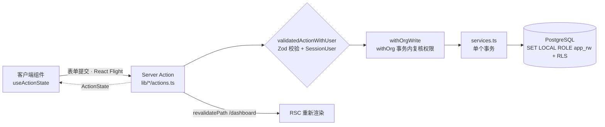

# 接口与集成设计

> **回答什么问题**：系统对外和对内暴露哪些接口？写操作怎么进系统？错误怎么表达？和外部系统怎么集成、契约怎么改？
> **读者**：开发 · 前端　**长度上限**：8 页
> **目标 vs 现状**：基线是**当前实现**（as-is）：40 个已导出的 Server Action 与 7 条 Route Handler（4 条只读 + 3 条谱文图片通道）都按本文契约在跑。未落地的部分单独用 `[目标]` 标注（§5.1 游标分页、§5.4 批量上限、§6.6 的谱书 Action）。接口形态、错误码、DTO 字段以本文为唯一来源；表与列见 [04-数据视图-数据架构](./04-数据视图-数据架构.md)，事务与写路径见 [07-运行视图-关键流程](./07-运行视图-关键流程.md)，鉴权语义见 [09-安全架构](./09-安全架构.md)。

## 目录

1. [这份文档怎么读](#1-这份文档怎么读)
2. [接口形态与边界](#2-接口形态与边界)
3. [认证与上下文](#3-认证与上下文)
4. [错误模型](#4-错误模型)
5. [通用约定](#5-通用约定)
6. [Server Action 清单](#6-server-action-清单)
7. [Route Handler](#7-route-handler)
8. [客户端消费](#8-客户端消费)
9. [外部集成与契约变更规则](#9-外部集成与契约变更规则)

---

## 1. 这份文档怎么读

### 1.1 覆盖什么

- **接口形态与边界**：为什么没有 REST、写为什么只走 Server Action、只读 Route Handler 的定位（§2）。
- **认证与上下文**：会话载体、公开 ID 到内部 scope 的解析、注册与默认组织（§3）。
- **通用约定**：分页、排序、并发、批量（§5）。
- **错误模型**：`ActionState` 的真实形状、`ActionErrorCode` 全集、Route Handler 的 JSON 错误体（§4）。
- **权威清单**：30 个 Server Action 与 4 条 Route Handler 的入参、返回、权限（§6、§7）。
- **客户端怎么消费**：RSC 首屏 + TanStack Query 读 + `useActionState` 写（§8）。
- **外部集成与契约变更规则**（§9）。

### 1.2 不覆盖什么

| 主题 | 去哪看 |
|---|---|
| 表、列、约束、索引、软删语义 | [04-数据视图-数据架构](./04-数据视图-数据架构.md) |
| 事务边界、多步写的执行顺序、失败回滚 | [07-运行视图-关键流程](./07-运行视图-关键流程.md) |
| 角色矩阵、权限字符串的含义、租户隔离的威胁模型 | [09-安全架构](./09-安全架构.md) |
| 部署单元、环境变量逐条、迁移执行与发布顺序 | [06-部署视图-部署架构](./06-部署视图-部署架构.md) |
| 本地命令、`.env` 写法、脚本表 | [13-本地开发与命令](./13-本地开发与命令.md) |
| 哪些功能已经实现、测试统计 | [11-需求与实现状态](./11-需求与实现状态.md) |
| 日志字段、探针、告警 | [10-可观测性与运维](./10-可观测性与运维.md) |
| 模块边界与依赖方向 | [03-逻辑视图-模块设计](./03-逻辑视图-模块设计.md) |

加 Action / 加 Route Handler 的动手步骤见 [guides/add-a-feature](../guides/add-a-feature.md)。

---

## 2. 接口形态与边界

### 2.1 四条通道

| 通道 | 用途 | 数量或范围 | 授权方式 |
|---|---|---|---|
| RSC（Server Component） | 首屏读：页面直接调 `lib/db/queries/`，把数据交给客户端 | 全部页面 | `requireOrgContext` / `requireProjectContext`（内部含 `getSessionUser()` + 成员校验，失败 `notFound()`） |
| Server Action | **唯一写通道**；写成功后的 RSC 刷新也由它触发 | 每域一个 `actions.ts`，共 30 个导出 | `validatedAction` / `validatedActionWithUser` 取用户 + `withOrgWrite(..., '<permission>')` 在事务内复核 |
| Route Handler | 客户端只读刷新与健康检查 | 4 条，全部 `GET`，见 §7 | `getSessionUser()`；组织级再加 `getOrgRole` |
| TanStack Query | 客户端缓存服务端状态；只调只读 Route Handler | 组织列表、项目列表、当前用户 | 无独立授权——请求带同一 Cookie，服务端仍按会话与成员关系判定 |

### 2.2 为什么没有 REST API

| 操作 | 通道 | 理由 |
|---|---|---|
| 内部读（首屏） | RSC 服务端直读 | 零客户端请求、无 loading 闪烁、类型天然贯通 |
| 内部读（客户端刷新） | TanStack Query → 只读 GET Route Handler | 统一缓存与失效；读请求可预取、按路由观测（[ADR 0008](../decisions/0008-read-only-route-handlers.md)） |
| 内部写 | Server Action | 免手写路由与 `fetch`、内置 Origin 校验、渐进增强 |
| 探活 | Route Handler | 需要标准 HTTP 语义 |

**没有公开接口**：没有分享页，没有第三方消费者，没有 `/api/auth/*`。引入 REST 层意味着多维护一份契约（DTO、校验、鉴权、文档），而收益是零。

### 2.3 写链路



Action 只传内部 UUID；公开 ID（`orgSlug` / `projectRef`）只在成功返回值里回给 UI 用于拼 URL。

### 2.4 两条硬边界

- **认证类 handler 数量为 0**，不新增 `/api/auth/*`。认证与租户写只从 Server Action 调 `auth.api.*`，不引入浏览器 auth client。
- **不对外暴露匿名可访问的业务数据**：所有业务数据都在登录后的控制台里，公开 URL 只有营销页与登录注册页。

### 2.5 命名与数据格式

| 对象 | 规则 | 示例 |
|---|---|---|
| Server Action | 动词 + 名词 + `Action` 后缀，驼峰（认证域为历史简写，见 §6.2） | `createLineageAction`、`addChildAction` |
| Action 文件 | `actions.ts`，按域 | `lib/lineage/actions.ts` |
| 入参类型 | 由 Zod schema 推导（`z.infer`），不另声明别名 | `createLineageSchema` |
| 出参类型 | `ActionState`（权威定义 `lib/auth/types.ts`） | `ActionState` |

| 项 | 约定 |
|---|---|
| 时间 | ISO 8601 带时区，`2026-10-21T12:00:00+08:00` |
| 日期（族谱原文） | 字符串，不做解析，如 `"乾隆三十年乙酉"` |
| ID | UUIDv7 字符串；20 位公开 ID 只用于 URL |
| 空值 | `null`，不用 `undefined`、不用空字符串 |
| 布尔 | `true` / `false` |
| 枚举 | 小写字符串或 smallint，见 [04-数据视图-数据架构](./04-数据视图-数据架构.md) |

### 2.6 协议与序列化

- 浏览器 ↔ 服务端：HTTP + React Flight（RSC 载荷），首屏由 `dehydrate` / `HydrationBoundary` 注入 TanStack Query 缓存。
- Server Action：`POST` + Flight 序列化，不是 REST。
- Route Handler：JSON 请求/响应，错误体为英文 JSON。
- 数据库：PostgreSQL wire protocol；本地与 CI 用 `postgres.js`，Vercel 用 `pg`。驱动差异由 `lib/db/drizzle.ts` 与 `lib/db/auth-db.ts` 吸收，业务代码只 import 这两个模块导出的类型与实例。
- 富文本：`jsonb` 存 ProseMirror 文档（编辑器选型见 [ADR 0010](../decisions/0010-rich-text-editor-selection.md)），谱文编辑入口已落地（§6.6）。

---

## 3. 认证与上下文

### 3.1 会话

| 项 | 约定 |
|---|---|
| 载体 | Better Auth 数据库会话，Cookie `better-auth.session_token`（HttpOnly、Secure、SameSite=Lax） |
| 令牌 | 会话 ID 由 Better Auth 生成；库内只存 token 哈希；`BETTER_AUTH_SECRET` 用于签发与校验 |
| 校验 | 服务端一律 `getSessionUser()`：调用 `auth.api.getSession` 按请求缓存查库，未命中返回 `null`；不信任 Cookie 是否存在 |
| 刷新 | Better Auth 滑动续期：会话 7 天过期、`updateAge` 1 天；`proxy.ts` 只检查 Cookie 是否存在，做粗粒度门禁 |
| 有效期 | 7 天（滑动）；**不做刷新令牌轮换** |
| 登出 | `signOut` 调 `auth.api.signOut` 删除当前数据库会话并清 Cookie；其他设备不受影响 |
| 登录方式 | **仅邮箱 + 密码**。手机验证码与 OAuth 不在当前范围 |
| 密码 | Better Auth 以 scrypt 哈希存入 `auth.account`；应用不接触哈希，不保存明文 |
| 邮箱验证 / 找回密码 / 改邮箱 | 均关闭；邮箱创建后只读 |

完整校验链路（`proxy.ts` → `getSessionUser()` → 成员校验）见 [09-安全架构](./09-安全架构.md)。

### 3.2 组织上下文

页面与布局用 `requireOrgContext(orgSlug)` / `requireProjectContext(projectRef)` 把公开 ID 解析成内部 scope（`organizationId`、`projectId`、`role`）。Action 入参一律使用内部 UUID（`orgId`、`projectId`、`lineageId` 等），**不使用公开 ID 作为授权依据**：即使 UUID 被篡改，`withOrgWrite` 仍会在事务内按成员关系复核权限。

公开 ID 只用于 URL 定位；不要新增按公开 ID 写入的入口。

失败时的真实表现：

| 情况 | 表现 |
|---|---|
| 未登录（Action） | `{ error: '登录已失效，请重新登录。', code: 'UNAUTHORIZED' }`（`validatedActionWithUser` 统一拦截） |
| 未登录（页面） | `requireUser()` 重定向到 `/sign-in` |
| 不是该组织成员（页面） | `notFound()` → 404 页，不返回 403，避免泄露组织存在性 |
| 不是该组织成员（Action） | 中文 `error`（`forbidden` / `not_found` 文案），事务内复核失败不写库 |
| 组织已归档 + 写操作 | `{ error: '组织已归档，无法继续操作。' }`（数据库 `RAISE EXCEPTION 'org_archived'` 被 `mapAuthError` 翻译） |

**当前 scope 没有 `planId`**：不包含付费档位或用量上限，所有组织功能无差别。

### 3.3 注册与默认组织

注册由 `signUp` Server Action 调 `auth.api.signUpEmail` 完成，默认组织由数据库触发器创建（见 [04-数据视图-数据架构](./04-数据视图-数据架构.md) 的注册触发器一节）。

```
用户提交邮箱密码
  → Zod 校验
  → auth.api.signUpEmail({ email, password, name })
      → Better Auth 以 scrypt 哈希写入 auth.account
      → 插入 auth.users
      → 触发器 trg_auth_user_created / handle_new_user() 建 organization + organization_member(owner)
  → Better Auth 写入数据库会话并 set-cookie（better-auth.session_token）
  → 直接登录并进入 /dashboard
```

应用层**不需要**调用任何「创建默认组织」的 Action——这条链路是数据库保证的。Better Auth 与触发器都以 `auth_service` 身份写租户表；业务运行时角色 `app_rw` 没有这些表的写权限。

注册**不发送验证邮件**：`auth.users` 插入后即可登录，不存在「等待验证」的中间状态；`emailVerification` 关闭。

### 3.4 CSRF

Server Action 由 Next.js 内置 Origin 校验。4 条 Route Handler 全部是只读 `GET`，无副作用，不需要 CSRF 防护。

---

## 4. 错误模型

### 4.1 原则

三层：

- **Action 不 throw**：throw 会被框架转成 500 错误页，UI 无法区分「同名冲突」和「校验失败」。所有失败都是返回值。
- **用户看到中文，日志与客户端看到机器码**：`error` 是给用户的中文文案，`code` 是给前端的稳定机器码，Route Handler 的 JSON 体是给日志与客户端的英文。
- **不泄露内部细节**：SQL 文本、堆栈、驱动错误、密码哈希一律不出服务端。

### 4.2 出口一：Server Action → `ActionState`

Server Action 无法设置 HTTP 状态码，所以 Action 一律返回 `ActionState`（权威定义 `lib/auth/types.ts`）：

```typescript
export type ActionState = {
  error?: string;
  code?: string;
  success?: string;
  email?: string;
  fieldErrors?: Record<string, string>;
  name?: string;
  orgId?: string;
  orgSlug?: string;
  projectId?: string;
  projectRef?: string;
  folderId?: string;
  lineageId?: string;
  nodeId?: string;
  spouseId?: string;
  inviteUrl?: string;
};
```

语义：

- `error` / `success`：面向用户的**中文**文案；
- `code`：稳定机器码，取值见 §4.4；
- `fieldErrors`：字段级错误（Zod 校验失败时由包装器填入）；
- `orgId` / `orgSlug` / `projectId` / `projectRef` / `lineageId` / `nodeId` 等：成功后的内部 UUID 与公开 ID，供 UI 导航或刷新。

**没有 `ok` 字段**：判断成败看 `error` 是否存在（或 `success` 是否存在），不要写 `result.ok`。不要回显密码；不要把异常堆栈放进返回值。

### 4.3 出口二：Route Handler → JSON

Route Handler 非 2xx 统一返回英文 JSON：`{ "error": "Unauthorized" }`，需要机器码时加 `code`。`/api/health` 在数据库不可达时返回 503 `{ "status": "error", "database": "down" }`。

未预期异常不返回堆栈；`request_id` 在响应头与日志里。4 条 Route Handler 中只有 `/api/health` 会产生 503，其余业务路由只返回 401 / 403 / 404。

### 4.4 错误码全集

`lib/errors.ts` 的 `ActionErrorCode` 是唯一合法集合，共 7 个：

| 码 | 含义 | 前端处理 |
|---|---|---|
| `UNAUTHORIZED` | 未登录或会话失效 | 跳登录页 / 表单内提示 |
| `FORBIDDEN` | 无该操作权限 | Toast + 保持只读态 |
| `NOT_FOUND` | 资源不存在或不可见 | 404 页 |
| `CONFLICT` | 唯一约束冲突、最后一个 owner、组织已归档 | 字段级提示或 Dialog |
| `VALIDATION` | 入参校验失败 | 字段内联提示 |
| `RATE_LIMITED` | 操作过于频繁 | 提示稍后重试 |
| `INTERNAL` | 未预期错误 | 通用 Toast |

Better Auth 与数据库抛出的错误由 `lib/auth/errors.ts` 的 `mapAuthError(error)` 统一翻译成上表的码 + 中文文案，**SQL 文本、堆栈、驱动细节不会到浏览器**。内部映射覆盖的原始码包括 `INVALID_EMAIL_OR_PASSWORD`、`INVALID_PASSWORD`、`USER_ALREADY_EXISTS`、`INVITATION_NOT_FOUND`、`MEMBER_ALREADY_EXISTS`、`ORGANIZATION_NOT_FOUND`、`YOU_CANNOT_LEAVE_THE_ORGANIZATION_AS_THE_ONLY_OWNER` 等，以及 HTTP 状态 401 / 403 / 404 / 409 / 422 / 429 的兜底。

家谱域的失败用 `lib/lineage/lineage-errors.ts` 的 `lineageError(reason)`，它只返回 `{ error: 中文 }`、不带 `code`（`reason` 取值：`forbidden`、`not_found`、`invalid_folder`、`conflict`、`referenced`、`root_exists`、`root_sibling`、`root_forbidden`、`invalid_target`、`invalid_parent`、`cycle`、`invalid_order`、`project_surname_missing`）。

`RATE_LIMITED` 是进程内滑窗（登录与注册）：重启清零、多实例不共享，是降低暴力尝试的尽力而为措施，不是账号级持久锁定，也不能当安全边界。

---

## 5. 通用约定

### 5.1 分页

**当前现状**：`lib/db/queries/*.ts` 没有游标或 `limit` 参数，列表查询一次返回该 scope 下的全部行，页面按需在 RSC 里切片。数据量小（一个家族的谱系与人丁）时够用。

`[目标]` 需要分页时用**游标分页**，不用 offset（offset 在数据变动时会重复/漏行）：

```typescript
interface PageQuery {
  cursor?: string;      // 上一页最后一条的 id
  limit?: number;       // 默认 20，最大 100
}

interface Page<T> {
  items: T[];
  nextCursor: string | null;   // null = 没有下一页
}
```

### 5.2 排序

| 资源 | 默认排序 | 可覆盖 |
|---|---|---|
| 谱系列表 | `updated_at DESC` | `name`、`created_at` |
| 人丁（世系表视图） | `generation ASC, sort ASC` | 不支持 |
| 编目 | `sort ASC` | 拖拽即写 `sort` |

### 5.3 并发控制

**只有一层**：业务唯一索引挡重复提交。

| 场景 | 机制 | 冲突返回 |
|---|---|---|
| 创建（防重复提交） | 业务唯一索引 | 中文 `error` + `code: 'CONFLICT'`（`mapAuthError` 对 `23505` 统一翻译为「数据冲突，请刷新后重试。」） |
| 同时编辑同一资源 | **无保护，last-write-wins** | 无 |

**当前没有编辑锁，也没有乐观锁。** 两人同时编辑同一谱系或人丁，后保存的覆盖先保存的。这是刻意的取舍：锁需要 `resource_lock` 表、心跳、fencing token、UI 只读态，是一整套机制；先不做，把成本留给有真实并发诉求之后。登记在 [12-风险与演进规划](./12-风险与演进规划.md)。

### 5.4 批量操作

`[目标]` 当前没有批量写入 Action，人丁是一个一个提交的。

| 限制 | 目标值 |
|---|---|
| 单次批量写入上限 | 500 行 |
| 超限 | 校验失败，提示分批 |
| 批量操作原子性 | 全部成功或全部回滚（同一事务） |

---

## 6. Server Action 清单

### 6.1 规范

每个 Action 必须遵循同一骨架：

```typescript
'use server';

export const updateNodeAction = validatedActionWithUser(
  updateNodeSchema,
  async (data, _formData, user) => {
    const result = await updateNodeInTransaction({
      userId: user.id,
      orgId: data.orgId,
      lineageId: data.lineageId,
      nodeId: data.nodeId,
      updates: { name: data.name, /* ...其余字段 */ },
    });

    if (!result.ok) {
      return lineageError(result.reason);
    }

    revalidateWholeConsole();
    return { success: '人丁信息已保存', nodeId: result.node.id };
  }
);
```

| 规则 | 说明 |
|---|---|
| 入参 | 单个对象，Zod 解析后才可信；schema 在 `lib/auth/schemas.ts`（认证/组织/项目）与 `lib/genealogy/schemas.ts`（家谱，文件名是历史原因） |
| 包装器 | `validatedAction(schema, fn)`（未登录入口）或 `validatedActionWithUser(schema, fn)`（注入 `SessionUser`，未登录直接返回 `UNAUTHORIZED`） |
| 出参 | 恒为 `ActionState`，永不 throw |
| 权限 | 业务写统一走 `withOrgWrite(userId, orgId, '<permission>', fn)`：开 `withOrg` 事务，**在事务内**再查一次成员关系与权限，返回 `{ ok: false, reason: 'forbidden' }` 而不是抛错 |
| 事务 | 多步写在 `lib/<domain>/services.ts` 的单个事务函数里，不串联多个独立写 |
| 副作用顺序 | 业务写入 → `revalidatePath`；写失败不失效缓存 |
| 幂等 | 不保证。重复提交由唯一索引挡住 |

**缓存失效现状**：所有写入 Action 只调 `revalidateWholeConsole()`（`revalidatePath('/dashboard', 'layout')`，整棵控制台树）。`lib/lineage/revalidate.ts` 里的 `revalidateProject(orgSlug, projectRef)` / `revalidateOrg(orgSlug)` 是**已实现但零调用者**的收窄版本——Action 的 Zod 入参只有 UUID，拿不到路径需要的公开 `orgSlug` / `projectRef`。收窄是已知代码任务（评审 P1-8），不要写成现状。

当前没有编辑锁；引入锁后顺序变为「锁 → 业务 → 缓存失效」。也**不写审计表**：关键动作写结构化日志，日志失败不阻塞业务（见 [10-可观测性与运维](./10-可观测性与运维.md)）。

### 6.2 auth（`lib/auth/actions/`）

| Action | 入参 | 成功返回 | 权限 |
|---|---|---|---|
| `signIn` | `{ email, password }` | 设置会话 Cookie，`success` | 公开（未登录） |
| `signUp` | `{ email, password, name?, invite? }` | 设置会话 Cookie，`success` | 公开（未登录） |
| `signOut` | 无 | `void` | 登录即可 |
| `updatePassword` | `{ currentPassword, newPassword, confirmPassword }` | `{ success: '密码已更新。' }` | 登录即可 |
| `updateAccount` | `{ name }` | `{ name, success }` | 登录即可 |
| `deleteAccount` | `{ password }` | `void` | 登录即可（不能是任何组织的唯一 owner） |

`signUp` 调 `auth.api.signUpEmail`，成功后 Better Auth 立即写数据库会话与 Cookie，无需等待验证邮件。`updatePassword` 走 `auth.api.changePassword({ revokeOtherSessions: true })`：当前会话保留、其他设备立即失效，没有 `token_version` 字段。登录与注册有进程内滑窗限流，超限返回 `RATE_LIMITED`；不持久化失败计数，也不做账号级锁定。删除账号前检查该用户是否为任何组织的唯一 owner（触发器兜底）。

### 6.3 organization 与成员（`lib/org/actions.ts`）

| Action | 入参 | 成功返回 | 权限 |
|---|---|---|---|
| `createOrgAction` | `{ name }` | `{ orgId, orgSlug }` | 登录即可 |
| `renameOrgAction` | `{ orgId, name }` | `success` | `org.settings` |
| `deleteOrgAction` | `{ orgId }` | `{ success: '组织已归档' }`（软删，不物理删除） | `org.settings` |
| `inviteOrgMember` | `{ orgId, email, role }` | `{ inviteUrl }` | `member.invite` |
| `acceptInviteAction` | `{ invitationId }` | `{ success: '已加入组织' }` | 登录即可 |
| `removeOrgMember` | `{ orgId, memberId }` | `success` | `member.manage` |
| `updateOrgMemberRole` | `{ orgId, memberId, role }` | `success` | `member.manage` |

`createOrgAction` 由服务端生成 20 位 `[0-9a-z]` 随机 `slug`，冲突时重试（最多 3 次）；`slug` 不可修改，客户端只在需要 URL 时读返回值。

`inviteOrgMember` 调 `auth.api.createInvitation`，链接为 `${BETTER_AUTH_URL}/sign-up?invite=<invitation.id>`，**只在创建时返回一次**；不发邮件。邀请 7 天过期、一次性；同一组织重新邀请会取消旧的 pending 邀请；禁止邀请 `owner`，管理员也不能邀请管理员。接受走 `/dashboard/join?invite=<id>`，失败时保留账号、可重试。邀请无效、过期、已使用或已撤销时返回中文文案（「邀请无效或已过期。」），不带独立错误码。

**没有 `bootstrapOrganization` 之类的 Action**：默认组织由数据库触发器创建（§3.3）。**也没有转让所有权（transfer ownership）的 Action**：`org.transfer` 权限字符串与权限矩阵里保留了位子，但没有任何入口调用它。

### 6.4 project 与 folder（`lib/project/actions.ts`、`lib/folder/actions.ts`）

| Action | 入参 | 成功返回 | 权限 |
|---|---|---|---|
| `createProjectAction` | `{ orgId, name, surname, themeName, countriesRegions, status?, importance?, notes? }` | `{ projectId, projectRef }` | `project.write` |
| `updateProjectAction` | `{ orgId, projectId, name?, countriesRegions?, hallCode?, status?, importance?, notes? }`（`surname` / `themeName` 不可修改） | `success` | `project.write` |
| `deleteProjectAction` | `{ orgId, projectId }` | `success`（软删） | `project.write` |
| `createFolderAction` | `{ orgId, projectId, kind, parentId?, name }` | `{ folderId }` | `project.write` |
| `renameFolderAction` | `{ orgId, folderId, name }` | `{ folderId }` | `project.write` |
| `deleteFolderAction` | `{ orgId, folderId }` | `success`（未分类内容会被移动，数量写在文案里） | `project.write` |

`ref` **不由客户端传入**：服务端生成 20 位随机公开 ID，作为 URL 第二段；`projectId` 是内部 UUIDv7，只用于 Action。删除谱系或分类时返回的 `success` 文案带数量（如「谱系已删除，3 位人丁已归档」），UI 直接展示。

### 6.5 lineage 与 node（`lib/lineage/actions.ts`）

| Action | 入参 | 成功返回 | 权限 |
|---|---|---|---|
| `createLineageAction` | `{ orgId, projectId, folderId?, name, hallCode?, region, notes? }` | `{ lineageId }` | `lineage.write` |
| `updateLineageAction` | `{ orgId, lineageId, folderId?, name?, hallCode?, region?, notes?, generationWords? }` | `{ lineageId }` | `lineage.write` |
| `deleteLineageAction` | `{ orgId, lineageId }` | `success`（软删，人丁一并归档） | `lineage.delete` |
| `createRootNodeAction` | `{ orgId, lineageId, name, surname?, sex, ...人丁字段, ...可选配偶字段 }` | `{ nodeId }` | `lineage.write` |
| `addChildAction` | `{ orgId, lineageId, parentId, ...同上 }` | `{ nodeId }` | `lineage.write` |
| `addSiblingAction` | `{ orgId, lineageId, siblingOfId, ...同上 }` | `{ nodeId }` | `lineage.write` |
| `addPersonAction` | `{ orgId, lineageId, parentId?, ...同上 }` | `{ nodeId, spouseId? }` | `lineage.write` |
| `addSpouseAction` | `{ orgId, lineageId, spouseOfId, name, surname }` | `{ nodeId }` | `lineage.write` |
| `updateNodeAction` | `{ orgId, lineageId, nodeId, name, surname, ...人丁字段 }` | `{ nodeId }` | `lineage.write` |
| `deleteNodeAction` | `{ orgId, lineageId, nodeId }` | `success`（子孙一并软删，数量写在文案里） | `lineage.write` |
| `moveNodeAction` | `{ orgId, lineageId, nodeId, newParentId }` | `{ nodeId }` | `lineage.write` |

`createLineageAction` 的 `folderId` 为空时，服务端在同一事务内创建「默认分类」；`generationWords` 只在更新时接受，逗号/空格/顿号分隔，最多 40 个字。

**五种新增方式的语义**：

| Action | 世次 | 父节点 | 路径 |
|---|---|---|---|
| `createRootNodeAction` | 1 | 无 | 新建根路径 |
| `addChildAction` | 父 + 1 | 当前节点 | 父路径 + 新 label |
| `addSiblingAction` | 同父节点世次 | 与参照节点相同 | 同父路径 + 新 label |
| `addPersonAction` | 有 `parentId` 时同 `addChildAction`，否则同 `createRootNodeAction` | 可选 | 按分支决定；带可选配偶，一次提交录入夫妻两人 |
| `addSpouseAction` | 不占世次 | 无 | `NULL`，`spouse_of_id` 指向配偶 |

人丁字段（`nodeNameFields` / `nodeDetailsFields`）：`name`、`surname`、`sex`、`courtesy`（字号）、`namePrefix`（前缀）、`isAlive`、`birthText`、`deathText`、`birthYear`、`deathYear`、`burialPlace`、`biography`（行传）；可选配偶字段 `spouseName` / `spouseSurname` 必须成对出现。

### 6.6 谱文（已实现）与谱书 `[目标]`

`article`、`book`、`book_catalog` 表已建。**谱文这条线已落地**（[specs/002-article-authoring](../../specs/002-article-authoring/spec.md)）：`/dashboard/project/[projectRef]/articles` 是列表 + 分类树，`.../articles/[articleId]` 是三区编辑器。谱书的 Action 仍未导出，`.../books` 还是占位 `EmptyState`。哪个功能做到哪一步只看 [11-需求与实现状态](./11-需求与实现状态.md)。

谱文写在 `lib/article/actions.ts`，入参是 **JSON 对象而不是 FormData**——文档是嵌套结构，`Object.fromEntries(formData)` 那条通道装不下，所以新增 `validatedActionWithUserObject`（`lib/auth/middleware.ts`）；成功时把结构化结果放进 `ActionState<T>` 的 `data`。契约细节（含失败文案与错误码）在 [contracts/actions-and-permissions.md](../../specs/002-article-authoring/contracts/actions-and-permissions.md)。

| Action | 入参 | `data` | 权限 |
|---|---|---|---|
| `createArticleAction` | `{ orgId, projectId, title, folderId? }` | `{ articleId }` | `article.write` |
| `updateArticleTitleAction` | `{ orgId, articleId, title }` | — | `article.write` |
| `moveArticleAction` | `{ orgId, articleId, folderId \| null }` | — | `article.write` |
| `deleteArticleAction` | `{ orgId, articleId }` | — | `article.write` |
| `saveArticlePageAction` | `{ orgId, articleId, pageId, doc }` | `{ savedAt, page }` | `article.write` |
| `addArticlePageAction` | `{ orgId, articleId }` | `{ pageId, pageOrder }` | `article.write` |
| `deleteArticlePageAction` | `{ orgId, articleId, pageId }` | `{ pageOrder }` | `article.write` |
| `reorderArticlePagesAction` | `{ orgId, articleId, pageIds }` | `{ pageOrder }` | `article.write` |
| `getArticleDeletePreviewAction` | `{ orgId, articleId }` | `{ pageCount, imageCount, referencedByCatalog }` | 只读 |
| `getFolderDeletePreviewAction` | `{ orgId, folderId }` | `{ name, folderCount, articleCount }` | 只读 |

- 两个预览 Action 只走 `withOrg` 查询（`SELECT` 由 RLS 与成员关系兜底），不写库、不失效缓存；谱文不存在与不属于本组织返回同一句「谱文不存在或已删除」，不泄露存在性。
- 分类的三个 Action（`createFolderAction` / `renameFolderAction` / `deleteFolderAction`）**签名与权限都没改**，谱文列表复用 `folder.kind = 1`；删除分类仍然连带子分类并把谱文移入未分类。
- 按页提交是刻意的：`saveArticlePageAction` 在事务内 `FOR UPDATE` 锁住谱文行、只替换 `pageId` 那一页。四个页级 Action **不做整树缓存失效**，否则服务端快照会在敲字间隙被推回编辑器、覆盖未保存的页。
- 业务失败文案来自 `lib/article/constants.ts` 的 `ARTICLE_ERRORS`（小写 code：`forbidden` / `not_found` / `page_not_found` / `last_page` / `max_pages` / `too_many_images` / `invalid_image` / `invalid_doc` / `catalog_referenced`）；`ActionState.code` 仍用 `lib/errors.ts` 的大写枚举。

谱文另外带三条 Route Handler（过渡形态，同 [ADR 0008](../decisions/0008-read-only-route-handlers.md)）：`GET /api/media/[...key]` 是图片读取代理，两种存储模式都走它，每次请求重新判成员资格（[ADR 0019](../decisions/0019-media-storage.md)）；`POST /api/blob/upload` 是 Vercel Blob 客户端直传的令牌通道；`POST /api/media/upload` 是本地兜底模式的上传。模式不匹配一律 404，鉴权失败也 404。

谱书部分仍是目标：

| Action | 入参 | 返回 | 权限 |
|---|---|---|---|
| `createBook` | `{ orgId, projectId, name, title, surname, coverSpec }` | `Book` | `book.write` |
| `updateBook` | `{ orgId, bookId, ...可选 }` | `Book` | `book.write` |
| `deleteBook` | `{ orgId, bookId }` | `void` | `book.write` |
| `addCatalogItem` | `{ orgId, bookId, parentId?, name, section, articleId?, lineageId? }` | `BookCatalog` | `book.write` |
| `updateCatalogItem` | `{ orgId, bookId, catalogId, name?, section?, hide? }` | `BookCatalog` | `book.write` |
| `moveCatalogItem` | `{ orgId, bookId, catalogId, parentId?, sort }` | `BookCatalog` | `book.write` |
| `removeCatalogItem` | `{ orgId, bookId, catalogId }` | `void` | `book.write` |

也没有 `createShareLink` / `revokeShareLink`：分享未排期。

### 6.7 清单自查

40 个导出逐个可 grep 到 `lib/**/actions.ts`（认证 6、组织与成员 7、项目 3、分类 3、谱系与人丁 11、谱文 10）。新增 Action 时同步改本文，并保持 `pnpm docs:check` 干净。

---

## 7. Route Handler

4 条 `GET` 只读（下表前四行），全部用 `withApiLogging('<route-name>', handler)` 导出。后三条是谱文图片通道（[ADR 0019](../decisions/0019-media-storage.md)）：读取代理是只读 `GET`，两个上传是 `POST`——它们存在只是因为「写入只走 Server Action」这条约定装不下 10MB 的图片字节（Server Action 请求体上限 1MB、Vercel 函数 4.5MB）。


| 路径 | 用途 | 授权 | DTO | 状态码 |
|---|---|---|---|---|
| `/api/health` | 存活与数据库连通性探针 | 无（匿名可访问，只返回 `status`/`database`） | `{ status, database }` | `200` / `503` |
| `/api/orgs` | 当前用户所属组织列表（控制台组织切换器） | `getSessionUser()` | `[{ id, name, slug, role }]` | `200` / `401` |
| `/api/orgs/[orgId]/projects` | 指定组织的项目列表 | `getSessionUser()` + `getOrgRole(userId, orgId)` | `[{ id, name, ref }]` | `200` / `401` / `403` / `404` |
| `/api/user` | 当前用户的最小身份 | `getSessionUser()` | `{ id, name, email }` | `200` / `401` |
| `GET /api/media/[...key]` | 谱文图片读取代理（两种存储模式都走它） | `getSessionUser()` + 按 pathname 里的 `organization_id` 判成员 | 图片字节 + `Content-Type` + `Cache-Control: private, max-age=300` | `200` / `404`（未登录、形状非法、非成员、文件缺失一律 404，不泄露存在性） |
| `POST /api/blob/upload` | Vercel Blob 客户端直传的令牌通道（`handleUpload`） | 同上 + `article.write` | `{ clientToken }` | `200` / `401` / `404`（越权与不存在都是 404；非 blob 模式 404） |
| `POST /api/media/upload` | 本地兜底模式（`.data/media/`）的上传 | 同上 + `article.write` | `{ pathname, size, contentType }` | `200` / `400` / `401` / `404`（非 fs 模式 404）/ `413` / `415` |

统一约定：

- `withApiLogging`（`lib/api.ts`）注入 `request_id`、回写 `x-request-id` 响应头、记录 `duration_ms`、把未捕获异常转成 JSON 500 而不是 HTML 错误页。
- **错误体是英文 JSON**（`{"error":"Unauthorized"}`），**用户可见文案是中文**——前者给客户端与日志，后者给界面。
- 只返回显式 DTO，不返回整行；`/api/user` 是最典型的例子：注释里明确绝不序列化整行 `auth.users`（含凭证与 token 状态）。
- `/api/orgs/[orgId]/projects` 的路径参数用 `z.uuid()` 校验，**不是合法 UUID 时按 404 处理**；是合法 UUID 但不是成员时返回 **403**（不是 404）——这是与页面 `notFound()` 策略不同的历史实现，改它要同步改集成测试。
- 谱文图片三条通道的 pathname 必须是 `articles/<organization_id>/<article_id>/<文件名>` 四段形状，任何一段不合法都按 404；上传落点由服务端拼，客户端传不了自己的前缀。集成测试见 `tests/integration/media.test.ts`。

新增一条 Route Handler 的顺序与检查项见 [03-逻辑视图-模块设计](./03-逻辑视图-模块设计.md) 与 [guides/add-a-feature](../guides/add-a-feature.md)；集成测试要覆盖 `401` / `403` / `404` / 成功四条路径。认证类 handler 数量保持 0。

---

## 8. 客户端消费

### 8.1 读

页面是 RSC，首屏数据在服务端取好后通过 `initialData` 或 `dehydrate` / `HydrationBoundary` 注入 TanStack Query，**客户端首屏不发起数据请求**。

```tsx
// app/(dashboard)/dashboard/project/[projectRef]/lineages/[lineageId]/page.tsx
export default async function Page({ params }: Props) {
  const ctx = await requireProjectContext(params.projectRef);
  const graph = await getLineageGraph(ctx, params.lineageId);
  return <LineageCanvas initialGraph={graph} />;
}
```

客户端需要刷新时只调 3 条业务只读路由（`/api/health` 不参与），`queryFn` 用 `lib/fetcher.ts` 的 `fetcher<T>(url)`：

```tsx
export function useConsoleOrgs() {
  return useQuery({
    queryKey: queryKeys.orgs,
    queryFn: () => fetcher<ConsoleOrg[]>('/api/orgs'),
  });
}
```

`queryKey` 一律从 `lib/query-keys.ts` 的工厂取（`queryKeys.user` / `queryKeys.orgs` / `queryKeys.projects(orgId)`），**不要在组件里手写 `fetch` 或拼字符串 key**。新鲜度由 `createQueryClient` 的 `staleTime: 30_000` 统一决定，不要在单个 hook 上设 `refetchOnMount`（[ADR 0013](../decisions/0013-next-react-runtime-layer.md)）。谱系画布的数据不走 TanStack Query，直接来自 RSC props + Action 返回值。

### 8.2 写

写操作走 Server Action + `useActionState`，成功后按需 `invalidateQueries` 再 `router.refresh()` 让 RSC 树重新渲染：

```tsx
const [state, action, isPending] = useActionState<ActionState, FormData>(
  createOrgAction,
  {}
);

useEffect(() => {
  if (state.orgSlug) {
    void queryClient.invalidateQueries({ queryKey: queryKeys.orgs });
    onOpenChange(false);
    router.push(`/dashboard/org/${state.orgSlug}`);
    router.refresh();
  }
}, [state.orgSlug, queryClient, router, onOpenChange]);
```

`router.refresh()` 是**当前的主力刷新手段**（`app`/`components`/`lib` 里共 14 处），因为 Action 的失效粒度是整棵 `/dashboard`（§6.1）。没有用 TanStack Query 的 `useMutation` 包 Action——`useActionState` 直接吃 `(prevState, formData)` 签名，配 `noValidate` 表单更省事。

### 8.3 错误映射

没有集中的错误映射文件，映射由各表单 / Toast 就地处理：

| 类别 | UI |
|---|---|
| 字段级（`VALIDATION` / `fieldErrors`） | 表单内联提示 |
| 认证（`UNAUTHORIZED`） | 跳登录页 / 表单内提示 |
| 权限（`FORBIDDEN`） | Toast + 保持只读态 |
| 冲突（`CONFLICT`） | 字段级提示或 Dialog，带解决动作 |
| 限流（`RATE_LIMITED`） | 提示稍后重试 |
| 其他（`INTERNAL`、`NOT_FOUND`） | 通用 Toast / 404 页 |

**不要直接把 `error.message` 或数据库错误展示给用户**——用户看到的是中文 `ActionState.error`；`error.message` 只给开发者。

---

## 9. 外部集成与契约变更规则

### 9.1 三个外部依赖

都是托管服务，没有自建中间件。

| 依赖 | 集成方式 | 失败时的表现 |
|---|---|---|
| Better Auth（自托管，跑在同一个 Next.js 进程里） | 只在 Server Action 里调 `auth.api.*`；数据库会话；表在 `auth` schema | 认证连接不可用 → 需要会话的页面与 Action 返回未登录/失败文案，业务读仍可用（业务连接独立） |
| 数据库（Neon PostgreSQL 18+） | 两条连接、两个登录角色（§9.1） | 启动时 Zod 校验失败直接抛错（`instrumentation.ts` 调用），不会把 `undefined` 带进请求路径 |
| 部署平台（Vercel） | 环境变量分作用域注入，构建不含迁移 | 配置错误的部署直接启动失败，而不是部分可用 |

**两个连接不能混用**：

| 连接 | 环境变量 | 登录角色 | 用途 |
|---|---|---|---|
| 业务 | `APP_POSTGRES_URL`（缺省回退 `POSTGRES_URL`） | `app`（成员 `app_rw`） | 全部业务读写，受 RLS 约束 |
| 认证 | `AUTH_POSTGRES_URL`（缺省回退 `POSTGRES_URL`） | `auth_runtime`（成员 `auth_service`） | Better Auth 的会话与租户写 |

`AUTH_POSTGRES_URL` 必须指向非池化直连端点——认证连接用启动参数固定 `role=auth_service`，pooler 不支持；这条在启动时校验，构建阶段跳过（构建不该要求数据库可达）。Vercel 上用 `pg` 的 `Pool` + `attachDatabasePool` 让平台管理连接冻结与恢复。环境变量逐条说明与作用域见 [06-部署视图-部署架构](./06-部署视图-部署架构.md)，本地写法见 [13-本地开发与命令](./13-本地开发与命令.md)。

### 9.2 消息与事件

**当前没有队列、没有定时器、没有事件总线、没有后台消费者。** 部署模型里没有可以承载它们的东西——这是决策，不是缺口，见 [ADR 0005](../decisions/0005-zero-background-jobs.md)。

| 看起来像事件的东西 | 实际是什么 |
|---|---|
| `activity_logs` | 产品活动流**表**，不是领域事件。写入与业务写在同一个事务里，没有订阅方 |
| 邀请 7 天过期 | 查询时按 `expires_at` 判断，没有定时清理任务 |
| 事实层回填与对账 | 人工执行的 CLI（`data:backfill:fact` / `data:reconcile:fact`），不是调度任务 |
| 限流窗口 | 进程内 Map，没有共享存储 |

**引入后台任务的前提条件**：出现真正需要定时或异步的消费者（过期数据清理、邮件通道、导出任务），并且同时具备可观测的失败重试与死信处理能力。在那之前，任何「先加个定时器以后用」的改动都会被拒绝。

### 9.3 契约变更规则

| 变更 | 处理 |
|---|---|
| 新增可选入参 | 直接改，兼容 |
| 新增必填入参 | 禁止。改为可选 + 服务端默认值 |
| 删除 / 重命名字段 | 禁止直接删。先标记废弃，两个版本后移除 |
| 新增 Action | 自由 |
| 修改 Action 语义 | 必须新增 Action，不改旧的 |
| 错误码新增 | 自由，但前端映射表必须有兜底分支 |
| 错误码语义变更 | 禁止 |

内部接口没有版本号。契约由 TypeScript 类型保证，破坏性变更在编译期就会被发现。引入编辑锁后，`lineage` 与谱书的写 Action 新增带锁的变体，而不是改现有签名。

**改这份文档的时机**：Action 增删改、`ActionState` 字段变化、`ActionErrorCode` 变化、Route Handler 的 DTO 或状态码变化、外部依赖增删。改完跑 `pnpm docs:check --strict`。
