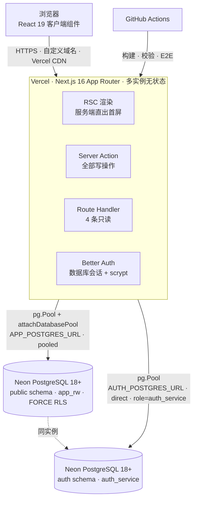

# 部署视图：部署架构

> **回答什么问题**：系统跑在哪？分成哪些部署单元？怎么发布、怎么回滚、怎么扩缩容？
> **读者**：开发 · 运维　**长度上限**：5 页
> **目标 vs 现状**：本文描述当前实现（as-is）。目标设计见 [PRD](../prd.md) 与 [decisions](../decisions/README.md)。

运维步骤、环境变量逐条说明、备份与恢复手册见 [部署蓝图](../ops-target.md) 与 [runbooks](../guides/runbooks.md)；本文件只写拓扑与流水线形状。

---

## 容器视图（C4-L2）

两条连接指向同一个 Neon 计算实例的两个角色，但在配置上是两个 URL：业务连接必须走 pooled 端点，认证连接必须走 direct 端点（认证连接用启动参数固定 `role=auth_service`，pooler 不接受该参数）。同区域部署，不在函数与数据库之间跨区。

---

## 部署单元（C4-L3）

| 部署单元 | 跑什么 | 伸缩单位 | 冷启动影响 |
|---|---|---|---|
| Vercel 函数 | RSC 渲染、Server Action、Route Handler、Better Auth（进程内） | 按请求数自动水平扩，实例之间无共享状态 | 首个请求要建连接并加载配置；`attachDatabasePool` 让平台冻结/恢复连接池 |
| Neon 计算实例 | PostgreSQL 18+，`public` 与 `auth` 两个 schema | 托管，按负载升降；空闲可自动挂起 | 挂起后首个连接会等待恢复，表现为一次慢请求 |
| 本地 Docker | 仅 PostgreSQL，不含应用 | 单实例 | 不适用 |
| CI runner | 构建、迁移、单测、集成测试、E2E | 每次运行一台 GitHub 托管机 | 不适用 |
| 运维 CLI（`data/`） | 事实层回填与对账 | 人工执行一次 | 不适用；用迁移角色直连，长事务不占应用连接池 |

**没有的东西**：没有独立的后台 worker、没有队列消费者、没有定时任务、没有独立缓存层、没有对象存储。这些不是待补的空白，是部署模型的一部分，见 [decisions/0005](../decisions/0005-zero-background-jobs.md)。

---

## 环境矩阵

| 环境 | 数据库 | 驱动 | 认证连接 | 启动方式 |
|---|---|---|---|---|
| 本地开发 | Docker PostgreSQL，库名任意，需先 `pnpm db:setup` | `postgres.js`（直连，无 pooler，可用 prepared statements） | `AUTH_POSTGRES_URL` 指向本地，登录角色 `auth_runtime` | `pnpm dev` |
| 本地生产模式 | 同本地（Docker） | 本地仍走 `postgres.js`（`isVercel()` 为假） | 同上 | `pnpm build && pnpm start`，用 `pnpm verify:deploy` 验证 |
| CI | `postgres:18-alpine` service，库名以 `_test` 结尾 | `postgres.js` | CI 内 `auth_runtime` 角色由流水线创建 | GitHub Actions，见下 |
| 生产 | Neon PostgreSQL 18+ | `pg` 的 `Pool`（`max: 5`）+ `attachDatabasePool` | `AUTH_POSTGRES_URL` 必须是 direct 端点 | Vercel 构建后由平台启动 |
| Staging（仅 E2E 外部模式） | 真实环境 | 同生产 | 同生产 | 需要 `E2E_EXTERNAL_SERVER` 与 `E2E_ALLOW_EXTERNAL` 同时开启 |

**环境缺口**：仓库里没有独立的 staging 或 PR preview 环境。生产形态的三个假设（`pg.Pool` + `attachDatabasePool` 的连接生命周期、非属主 `app` 角色下 `FORCE RLS` 的兜底、pooled/direct 双 URL 分离）只在本地生产模式验证过，没有在真实 Vercel + Neon 上验证。这条登记在 [13-风险与演进规划](./13-风险与演进规划.md)。

本地开发的三个陷阱：dotenv 读的是 `.env`（写成 `.env.local` 会读不到）；本地地址必须是 `http://localhost:3000`（Cookie 带 `Secure`，用 IP 或其它域名登录不上）；`pnpm test:e2e` 在本地模式会清空测试库。

---

## CI/CD 流水线

单 job 顺序执行，阶段名与 `.github/workflows/ci.yml` 一致。

- **Install dependencies** — 挡住锁文件与 `package.json` 不一致（`--frozen-lockfile`）。
- **Lint & format check** — `pnpm check`：Biome 规则，含三条 `noRestrictedImports` 依赖方向规则。
- **Docs consistency** — `pnpm docs:check --strict`：文档相对链接、锚点、过期路径、矛盾措辞、文件头字段。
- **Architecture constraints (F6/F7)** — `pnpm arch:check`：单文件 ≤400 行（存量豁免只许缩）、`process.env` 只在 `lib/config.ts` 读。
- **Typecheck** — `pnpm typecheck`：TypeScript 7，`strict` 开启。
- **Migrate test database** — `pnpm db:migrate`：迁移必须能在空库一次执行。
- **Provision runtime login roles** — 创建 `app`（成员 `app_rw`）与 `auth_runtime`（成员 `auth_service`）两个登录角色，测试才有非属主连接可用。
- **Unit + integration tests with coverage** — `pnpm test:coverage`：单测 + 真实 PostgreSQL 集成测试，并卡覆盖率阈值。
- **Upload coverage** — 上传覆盖率产物，仅留证据，不拦发布。
- **Check migration drift** — `pnpm db:generate` 后确认没有新迁移，挡住「改了 schema 忘了生成迁移」。
- **Build** — `pnpm build`：Next.js 生产构建；构建阶段不要求数据库可达。
- **Install Playwright browser** — 安装 chromium 及系统依赖。
- **E2E critical path** — `pnpm test:e2e`：对 production server 跑关键路径。
- **Upload Playwright artifacts** — 失败时留报告与截图。
- **Deployment verification** — 在 3100 端口起 production server，等 `/api/health` 就绪，再跑 `scripts/verify-deployment.mjs`。

**真正拦发布的**是前 11 步与后 3 步中任何一步失败：这个仓库没有 `continue-on-error`，除覆盖率与 Playwright 产物上传外全部阻塞。**不拦发布的**只有两个上传步骤（`if-no-files-found: ignore`）。

---

## 发布与回滚

- **发布**：合并到 `main` 触发 Vercel 构建与部署；没有手工发布脚本，也没有多环境晋级流程。
- **顺序**：迁移与业务代码分开提交，先合迁移、后合代码；迁移必须向后兼容一个版本，因为回滚时旧代码要能读新库。
- **回滚**：Vercel 重新部署上一版本 + Neon 分支/PITR 恢复数据。**没有应用层回滚脚本**，也没有自动化数据回滚；业务表的软删与 `deleted_at` 分组是唯一的行级恢复手段。
- **删除不可逆的部分**：`organization_member` 与 `invite` 是硬删除；`app_rw` 没有 `DELETE` 授权，物理删除只能走运维。

---

## 扩缩容与连接

- **函数实例无状态**，可以水平扩；所有请求内工作在单次请求内完成，不依赖实例内存。例外是限流计数器与请求级缓存，它们在实例之间不共享——因此限流不能当安全边界。
- **连接数是先坏的资源**：每实例池上限 `max: 5`，实例数上升时先撞 Neon 的连接上限。`attachDatabasePool` 只在 Vercel 生效，让平台在实例冻结时回收连接；本地与 CI 用 `postgres.js` 直连，不需要它。
- **连接复用必须安全**：`withOrg` 用 `SET LOCAL ROLE app_rw` 与会话内的 `set_config(..., true)` 注入用户声明，都是事务级设置。会话级 `SET` 会把角色与声明泄漏给下一个借用该连接的请求——这是这套隔离模型里最容易踩的坑。
- **数据库侧伸缩**：Neon 托管，按负载升降、空闲挂起；迁移、备份与运维走 `POSTGRES_URL_DIRECT`，不占应用连接池。
- **观测手段**：Neon 指标（连接数、计算用量）+ 应用结构化日志（`request_id`、`duration_ms`）+ `/api/health` 探针。具体阈值与告警见 [10-可观测性与运维](./10-可观测性与运维.md)，容量口径见 [08-非功能性设计](./08-非功能性设计.md)。
