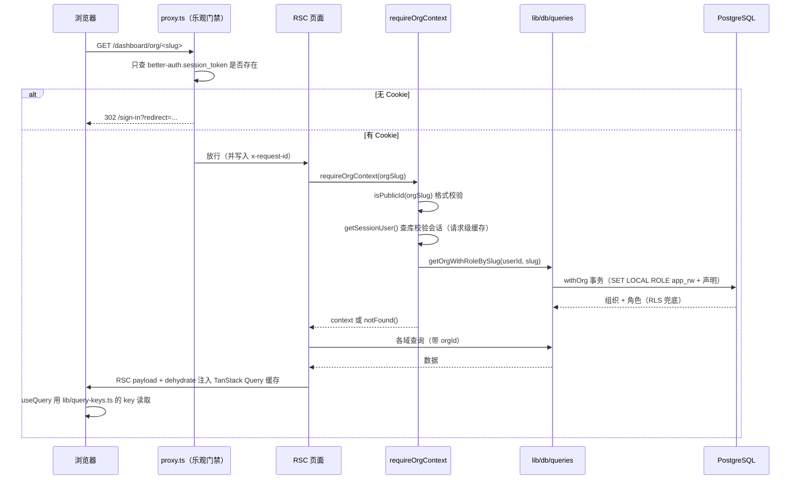
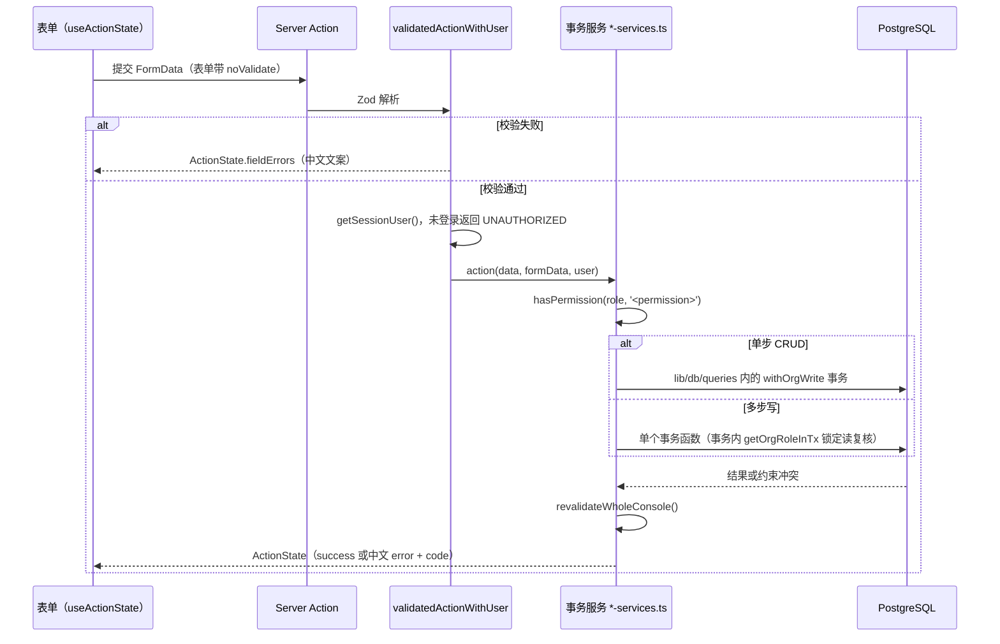
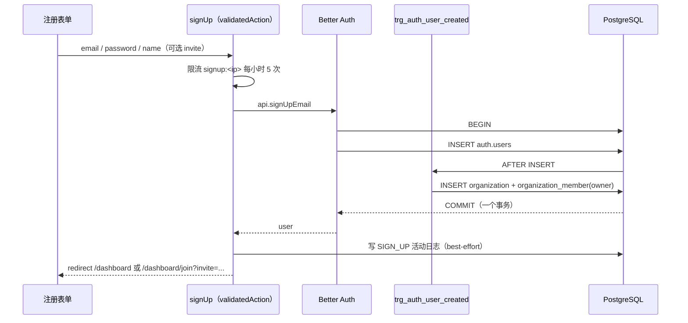
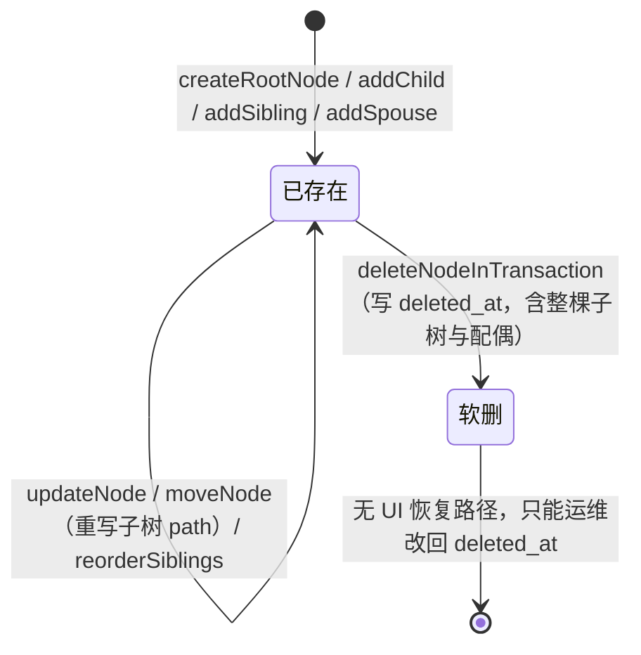

# 运行视图：关键流程

> **回答什么问题**：一次读、一次写、一次多步业务操作分别经过哪些步骤？失败时停在哪？
> **读者**：开发　**长度上限**：7 页
> **目标 vs 现状**：本文描述当前实现（as-is）。目标设计见 [PRD](../prd.md) 与 [decisions](../decisions/README.md)。

模块归属见 [03-逻辑视图-模块设计](./03-逻辑视图-模块设计.md)，隔离与事务边界见 [04-数据视图-数据架构](./04-数据视图-数据架构.md)。

---

## 读路径

每步的失败表现：

- **Cookie 不存在** → `proxy.ts` 直接 302 到登录页，带 `redirect` 参数。这一步是乐观判断，不查库，所以伪造的 Cookie 会通过这一层。
- **Cookie 存在但会话无效/过期** → `getSessionUser()` 返回 `null`，页面重定向到 `/sign-in`。权威校验只在这里发生。
- **公开 ID 格式不对** → `requireOrgContext` 第一步 `notFound()`，不会拿一个非法字符串去查库。
- **不是成员、或公开 ID 不存在** → 同一个 `notFound()`。两种情况返回相同的 404，不泄露「这个 ID 存在但不是你的」。

`getOrgContext` / `getProjectContext` 是同一逻辑的 `null` 版本，供「没有 scope 也要渲染」的场景使用；`requireProjectContext` 对项目页做同样的三步。三者都用 React `cache()` 做请求级记忆化，同一请求内不会重复查会话。

---

## 写路径

四条约束：

- **失败返回中文文案，不抛异常**。数据库错误码在 `lib/db/errors.ts` 识别后转成 `ActionState`，异常堆栈只进日志。
- **不串联多个独立写**：需要多步就调用一个事务函数，不在 Action 里连开两个事务。
- **权限在事务内复核**：事务外的角色读取可能已过期，事务函数内用 `getOrgRoleInTx(tx, userId, orgId)` 锁定读重判。
- **公开 ID 的生成只发生在服务端**：`generatePublicId()` 生成 20 位 ID，遇唯一冲突重新生成并重试，最多 3 次。

当前所有写 Action 成功后都调用 `revalidateWholeConsole()`（`revalidatePath('/dashboard', 'layout')`）。收窄失效范围的 `revalidateProject` / `revalidateOrg` 已写好但未接线——Action 的 Zod 入参只有 UUID，拿不到路径需要的公开 ID；在接线之前不要假设失效是收窄的。

---

## 多步事务时序

### 注册与默认组织

1. `signUp`（`validatedAction`，还没有会话）先做限流：同一 IP 每小时 5 次。
2. 调 `auth.api.signUpEmail` 插入 `auth.users`。**同一个数据库事务内**，`trg_auth_user_created` 触发器（`SECURITY DEFINER`，owner 是 `auth_service`）插入 `organization` 与 `organization_member`（角色 `owner`）——「注册即得默认组织」由数据库触发器完成，不是应用层多步写。
3. 应用层再写一条 `SIGN_UP` 活动日志，失败只记 warn 不阻断。
4. 重定向到 `/dashboard`；带邀请参数时重定向到 `/dashboard/join?invite=...`。

**失败时回滚到什么状态**：步骤 2 整体回滚——不会出现「有用户没有组织」的中间态。步骤 3 的日志可能丢，不影响业务数据。

### 接受邀请

1. `acceptInviteAction`（`validatedActionWithUser`）校验 `invitationId`。
2. 调 `auth.api.acceptInvitation`：Better Auth 在一个事务内插入 `organization_member`、把邀请标记为已接受。邀请是 7 天过期、一次性的。
3. 应用层写 `ACCEPT_INVITATION` 活动日志（best-effort），然后 `revalidateWholeConsole()`。

**失败时回滚到什么状态**：过期、已使用、或与当前登录邮箱不匹配时，Better Auth 抛错，成员关系不成立，用户仍停留在原来的组织集合里。

### 成员角色变更 / 删号

1. `updateOrgMemberRole` / `removeOrgMember` 先做应用层预检：调用者是否有 `member.manage`、目标成员是否在本组织、是否在移除自己、是否在移除最后一个 `owner`、管理员是否能管理其他管理员。预检不通过直接返回中文文案，不进数据库。
2. 调 `auth.api.updateMemberRole` / `auth.api.removeMember`。删除成员是**硬删除**。
3. 触发器兜底：`trg_org_member_last_owner_delete` / `trg_org_member_last_owner_update` 在数据库层再挡一次「删掉最后一个 owner」，应用层预检被绕过时仍然失败。
4. 删号走 `auth.api.deleteUser`，删前检查该用户是否为任何组织的唯一 owner。

**失败时回滚到什么状态**：Better Auth 的写是原子的；应用层的活动日志是 best-effort，可能缺失。**活动日志不保证与业务写同事务**——这是产品活动流的定位，不是审计日志。

---

## 状态机

### 组织

| 状态 | 怎么进入 | 能退出吗 |
|---|---|---|
| `active` | 注册触发器创建，或 `createOrgAction` 创建 | 可以被归档 |
| `suspended` / `closed` | `status` 字段取值，当前没有把组织切到这两个状态的业务入口 | 没有入口 |
| 归档（`deleted_at` 非空） | `deleteOrgAction` 写 `deleted_at` | 只能运维改回；归档后组织不出现在列表与 scope 解析里 |

不可逆点：组织归档不影响成员与邀请行（它们是硬删除，另一条路径），也不删除业务数据。**没有「删除组织并清理数据」的能力**。

### 人丁 node

| 变化 | 触发 | 结果 |
|---|---|---|
| 新建根节点 / 子女 / 兄弟 / 配偶 | `createRootNodeInTransaction`、`addChildInTransaction`、`addSiblingInTransaction`、`addSpouseInTransaction` | 写 `parent_id` 与 `path`（`ltree`），同事务维护 `lineage.node_count` |
| 移动 | `moveNodeInTransaction` | 重写该子树所有节点的 `path`，同事务内完成 |
| 排序 | `reorderSiblingsInTransaction` | 调整同级 `sort` |
| 软删 | `deleteNodeInTransaction` | 用 `path <@ 目标路径` 找出整棵子树，连同这些人的配偶行一起写 `deleted_at`，同事务扣减 `node_count` |
| 恢复 | 无 | **没有回收站，软删后没有 UI 恢复路径**，只能运维改回 `deleted_at` |

删除的边界：根节点（`role = 'blood'` 且无 `parent_id`）不允许删除；删除是软删，`app_rw` 没有 `DELETE` 授权，物理删除只能走运维。

---

## 并发与冲突

- **没有编辑锁**：两个成员可以同时编辑同一个人丁，后写入的覆盖先写入的。这是显式决策（[decisions/0002](../decisions/0002-no-edit-lock.md)），理由是冲突概率低于锁的成本。
- **并发写靠事务与唯一约束兜底**：唯一索引、`CHECK`、复合外键、租户列不可变触发器在任何并发顺序下都成立；业务层的「先查后写」不保证原子，所以关键判断放在事务内做锁定读（`loadLineageForUpdate`、`getOrgRoleInTx`）。
- **公开 ID 冲突**：`ref` / `slug` 由 `generatePublicId()` 生成，插入时遇唯一冲突重新生成，最多重试 3 次；创建项目时用 `onConflictDoNothing()` + 重新生成，不复用冲突的那个 ID。
- **同事务内软删分组**：一次操作软删的所有行共享 `deleted_at`，运维可以整组恢复。

---

## 异常与补偿

**没有补偿任务、没有重试队列、没有死信处理。** 失败要么回滚，要么降级为「少一条日志」。

| 异常 | 现在怎么处理 | 有没有补偿 |
|---|---|---|
| 唯一约束冲突（`23505`） | 识别后转中文提示，不重试成重复数据 | 无（用户重试） |
| `CHECK` 违反（`23514`） | 转中文提示 | 无 |
| 外键违反（`23503`） | 转中文提示，事务回滚 | 无 |
| 租户列被改（`42501`） | 报错并回滚 | 无 |
| 事务中途失败 | 整体回滚，不留半成品 | 无 |
| 会话失效 | 页面重定向登录；Action 返回 `UNAUTHORIZED` 中文提示 | 用户重新登录 |
| 权限不足 | 页面 `notFound()`；Action 返回中文提示；Route Handler 返回 403 | 无 |
| 活动日志写入失败 | 记 `warn` 后继续 | **无**——日志会永久缺失 |
| 数据库不可用 | `/api/health` 返回 503；页面 500；没有降级路径 | 无 |
| 迁移失败 | 部署前 CI 已挡；生产靠 Neon 分支与 PITR 恢复 | 人工 |

这张表的设计意图是「宁可少一条日志，也不要因为日志失败把业务写回滚掉」——`logBestEffort` 与 `logOrgActivity` 都是 try/catch 包住的。代价是活动流不完整，追溯要靠软删与 PITR，见 [13-风险与演进规划](./13-风险与演进规划.md)。

---

## 前端渲染与交互

| 场景 | 渲染方式 | 状态来源 |
|---|---|---|
| 首屏 | RSC 直出 + `dehydrate` / `HydrationBoundary` 注入缓存 | 服务端查询结果 |
| 交互工作区 | TanStack Query 读只读 Route Handler | `lib/query-keys.ts` 的 key 工厂（`user`、`orgs`、`projects(orgId)`） |
| 谱系画布与检查器 | zustand store 只存视图状态（视图模式、选中、折叠、搜索、筛选、渲染窗口、侧栏宽度） | 实体数据来自 RSC props 与 Action 结果；store 不存实体、不做 persist |
| 导航数据 | `lib/lineage/nav.ts` 用 React `cache()` 做请求级共享 | 服务端查询 |
| 打印 | 同一页面的 `print:` 样式，不是独立路由 | 同首屏 |

新鲜度只有一个来源：`createQueryClient` 的 `staleTime`（30 秒）。**不要在单个 hook 上设 `refetchOnMount`**——`'always'` 会绕过新鲜度判断，把服务端刚查过的同一份数据再打一遍。`retry` 只在网络错误与 5xx 时重试，4xx 不重试。

写成功后的刷新是两步：`revalidatePath`（服务端失效）+ 必要时 `invalidateQueries`（客户端缓存失效）。理由见 [decisions/0013](../decisions/0013-next-react-runtime-layer.md)。
