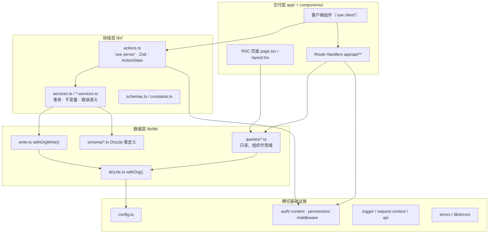
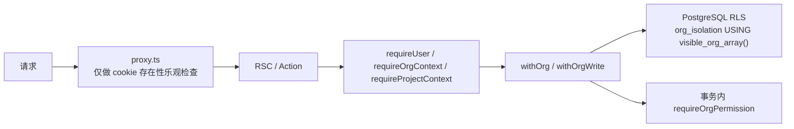
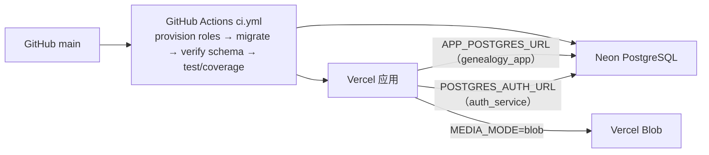

# 02 · 整体架构

## 1. 架构风格

云谱是**模块化单体（Modular Monolith）**：

- 一个 Next.js 16 应用同时提供页面、Server Action、Route Handler；
- 一个 PostgreSQL 承载全部业务域，没有微服务、消息队列、后台任务或独立缓存；
- 模块边界由**目录 + 依赖方向规则 + 数据库 RLS**共同保证，而不是进程边界。

设计目标不是「可拆分」，而是「在单体内让每个域有清晰的写入口、读入口与安全边界」。

## 2. 分层模型



### 2.1 各层职责

| 层 | 目录 | 允许做的事 | 禁止做的事 |
| --- | --- | --- | --- |
| 交付层 | `app/`、`components/` | 渲染、表单、交互、调用 Action | 直接 import ORM / 数据库（客户端组件硬性禁止） |
| Action 层 | `lib/*/actions.ts` | 鉴权包装、Zod 校验、调用 service、映射错误、`revalidateWholeConsole()` | 写 SQL、拼装展示数据 |
| Service 层 | `lib/*/services.ts` | 事务、不变量校验、行锁、复合写入、返回领域错误 | 读取 cookie / session、返回 JSX |
| 查询层 | `lib/db/queries/*.ts` | 只读 SQL、投影、组织作用域过滤 | 依赖 Action、写数据 |
| 连接层 | `lib/db/drizzle.ts`、`write.ts` | 连接池、`SET LOCAL`、事务、权限复核 | 业务规则 |
| 横切 | `lib/auth`、`lib/config`、`lib/logger`、`lib/api` | 会话、权限矩阵、配置、日志 | 领域逻辑 |

依赖方向由 `biome.json` 的 `noRestrictedImports` 强制（见 [11-dependencies.md](11-dependencies.md)）。

## 3. Server Action 统一契约

所有写操作返回 `ActionState<T>`（`lib/auth/types.ts`）：

```ts
export type ActionState<T = undefined> = {
  error?: string;        // 面向用户的中文提示
  code?: string;         // 稳定的机器码：UNAUTHORIZED / FORBIDDEN / NOT_FOUND / ...
  success?: string;
  fieldErrors?: Record<string, string>;
  data?: T;              // 成功时的结构化载荷（如保存时间、回显页）
  // 便捷 ID 字段：orgId / orgSlug / projectId / projectRef / lineageId / nodeId ...
};
```

典型 Action 的固定节奏：

1. `validatedActionWithUser(schema, formData, handler)`（`lib/auth/middleware.ts`）读取会话并做 Zod 校验；
2. 继续做业务级权限判断（`hasPermission` / `withOrgWrite` 内部复核）；
3. 调用 service，拿到 `T | { ok: false; reason: ... }`；
4. 用 `actionError(code, message)` 映射为 `ActionState`；
5. 结构性变更后调用 `revalidateWholeConsole()`。

错误码定义在 `lib/errors.ts`：`UNAUTHORIZED | FORBIDDEN | NOT_FOUND | CONFLICT | VALIDATION | RATE_LIMITED | INTERNAL`。

## 4. 读路径：RSC + 查询层

页面是 React Server Component，直接调用查询函数：

```tsx
// app/(dashboard)/dashboard/org/[orgSlug]/layout.tsx（示意）
const context = await requireOrgContext(orgSlug);
const projects = await getProjects(context.user.id, context.organization.id);
```

- `requireOrgContext` / `requireProjectContext` 同时完成**解析公开 ID → 校验成员身份 → 取 scope**，失败时 `redirect()` 或 `notFound()`。
- 查询函数内部统一通过 `withOrg(userId, tx => ...)` 执行，RLS 依据 `app.user_id` 过滤可见组织。
- RSC 结果通过 `QueryProvider` 的 `initialData` 注入 TanStack Query，客户端后续可用 `useConsoleOrgs()` / `useConsoleProjects()` 复用。

```mermaid
sequenceDiagram
  participant B as Browser
  participant R as RSC page.tsx
  participant C as requireProjectContext
  participant Q as getXxx(userId, ...)
  participant D as withOrg()
  participant P as PostgreSQL
  B->>R: GET /dashboard/project/:ref/lineages
  R->>C: 解析 projectRef
  C->>P: 查询成员与项目 scope（RLS）
  C-->>R: { user, organization, project }
  R->>Q: 读取谱系列表
  Q->>D: withOrg(userId)
  D->>P: SET LOCAL role genealogy_app; set_config('app.user_id')
  P-->>Q: 仅返回可见行
  Q-->>R: 数据
  R-->>B: HTML + RSC payload
```

## 5. 写路径：Action → Service → 事务

```mermaid
sequenceDiagram
  participant C as Client Component
  participant A as Server Action
  participant M as validatedActionWithUser
  participant W as withOrgWrite()
  participant S as Service
  participant P as PostgreSQL
  C->>A: formData / 参数
  A->>M: 读取 session + Zod 校验
  M-->>A: userId + 已校验数据
  A->>W: userId, orgId, permission
  W->>P: BEGIN; SET LOCAL role genealogy_app; set_config('app.user_id')
  W->>W: requireOrgPermission(tx, ...) 事务内复核
  W->>S: tx + 领域参数
  S->>P: 行锁 / 不变量检查 / 复合写入
  P-->>S: 结果
  S-->>A: T 或 { ok:false, reason }
  A->>A: revalidateWholeConsole()
  A-->>C: ActionState
```

关键点：

- **权限复核在事务内**（`requireOrgPermission`），避免「页面校验通过后角色被改」的窗口；
- `withOrgWrite` 返回 `{ ok: false, reason: 'forbidden' }` 而不是抛异常，保持 `ActionState` 契约；
- 每个写入入口都先锁作用域行（如谱系 `SELECT ... FOR UPDATE`），避免并发分配冲突；
- 事务提交后再失效缓存。

## 6. 缓存与失效

- 所有 RSC 路由都是动态渲染（`ƒ Dynamic`），没有预渲染 HTML。
- 写操作统一调用 `revalidateWholeConsole()` → `revalidatePath('/dashboard', 'layout')`，失效整个控制台。
- **例外**：谱文页级保存、加页、删页、重排**不失效**，否则服务端快照会在用户编辑期间被推回编辑器，覆盖本地输入（详见 [07-article-media.md](07-article-media.md)）。
- 当前不做按子树收窄：Action 入参只有 UUID，缺少 `orgSlug/projectRef`；这是已知后续任务。

## 7. 安全边界



四层防线：

1. `proxy.ts`：对 `/dashboard` 做 cookie 存在性判断，**不做真实身份校验**（避免边缘运行时依赖）；
2. `getSessionUser` / `require*Context`：服务端读取真实 session，校验 org/project 成员身份；
3. `withOrg()`：切换数据库角色并注入 `app.user_id`，使 RLS 生效；
4. `requireOrgPermission`：在同一事务内按权限矩阵二次判断。

数据库角色隔离：

- `genealogy_app`：业务 DML + `app` schema EXECUTE，**无 auth schema 访问权**；
- `auth_service` / `auth_runtime`：仅认证链路使用，凭据表无 RLS，因此必须与业务连接分离。

## 8. 错误处理

| 场景 | 机制 |
| --- | --- |
| 表单校验失败 | Zod → `fieldErrors` + `code: 'VALIDATION'` |
| 未登录 | `UNAUTHORIZED`，页面层 `redirect('/sign-in')` |
| 无权限 | Action 返回 `FORBIDDEN`；RSC 直接 `notFound()` 隐藏资源存在性 |
| 资源不存在 | `NOT_FOUND` / `notFound()` |
| 唯一约束冲突 | `isUniqueViolation()` → `CONFLICT` |
| 外键 / 子表引用 | `isForeignKeyViolationOf()` → 友好文案（如项目删除） |
| 数据库 RAISE EXCEPTION | `isRaisedException(error, 'last_owner' \| 'org_archived')` → 专用文案 |
| Route Handler 未捕获异常 | `withApiLogging` 返回 JSON 500 + `x-request-id`，不泄漏堆栈 |
| 页面渲染异常 | `app/error.tsx` / `app/global-error.tsx` + `RouteError` |

## 9. 部署形态



- 应用：Vercel（Fluid Compute），Next.js 16；
- 数据库：Neon PostgreSQL 18；
- 图片：生产 `@vercel/blob`，本地 fs；
- 迁移：`drizzle-kit migrate` + 自定义脚本校验（`verify-target-schema`、`verify-deployment`）；
- 迁移前必须先 `provision-roles` 创建数据库角色，否则 RLS / 权限校验失败（CI 与 `migrate-production.yml` 均按此顺序）。
