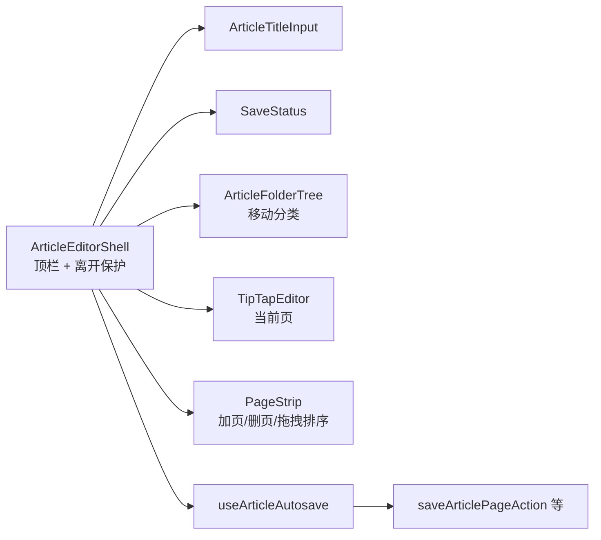
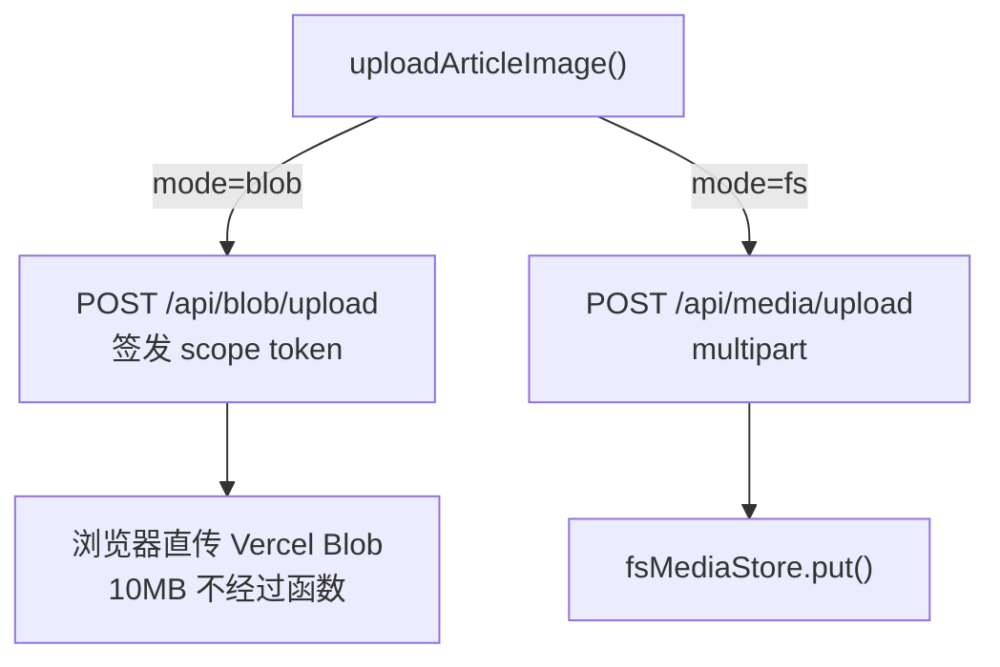
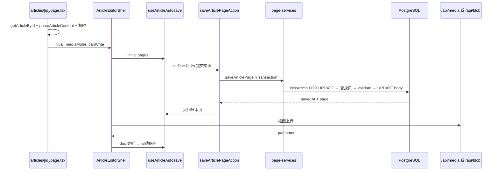

# 07 · 谱文与媒体

谱文域提供「分页富文本 + 私有图片」的编辑能力。核心设计：`article.body` 是一个**自描述的分页文档包**，每页是一份 TipTap/ProseMirror JSON；保存以**页**为单位，服务端只替换该页。

## 1. 文档模型

### 1.1 序列化结构

[`lib/article/doc.ts`](../../lib/article/doc.ts)：

```ts
type ArticlePageDoc = { type: 'doc'; content?: ArticleNode[] };

type ArticlePage = { id: string; doc: ArticlePageDoc };

type ArticleContent = {
  schemaVersion: 1;       // ARTICLE_SCHEMA_VERSION
  pages: ArticlePage[];   // 至少 1 页，最多 100 页
};
```

- `serializeArticleContent(content)` → `JSON.stringify`
- `parseArticleContent(value)` → 容错解析：非法输入回退为空文档包，**保证读取永不抛错**
- `normalizePageDoc(value)` → 空文档补形（ProseMirror 空文档不带 `content`）
- `createEmptyPageDoc()` / `newArticlePageId()` / `createEmptyArticleContent()`

### 1.2 白名单（服务端权威）

[`lib/article/schemas.ts`](../../lib/article/schemas.ts) 只允许以下节点：

| 类别 | 允许 |
| --- | --- |
| 块级 | `doc`、`paragraph`、`heading(level 1\|2)`、`articleImage`、`bulletList`、`orderedList`、`listItem` |
| 行内 | `text` |
| marks | `textStyle(fontFamily/fontSize)`、`bold`、`italic`、`underline` |

明确禁止：表格、引用、代码块、链接、删除线、分隔线、硬换行、**嵌套列表**（列表项内只允许段落/标题/图片）。

整篇校验（`articleContentSchema(scope)`）：

1. `schemaVersion` 必须为 1；
2. 页数 1–100；
3. 页 id 唯一；
4. 每页图片 ≤ 6；
5. 图片 `pathname` 必须以 `articles/<orgId>/<articleId>/` 开头（防止跨谱文/跨组织引用）。

### 1.3 上限常量

[`lib/article/constants.ts`](../../lib/article/constants.ts)：

| 常量 | 值 |
| --- | --- |
| `MAX_PAGES_PER_ARTICLE` | 100 |
| `MAX_IMAGES_PER_PAGE` | 6 |
| `MAX_IMAGE_BYTES` | 10 MiB |
| `ARTICLE_IMAGE_CONTENT_TYPES` | jpeg / png / webp |
| `ARTICLE_IMAGE_WIDTHS` | small / medium / full（默认 full） |
| `ARTICLE_FONT_FAMILIES` | SimSun / SimHei / KaiTi |
| `ARTICLE_FONT_SIZES` | 14px / 16px / 19px |
| `ARTICLE_TEXT_ALIGNMENTS` | left / center / right |
| `ARTICLE_TITLE_MAX_LENGTH` | 60 |

错误码与中文文案集中在 `ARTICLE_ERRORS`，例如 `page_not_found`：「这一页已被删除，你的文字仍保留在本地，请刷新后重新添加一页」。

## 2. 服务层

### 2.1 谱文结构操作

[`lib/article/services.ts`](../../lib/article/services.ts)：

```ts
createArticleInTransaction({ userId, orgId, projectId, title, folderId })
updateArticleTitleInTransaction({ userId, orgId, articleId, title })
moveArticleInTransaction({ userId, orgId, articleId, folderId })
deleteArticleInTransaction({ userId, orgId, articleId })
```

- 创建：`article.write`；校验 project 属于 org；`folderId` 为空时 `ensureDefaultFolderInTx()`（`lib/folder/services.ts`，与谱系侧共用）在同一事务找/建「默认分类」；初始化一页空文档；
- 改标题 / 移动分类：更新后 `revalidateWholeConsole()`；
- 删除：
  1. 若被 `book_catalog` 引用 → `catalog_referenced`；
  2. 读取正文提取图片 `pathname`；
  3. 删行后尽力删除图片字节（失败只记日志，不回滚）。

### 2.2 页级操作

[`lib/article/page-services.ts`](../../lib/article/page-services.ts)：

```ts
saveArticlePageInTransaction({ userId, orgId, articleId, pageId, doc })
addArticlePageInTransaction({ userId, orgId, articleId })
deleteArticlePageInTransaction({ userId, orgId, articleId, pageId })
reorderArticlePagesInTransaction({ userId, orgId, articleId, pageIds })
```

共同模式：

1. `withOrgWrite(..., 'article.write', tx => ...)`；
2. `lockArticle(tx, orgId, articleId)` → `SELECT body FROM article WHERE id = ... FOR UPDATE`；
3. 解析当前 `ArticleContent`；
4. 执行页级变更；
5. 整篇 `validateContent()`；
6. 写回 `body`。

关键不变量：

| 操作 | 约束 |
| --- | --- |
| 保存页 | 页必须仍存在（否则 `page_not_found`，不凭空造页）；`doc` 形状不符 → `invalid_doc`；只替换该页，其他页保持服务端现状 |
| 加页 | 页数 < 100；新页 id 由服务端生成；`savedAt` 不返回（不触发整篇回显） |
| 删页 | 不能删最后一页；返回该页独有且其他页不再引用的图片 `pathnames`，由 Action 提交后清字节 |
| 重排 | `pageIds` 必须与当前页集合**完全一致**（长度、去重、成员）；否则拒绝，让客户端按服务端页序重来 |

### 2.3 并发语义

- 同一篇谱文的并发只会在**同一页**内「后写覆盖先写」；
- 不同页并行编辑互不影响；
- 行锁保证读-改-写原子性，不会出现两页同时写导致整篇 JSON 丢页。

## 3. Action 层

[`lib/article/actions.ts`](../../lib/article/actions.ts)（全部 `validatedActionWithUserObject`）：

| Action | 入参 schema | 缓存失效 |
| --- | --- | --- |
| `createArticleAction` | `createArticleSchema` | 整棵控制台 |
| `updateArticleTitleAction` | `updateArticleTitleSchema` | 整棵控制台 |
| `moveArticleAction` | `moveArticleSchema` | 整棵控制台 |
| `deleteArticleAction` | `deleteArticleSchema` | 整棵控制台 |
| `saveArticlePageAction` | `saveArticlePageSchema` | **不失效** |
| `addArticlePageAction` | `addArticlePageSchema` | **不失效** |
| `deleteArticlePageAction` | `deleteArticlePageSchema` | **不失效** |
| `reorderArticlePagesAction` | `reorderArticlePagesSchema` | **不失效** |
| `getArticleDeletePreviewAction` | `previewArticleSchema` | 只读 |
| `getFolderDeletePreviewAction` | `previewFolderSchema` | 只读 |

**为什么不失效**：页级保存若触发 `revalidatePath`，RSC 会下发服务端快照；而客户端此时可能已有更新的未保存输入，快照回灌会覆盖用户内容。结构操作（新建/改名/移动/删除）不涉及编辑器内联内容，才安全失效。

## 4. 自动保存

### 4.1 状态机（纯函数）

[`lib/article/save-state.ts`](../../lib/article/save-state.ts)：

```ts
type PageSaveStatus = 'clean' | 'dirty' | 'saving' | 'saved' | 'error';
type TopBarStatus = 'idle' | 'dirty' | 'saving' | 'error' | 'saved';
```

不变量：**只要还有任何一页是 `dirty` / `saving` / `error`，顶栏绝不显示「已保存」**。

关键函数：

| 函数 | 作用 |
| --- | --- |
| `createSaveState(pageIds, previous?)` | 重建页状态；加删页时保留在途状态 |
| `setPageStatus` | 状态迁移（未跟踪页忽略） |
| `markSaved` | 记录最后一次成功保存时间（取较大值） |
| `pendingPageIds` | `dirty` / `error`（重试队列） |
| `inFlightPageIds` | `saving` |
| `hasUnsettled` | `dirty` / `saving` / `error` —— 离开门禁 |
| `topBarStatus` / `topBarText` | 优先级：saving > error > dirty > saved > idle |

### 4.2 接线 Hook

[`hooks/use-article-autosave.ts`](../../hooks/use-article-autosave.ts)：

| 参数 / 行为 | 值 |
| --- | --- |
| 自动保存防抖 | 2000 ms（按页独立计时） |
| 单次保存超时 | 3000 ms（超时只改状态，不取消请求） |
| `saveNow` 最大补轮 | 3 轮 |
| 请求去重 | `inFlight: Map<pageId, Promise>`，同页不并发 |
| 回显 | 只用 `data.page` 覆盖本页；若请求期间用户又改过（`docsRef` 不等），保持 `dirty` |
| 结构操作 | 加页/删页/重排前先 `saveNow()` |
| 重排失败 | 回滚本地页序，保证屏幕顺序 = 数据库顺序 |

返回 `ArticleWorkspaceState`：`pageIds / currentPageId / docOf / setDoc / addPage / removePage / movePage / saveNow / saveCurrentPage / state / status / statusText / hasPending / inFlightCount / notice`。

### 4.3 离开保护

`ArticleEditorShell`：

- 应用内跳转（返回、分类树）：`await saveNow()` 成功才 `router.push`，失败停留并提示；
- 浏览器关闭/刷新：`beforeunload` 拦截（只能确认，无法等待异步保存）；
- 查看者（`canWrite=false`）不触发保存。

## 5. 编辑器

### 5.1 TipTap 扩展

[`components/article/editor/tiptap-editor.tsx`](../../components/article/editor/tiptap-editor.tsx)：

| 扩展 | 配置 |
| --- | --- |
| `StarterKit` | `heading: [1,2]`；保留 B/I/U、单级列表；关闭 `strike/code/codeBlock/blockquote/link/horizontalRule/hardBreak`；`listKeymap: false` 禁嵌套 |
| `articleTextAlign` | paragraph / heading(1\|2) 的 `textAlign` |
| `articleTextStyle` | `textStyle` mark 容器 |
| `articleFontFamily` / `articleFontSize` | 字体、字号白名单 |
| `articleImage` | 自定义图片节点，保存 `pathname / width`，渲染走 `mediaUrl(pathname)` |

- `immediatelyRender: false`，避免 SSR 水合不一致；
- 空文档在 `onUpdate` 中 `normalizePageDoc()` 补形；
- 粘贴先过 `sanitizePasteHtml()`（三级标题降级、剥颜色/外链图、压平嵌套列表）；
- 查看者不渲染工具栏（不是禁用后仍可见）。

### 5.2 工具栏

`components/article/editor/toolbar.tsx` + `toolbar-primitives.tsx`：标题、加粗/斜体/下划线、列表、对齐、字体、字号、插图、撤销/重做。所有按钮使用 `onMouseDown preventDefault` 保持选区。

### 5.3 页面结构



## 6. 媒体（图片）

### 6.1 pathname 规则

```text
articles/<organizationId>/<articleId>/<uuid>.<ext>
```

[`lib/article/media/path.ts`](../../lib/article/media/path.ts)：

| 函数 | 作用 |
| --- | --- |
| `parseMediaPathname(input)` | 严格四段校验：根前缀、两个 UUID、文件名 `[A-Za-z0-9][A-Za-z0-9._-]{0,127}` |
| `buildMediaPathname(orgId, articleId, filename)` | 拼接 |
| `mediaFilenameFor(uuid, contentType)` | 扩展名映射 |
| `contentTypeForMediaPathname(pathname)` | 反查 MIME |
| `sniffImageContentType(bytes)` | **魔数嗅探**：PNG / JPEG / WebP，忽略客户端声明的 MIME |
| `mediaUrl(pathname)` | 生成 `/api/media/<逐段编码>`，浏览器永远拿不到存储直链 |

### 6.2 存储抽象

[`lib/article/media/store.ts`](../../lib/article/media/store.ts)：

```ts
interface MediaStore {
  mode: 'fs' | 'blob';
  read(pathname): Promise<{ bytes, contentType } | null>;
  delete(pathname): Promise<void>;
  readRedirect(pathname): Promise<string | null>; // Blob 签名 URL；fs 返回 null
}
```

`getMediaStore()` 按 `BLOB_READ_WRITE_TOKEN` 自动选择：

- 有 token → `blobMediaStore`（Vercel Blob 私有桶）；
- 否则 → `fsMediaStore`（`.media/` 本地目录，开发用）。

### 6.3 上传通道



**Blob 模式**（`app/api/blob/upload/route.ts`）：

1. 非 blob 模式 → 404；
2. 未登录 → 401；
3. `handleUpload` 的 `onBeforeGenerateToken` 中：
   - `parseMediaPathname` 校验形状；
   - `getOrgRole` + `hasPermission('article.write')`；
   - `getArticleScope` 校验谱文属于该组织/用户可见；
   - 返回允许类型、10MB 上限、`addRandomSuffix: false`；
4. 任何拒绝都返回 404（防止探测谱文是否存在）。

**FS 模式**（`app/api/media/upload/route.ts`）：

- 非 fs 模式 → 404；
- 读取 multipart → 大小校验 → 魔数嗅探；
- pathname 形状校验 → 权限/谱文 scope 校验；
- 写本地文件，返回 `{ pathname, size, contentType }`。

### 6.4 读取代理

`app/api/media/[...key]/route.ts`：

1. 未登录 / 形状非法 / 非成员 / 谱文不存在 → 统一 404；
2. 先 `readRedirect()`：Blob 模式返回 302 到短命签名 URL（`Cache-Control: no-store`）；
3. 否则 `read()` 读字节，返回 `Content-Type` + `X-Content-Type-Options: nosniff`。

这样「删除谱文后新请求取不到图片」由谱文行存在性天然保证；删字节失败也不会泄漏访问。

## 7. 端到端：打开 → 编辑 → 保存 → 插图



## 8. 文件速查

| 文件 | 职责 |
| --- | --- |
| `lib/article/constants.ts` | 上限、白名单、错误文案 |
| `lib/article/schemas.ts` | 文档/页/Action 入参 Zod |
| `lib/article/doc.ts` | 序列化、解析、空文档、归一化 |
| `lib/article/doc-view.ts` | 纯文本、图片计数、引用判断、图片属性遍历 |
| `lib/article/mutations.ts` | 锁行、文件夹解析、内容校验、图片路径提取 |
| `lib/article/services.ts` | 谱文结构 CRUD |
| `lib/article/page-services.ts` | 页保存/加页/删页/重排 |
| `lib/article/actions.ts` | 10 个 Server Action |
| `lib/article/save-state.ts` | 保存状态机纯函数 |
| `hooks/use-article-autosave.ts` | 自动保存接线 |
| `lib/article/media/*` | pathname、存储抽象、fs/blob 驱动、token |
| `components/article/*` | 列表、编辑器、页条、分类树、工具栏 |
