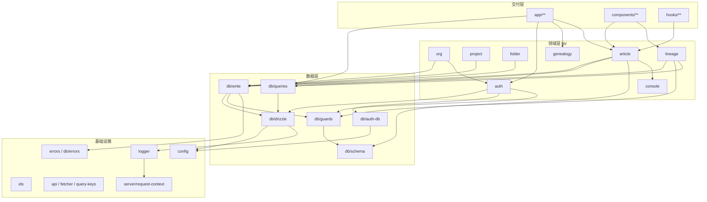

# 11 · 依赖关系

## 1. 模块依赖总图



## 2. 依赖方向规则（Biome `noRestrictedImports`）

这些不是文档约定，而是 `pnpm check` 会失败的硬规则。

| 作用范围 | 禁止 import | 原因 |
| --- | --- | --- |
| `components/**`、`hooks/**` | `drizzle-orm`、`@/lib/db/drizzle`、`@/lib/db/auth-db`、`@/lib/db/schema`、`@/lib/db/schema/*` | 客户端组件不得直接依赖 ORM / 数据库（含按域拆分的 schema 子路径） |
| `lib/db/**` | `next/*` | 基础设施层不得依赖 Next 运行时（F1′），保证可测试、可迁移 |
| `lib/db/queries/**` | `@/lib/*/actions` | 查询层不得反向依赖 Action 层 |
| 除 `lib/article/**`、`components/article/editor/**` 外的所有 TS/TSX | `@tiptap/**`、`prosemirror-*` | 编辑器依赖必须有明确消费者（ADR 0010），避免包体膨胀 |

此外 `server-only` 包用于在服务端模块顶部标记：

```ts
import 'server-only';
```

一旦被客户端组件误 import，构建期即报错。

## 3. 领域间依赖

| 上游 | 下游 | 方式 |
| --- | --- | --- |
| `org` | `auth` | `validatedActionWithUser`、`hasPermission`、`getOrgRole` |
| `org` | `db/auth-db` | 补 `auth.user.name/email` |
| `project` / `folder` / `lineage` / `article` | `db/write` | `withOrgWrite` |
| `lineage` | `db/queries/nodes`、`genealogy/schemas` | 节点读取与表单校验 |
| `article` | `db/queries/articles`、`console/revalidate` | 读取与失效 |
| `article` | `article/media` | 图片存储抽象 |
| `app` 页面 | `db/queries/*`、`auth/context` | 首屏读取 |
| `components/lineage` | 无 `lib/lineage` | **只通过 props / Server Action 交互**，不 import 服务端模块 |
| `components/article` | `lib/article/constants`、`lib/article/doc`、`lib/article/save-state`、`lib/article/schemas` | 纯函数与常量可共享；Action 通过 `'use server'` 文件引用 |

**禁止的双向依赖**：

- `lib/db/queries` ↛ `lib/*/actions`（Biome 强制）；
- `lib/db` ↛ `next/*`（Biome 强制）；
- 客户端组件 ↛ `lib/db/**`（Biome 强制）。

## 4. 三方依赖清单

### 4.1 运行时（dependencies）

| 包 | 版本 | 用途 | 主要消费者 |
| --- | --- | --- | --- |
| `next` | 16.4.3 | 应用框架 | 全局 |
| `react` / `react-dom` | 19.3.1 | UI 运行时 | 全局 |
| `@tanstack/react-query` | ^5.104.5 | 客户端缓存 | `components/query-provider.tsx`、console picker |
| `zustand` | 5.0.16 | 画布视图状态 | `components/lineage/lineage-store.ts` |
| `@xyflow/react` | ^12.12.0 | 谱系画布 | `components/lineage/canvas/**` |
| `@tiptap/core` / `react` / `pm` / `starter-kit` / `extension-image` / `extension-text-style` | ^3.32.2 | 谱文编辑器 | `components/article/editor/**` |
| `drizzle-orm` | ^0.45.4 | ORM | `lib/db/**` |
| `postgres` | 3.4.9 | 本地/CI 驱动 | `lib/db/drizzle.ts` |
| `pg` | ^8.23.1 | Vercel 连接池 | `lib/db/drizzle.ts` |
| `better-auth` | 1.7.12 | 认证 | `lib/auth/**` |
| `@vercel/blob` | ^2.8.2 | 图片对象存储 | `lib/article/media/blob-store.ts`、`app/api/blob/upload` |
| `@vercel/functions` | 3.10.3 | `attachDatabasePool` | `lib/db/drizzle.ts` |
| `zod` | 4.6.7 | 边界校验 | `lib/*/schemas.ts`、`lib/config.ts` |
| `radix-ui` | 1.8.1 | 无样式原语 | `components/ui/**` |
| `class-variance-authority` / `clsx` / `tailwind-merge` | 0.7.1 / 2.1.1 / 3.7.0 | className 组合 | `components/ui/**` |
| `lucide-react` | 1.61.0 | 图标 | 全部 UI |
| `next-themes` | ^0.4.6 | 明暗主题 | `components/theme-provider.tsx` |
| `tailwindcss` / `@tailwindcss/postcss` / `postcss` | 4.3.3 / 4.3.3 / 8.5.31 | 样式管线 | 全局 |
| `tw-animate-css` | 1.4.0 | 动画工具类 | 全局样式 |
| `server-only` | ^0.0.1 | 服务端边界标记 | `lib/db/**`、服务端模块 |

### 4.2 开发（devDependencies）

| 包 | 版本 | 用途 |
| --- | --- | --- |
| `typescript` | 7.0.2 | 类型检查 |
| `@biomejs/biome` | 2.6.3 | lint + format + import 规则 |
| `vitest` / `@vitest/coverage-v8` | 5.0.5 | 单测/集成/覆盖率 |
| `vite` | 8.3.5 | Vitest 底座 |
| `@playwright/test` | 1.64.1 | E2E |
| `drizzle-kit` | ^0.31.11 | 迁移生成/应用/Studio |
| `dotenv` | 18.0.9 | CLI 脚本加载 `.env` |
| `@types/node` / `@types/react` / `@types/react-dom` / `@types/pg` | 24.19.2 / 19.3.0 / 19.3.0 / ^8.23.1 | 类型 |

## 5. 依赖引入原则

来自 `docs/` 的约束与 Biome 规则：

1. **依赖必须有消费者**：不为「以后可能用」引入包；TiPTap 的例外范围通过 overrides 精确限定。
2. **客户端不碰数据库**：任何数据都通过查询层（RSC）或 Action（客户端）获得。
3. **基础设施不依赖框架**：`lib/db` 保持纯 Node + SQL，便于测试与迁移。
4. **安全相关依赖集中在少量模块**：`better-auth` 只出现在 `lib/auth`、`app/api/auth` 相关路径；`@vercel/blob` 只出现在媒体模块。
5. **版本锁定**：核心框架、认证、DB 驱动使用精确版本；工具链允许 `^`。

## 6. 升级影响面

| 升级 | 影响 | 验证 |
| --- | --- | --- |
| Next.js 16 → 17 | RSC / Server Action / `proxy.ts` 语义 | E2E + `pnpm build` |
| React 19 → 20 | RSC、`useActionState` | 单测 + 页面冒烟 |
| Drizzle 0.45 → 0.5x | 事务/查询 API | 集成测试 + `drizzle-kit generate` 漂移检查 |
| Better Auth 1.7 → 2.x | adapter、session、cookie | 登录/注册/邀请 E2E |
| TipTap 3.32 → 3.4x | 扩展 API、schema | 谱文保存/回显 E2E |
| PG 18 → 19 | `23001` 等 SQLSTATE、RLS 行为 | `verify:target-schema` |
