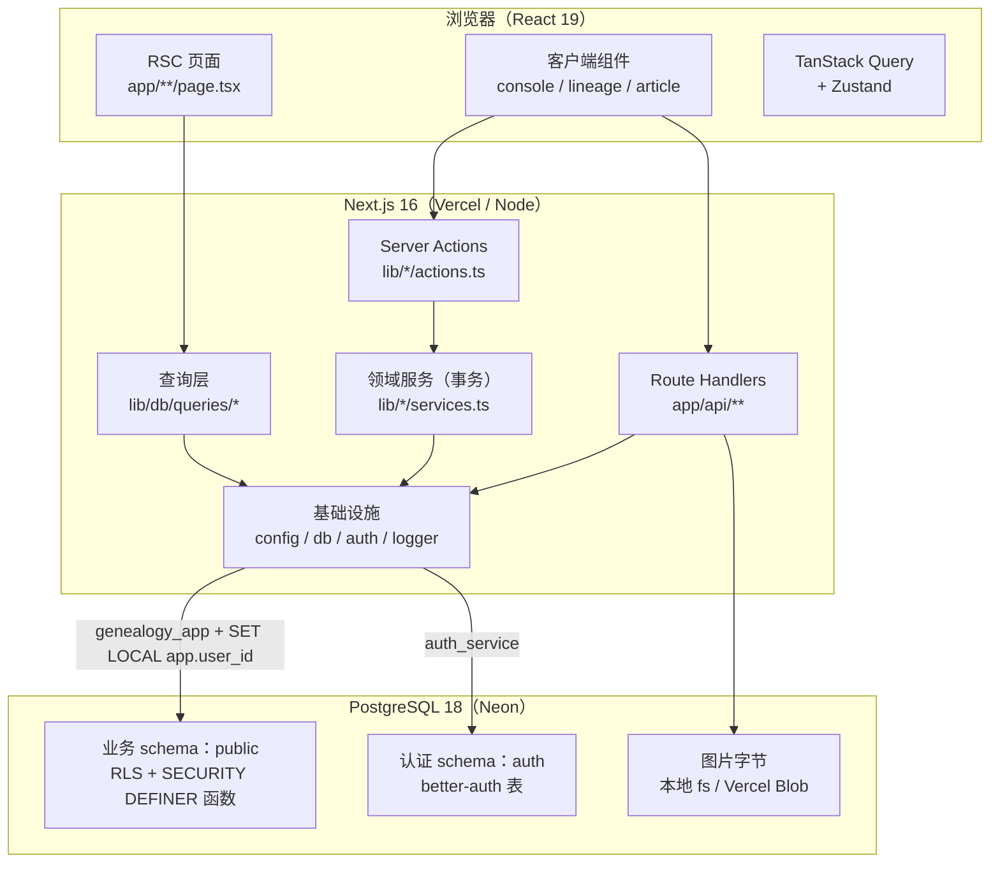

# 云谱（gramps）Code Wiki

本 Wiki 基于仓库 [`bobo522487/gramps`](https://github.com/bobo522487/gramps) 的 `main` 分支快照生成：

- Commit：`89d5103c6e39a6dc41da599121079eecf4d17f0d`
- 时间：2026-11-09
- 代码根目录：`/workspace/gramps`

云谱是一套面向**家族修谱场景**的在线谱牒编纂平台：组织（家族 / 修谱工作室）在云端建立「云谱空间」，录入世系、撰写谱文、编排谱书目录。工程形态是**模块化单体** —— 单个 Next.js 16 应用同时承载 RSC 页面、Server Action 写入口与只读 Route Handler，所有业务域共用一个 PostgreSQL。

> 阅读提示：本 Wiki 是面向开发者的代码导览，聚焦「代码在哪里、如何协作、如何运行」。产品意图与路线图以仓库 `docs/vision.md`、`docs/roadmap.md` 为准。

---

## 文档索引

| 文档 | 内容 | 适合谁 |
| --- | --- | --- |
| [01-overview.md](01-overview.md) | 产品定位、用户、M1 范围、术语表、技术栈 | 所有人，第一份 |
| [02-architecture.md](02-architecture.md) | 整体架构、分层规则、请求生命周期、部署形态 | 架构评审、新人 |
| [03-directory-structure.md](03-directory-structure.md) | 目录树与每个目录的职责 | 查找代码 |
| [04-data-model.md](04-data-model.md) | 数据表、关系、ltree、RLS、SQL 函数 | 改表 / 排查数据 |
| [05-auth-org-project.md](05-auth-org-project.md) | 认证、会话、RBAC、组织/邀请/云谱空间/分类 | 账号与权限需求 |
| [06-lineage.md](06-lineage.md) | 谱系、人丁事实层、路径算法、画布前端 | 谱系功能开发 |
| [07-article-media.md](07-article-media.md) | 谱文分页文档、自动保存、TipTap、图片媒体 | 谱文功能开发 |
| [08-routes-and-actions.md](08-routes-and-actions.md) | 页面路由、Route Handler、Server Action 全目录 | 接口对接 |
| [09-infrastructure.md](09-infrastructure.md) | 配置、双数据库连接、日志、错误、缓存、限流 | 平台 / 运维 |
| [10-development.md](10-development.md) | 环境搭建、命令、测试分层、CI、部署 | 第一次跑起来 |
| [11-dependencies.md](11-dependencies.md) | 模块依赖图、依赖方向约束、三方包清单 | 重构 / 升级 |
| [12-code-index.md](12-code-index.md) | 关键类、函数、组件速查索引 | 日常查阅 |

---

## 架构一图流

核心闭环：

1. **读**：RSC 直接调用 `lib/db/queries/*`，在同一组织作用域事务中由 RLS 过滤。
2. **写**：客户端调用 Server Action → Zod 校验 → `withOrgWrite()` 开启事务并二次鉴权 → 领域 service 写入 → `revalidateConsole()` 失效快照。
3. **二进制**：图片经 Route Handler 上传/读取，元数据（`pathname`）存于谱文 JSON。

---

## 按任务阅读路线

| 我要做的事 | 建议阅读顺序 |
| --- | --- |
| 第一次加入 | 01 → 02 → 03 → 10 |
| 新增一个页面 / Action | 02 → 08 → 09 → 11 |
| 改数据表 / 迁移 | 04 → 09 → 10（迁移与校验章节） |
| 开发谱系功能 | 04 → 06 → 08 |
| 开发谱文 / 图片 | 04 → 07 → 08 |
| 排查权限问题 | 05 → 09（事务与 RLS）→ 04（RLS 策略） |
| 部署 / 值班 | 09 → 10 |

---

## 文档约定

- **层级名词**与源码一致：`organization`（组织）、`project`（云谱空间）、`folder`（分类）、`lineage`（谱系）、`node`（人丁位置）、`person`（人物事实）、`article`（谱文）、`book`（谱书）。
- 文中路径均相对于仓库根目录。
- 函数签名以源码为准；示意签名省略了泛型细节，精确签名请跳转对应文件。
- 「未实现 / 明确不做」会显式标注，避免把路线图当成现状。
