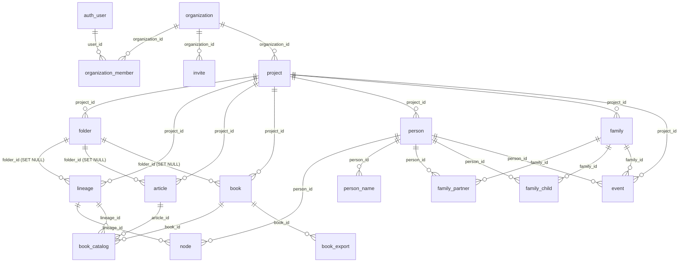
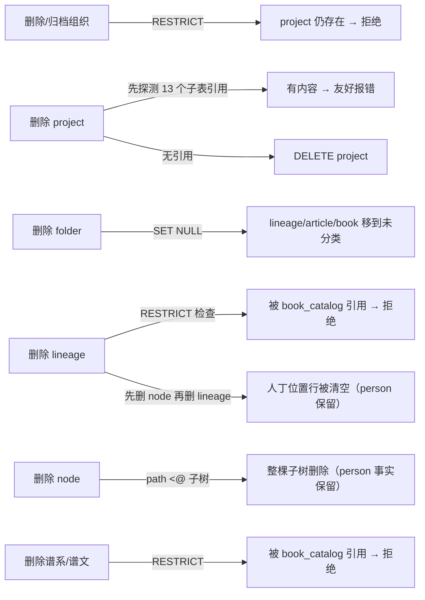

# 数据模型（Data Model）

> **回答什么问题**：有哪些实体、怎么分层、哪些不变量由数据库保证、删除会发生什么。
> **读者**：开发 · 技术负责人 · AI Agent　**长度上限**：6 页
> **不写什么**：逐列 DDL（`lib/db/schema/` 与迁移是唯一真相源）、接口与 DTO（`docs/api.md`、`docs/contracts/`）、性能阈值（`docs/nfr.md`）、操作步骤（`docs/runbooks/`）。裁决顺序见 `CONTRIBUTING.md` §2「权威口径」。

数据层的唯一基线是 [`lib/db/migrations/0000_target_schema.sql`](../lib/db/migrations/0000_target_schema.sql)，Drizzle 表定义位于 `lib/db/schema/`。目标态**没有软删列**，删除语义统一为 `ON DELETE RESTRICT`（例外：`organization_member.user_id` 级联、`folder_id` 置空、`created_by` 置空）。

## 1. 实体分层



三个层次：

1. **租户层**：`auth.user` → `organization` → `organization_member` / `invite`；
2. **工程层**：`project`（云谱空间）+ `folder`（单层分类），是谱系/谱文/谱书的共同 scope；
3. **内容层**：
   - 谱系：`person` / `person_name` / `family` / `family_partner` / `family_child` / `event` / `lineage` / `node`；
   - 谱文：`article`（正文 JSON 存在 `body`）；
   - 谱书：`book` / `book_catalog`（ltree 编目树）/ `book_export`。

## 2. 关键表

### 2.1 租户

| 表 | 主键 | 关键列 | 约束 |
| --- | --- | --- | --- |
| `organization` | `id uuid` | `slug text`（公开 20 位 ID，默认 `generate_public_id()`）、`name`、`status`（active/suspended/closed）、`created_by` | `uk_organization_slug` 唯一；`ck_organization_status` |
| `organization_member` | `(organization_id, user_id)` | `role`（owner/admin/editor/viewer） | 每组织仅一个 owner 的部分唯一索引；`ck_org_member_role`；`user_id` 外键 `ON DELETE CASCADE` |
| `invite` | `id uuid` | `email`、`role`、`token_hash`（sha256，唯一）、`status`（pending/accepted/revoked）、`expires_at`、`accepted_at`、`invited_by` | `token_hash` 存哈希不存明文；`status`/`accepted_at` 双蕴含检查 |

### 2.2 工程与分类

| 表 | 主键 | 关键列 | 约束 |
| --- | --- | --- | --- |
| `project` | `(organization_id, id)` + 全局唯一 `id` | `ref`（20 位公开 ID）、`name`、`theme_name`（创建后服务层不再更新）、`surname`、`countries_regions`、`hall_code`、`status`（planning/in_progress/completed）、`importance` 1–5、`allow_consanguineous_marriage`、`notes`、`description` | `uk_project_ref`；`ck_project_status`；`ck_project_importance` |
| `folder` | `(project_id, id)` | `name`、`seq` | 扁平单层；`(project_id, name)` 唯一；scope 外键指向 `project(organization_id, id)` |

### 2.3 人物与关系事实

所有内容表都以 `(project_id, id)` 为主键，并通过复合外键保证「同一项目内」的引用完整性；同时冗余 `organization_id` 供 RLS 直接过滤。

| 表 | 关键列 | 约束 |
| --- | --- | --- |
| `person` | `sex`（male/female/unknown/other） | `ck_person_sex` |
| `person_name` | `person_id`、`kind`（given/courtesy/art/milk/genealogy/posthumous/other）、`value`、`is_primary` | `(project_id, person_id, kind, value)` 唯一；每人仅一个 primary 的部分唯一索引；非空值检查 |
| `family` | — | 婚姻单元 |
| `family_partner` | `family_id`、`person_id`、`role`（husband/wife/concubine/partner/unknown）、`role_label`、`rank` | `(project_id, family_id, person_id)` 唯一；`(…, role)` 唯一；`(…, role, rank)` 唯一；rank > 0 |
| `family_child` | `family_id`、`person_id`、`kind`（biological/adopted/step/foster/ritual_heir/unknown）、`mother_person_id`、`mother_role`、`origin_family_id`、`birth_order`、`birth_order_label` | `(project_id, family_id, person_id)` 唯一；母亲字段成对出现；继养来源家庭必须与当前家庭不同；外键均 RESTRICT |
| `event` | `kind`（birth/death/burial/marriage/divorce/adoption/heir_transfer/migration/office/exam/other）、`person_id`、`family_id`、`date_text`、`date_sort`、`place_text`、`summary` | `person_id` / `family_id` 恰有一个；birth/death 每人最多一条；`date_sort` 必须有 `date_text` 且形如 `YYYY[-MM[-DD]]` |

### 2.4 谱系与节点

| 表 | 关键列 | 约束 |
| --- | --- | --- |
| `lineage` | `folder_id`、`name`、`description`、`poem_text`（字辈诗）、`base_generation`（默认 1）、`seq` | `lineage_name_unique (project_id, name)`；名称非空、`base_generation > 0`、`seq >= 0` |
| `node` | `lineage_id`、`person_id`、`path ltree`、`parent_path ltree`（生成列）、`kind`（primary/annotation/…）、`display_name` | `node_path_format`：`^[0-9]{4}([.][0-9]{4})*$`；`node_path_unique (project_id, lineage_id, path)`；`node_one_primary`：每 lineage 每 person 仅一个 primary；`node_parent_fk` 自引用复合外键；GiST 索引 `node_path_gist` |

`parent_path` 定义（生成列，永不写入）：

```sql
case when nlevel(path) > 1
     then subpath(path, 0, nlevel(path) - 1)
end
```

`kind = 'annotation'` 与 `person_id IS NULL` 互为充要条件（`node_annotation_person` 检查）。

### 2.5 谱文与谱书

| 表 | 关键列 | 约束 |
| --- | --- | --- |
| `article` | `folder_id`、`title`、`kind`（默认 other）、`body text`、`author_text`、`date_text`、`subject_person_id`、`lineage_id` | `folder_id` 删除时 `SET NULL`；`subject_person_id` / `lineage_id` RESTRICT；`body` 不是 jsonb，而是序列化后的分页 JSON 字符串 |
| `book` | `folder_id`、`title`、`edition_text`、`compiler_text` | 暂无写入口 |
| `book_catalog` | `book_id`、`path ltree`、`parent_path`、`title`、`article_id`、`lineage_id` | ltree 编目树；引用谱文/谱系 |
| `book_export` | `book_id`、`exported_at`、`fact_cutoff`、`artifact_uri`、`checksum`、`format` | 导出快照，暂无写入口 |

## 3. ltree 与世次

- 路径每段固定 4 位数字，段间以 `.` 分隔，例如 `0010.0020.0010`。
- 兄弟节点分配采用**稀疏步长 10**：`max(trailing segment) + 10`，为中间插入留空间。
- **世次不落库，读时派生**：查询层 `generation = nlevel(path)`；展示层如需字辈偏移则 `nlevel(path) + base_generation - 1`。`base_generation` 默认 1，两者此时相等。公式只在这里定义，其他文档引用本节，不复制。
- 子树判定：`path <@ ancestor_path`。
- 兄弟排序：路径文本序即为显示序。
- `node_parent_fk` 指向 `(project_id, lineage_id, path)`，因此父节点必须存在；由于约束不可延迟，**整棵子树移动无法在一个事务内先改父再改子**，这是移动暂未实现的根因。

## 4. 公开 ID 与内部 ID

| 类型 | 生成方式 | 用途 |
| --- | --- | --- |
| 内部主键 | `uuidv7()`（时间有序 UUID） | 外键、事务、索引 |
| 组织 slug | `public.generate_public_id()`：20 位字母数字 | URL `/dashboard/org/:slug` |
| 项目 ref | `public.generate_public_id()` | URL `/dashboard/project/:ref` |
| 邀请 token | 32 字节随机 → sha256 入库 | 邀请链接，明文只出现一次 |

公开 ID 由数据库生成，应用层不自行拼装；`lib/ids.ts` 提供应用侧生成能力（如非数据库场景）。

## 5. RLS 与数据库角色

### 5.1 角色

| 角色 | 权限 | 连接 |
| --- | --- | --- |
| `genealogy_app` | public schema DML + `app` schema 函数 EXECUTE；**无 auth schema 权限** | 业务连接（`APP_POSTGRES_URL`） |
| `auth_service` / `auth_runtime` | auth schema 读写 | 认证连接（`AUTH_POSTGRES_URL`） |
| DDL 角色（迁移用） | 建表/策略/函数，需 `GRANT ... ON auth.user` | 仅迁移脚本 |

### 5.2 策略

- 基线用 `DO` 块遍历 16 张业务表：`ENABLE ROW LEVEL SECURITY` + `CREATE POLICY org_isolation FOR ALL USING (...) WITH CHECK (...)`。
- 所有业务表都**冗余存储 `organization_id`**（不只靠 `project_id` 反查），因此统一谓词是：

```sql
organization_id = ANY (coalesce((SELECT app.visible_org_array()), '{}'::uuid[]))
```

`app.visible_org_array()` 必须写成子查询（InitPlan）而不是裸函数调用，否则逐行求值；`'{}'::uuid[]` 保证 GUC 未设置时 fail-closed。

- `organization` 表自身把谓词里的 `organization_id` 替换为 `id`；
- 不再需要多级 join 才能判断租户，RLS 可走单列索引；
- `app.visible_org_array()` 读取 GUC `app.user_id`：

```sql
nullif(current_setting('app.user_id', true), '')::text
```

因此应用必须在**同一事务**内：

```sql
SET LOCAL role genealogy_app;
SELECT set_config('app.user_id', $1, true);
```

这正是 `lib/db/drizzle.ts` 的 `withOrg(userId, fn)` 所做的工作。`SET LOCAL` 防止连接池复用时串租户。

### 5.3 关键函数

| 函数 | 作用 |
| --- | --- |
| `app.current_user_id()` | 读取 `app.user_id` GUC |
| `app.visible_org_array()` | 当前用户可见组织数组，RLS 谓词核心 |
| `app.create_organization(text)` | 创建组织 + owner 成员行（事务内，`created_by` 取 GUC） |
| `app.rename_organization(uuid, text)` | 重命名并校验权限 |
| `app.archive_organization(uuid)` | 归档组织 |
| `app.organization_join_state(uuid)` | 返回加入状态（可加入 / 已是成员 / 已归档等） |
| `app.organization_is_open(uuid)` | 组织是否可加入 |
| `app.invite_join_preview(text)` | 邀请链接预览（未登录可读的最小信息） |
| `app.accept_invite(text)` | 接受邀请：校验 token、过期、邮箱、成员关系，写成员 |
| `app.remove_org_member(uuid, text)` | 移除成员，禁止移除最后一个 owner |
| `app.set_org_member_role(uuid, text, text)` | 改角色，禁止降级最后一个 owner |
| `app.forbid_tenant_move()` | 触发器：禁止把行移动到其他租户/项目 |
| `public.handle_new_user()` | `auth.user` 插入后创建个人组织（`trg_auth_user_created`） |
| `public.generate_public_id()` | 生成 20 位公开 ID |

`archive_organization`、`remove_org_member`、`set_org_member_role` 会以 `RAISE EXCEPTION` 抛出语义化名称（如 `org_archived`、`last_owner`），应用层用 `isRaisedException()` 映射为中文文案。

## 6. 删除语义



| 操作 | 结果 |
| --- | --- |
| 删 `project` | `lib/project/services.ts` 先探测 13 张子表；有内容返回 `not_empty`，不发出会失败的 `DELETE`，避免数据库外键错误直接暴露给用户 |
| 删 `folder` | `lineage / article / book` 的 `folder_id` 置空（未分类），内容不删 |
| 删 `lineage` | 先删全部 `node` 再删谱系，返回删除的节点数；被 `book_catalog` 引用时拒绝 |
| 删 `node` | `path <@ target.path` 整棵子树；`person` 事实行保留 |
| 删 `article` | 被 `book_catalog` 引用时拒绝；提交后尽力删除图片字节 |

三个实测坑：

1. `ON DELETE RESTRICT` 违约的 SQLSTATE 是 **`23001`**，不是 `23503`（后者是 `NO ACTION` / 插入类外键）。
2. postgres.js 会记住事务内第一条失败 query，并在 COMMIT 重抛，**即使 JS 已 catch**；所以 `deleteProject` 必须先探查再删。
3. `ON DELETE SET NULL` 的复合外键必须带列清单，否则会把 `project_id` 一起置空并报 `23502`。

## 7. 索引要点

| 索引 | 表 | 用途 |
| --- | --- | --- |
| `uk_organization_slug` | organization | 公开 slug 寻址 |
| `uk_project_ref` | project | 公开 ref 寻址 |
| `uk_org_member_single_owner`（部分） | organization_member | 每组织一个 owner |
| `node_path_unique` | node | 路径唯一 |
| `node_one_primary`（部分） | node | 每人一个主节点 |
| `node_path_gist` | node | 子树 / 祖先查询 |
| `lineage_folder_idx` / `lineage_order_idx` | lineage | 分类筛选与排序 |
| `article_folder_idx` | article | 分类筛选 |
| `person_name_one_primary`（部分） | person_name | 每人一个主名 |

## 8. 约束要有执行者

- `scripts/verify-target-schema.mjs` 会在独立测试库重建目标态并比对 **DDL / 约束 / RLS / TS 与 SQL 列一致性 / EXPLAIN**；
- `npm run verify:deploy` 在部署后校验角色、schema、关键函数是否存在；
- 新增表必须同时满足：TS schema、SQL 迁移、`ENABLE RLS`、`org_isolation` 策略、`genealogy_app` 授权（基线注释明确要求）；
- 日常入口是 `pnpm verify:target-schema` / `pnpm verify:deploy`；性能数字见 [nfr.md](nfr.md)。

## 9. 硬不变量

| 不变量 | 兑现机制 |
| --- | --- |
| 跨组织不可见 | 单一 RLS 谓词 + GUC 未设置时 fail-closed |
| 行归属与项目一致 / 跨项目引用不存在 | 复合外键 + `project.id` 全局 `UNIQUE (id)` |
| 事件主体恰好一个且类型匹配 | `CHECK (num_nonnulls(person_id, family_id) = 1)` + kind 约束 |
| 同一世系 / 同一书内位置唯一、路径格式合法 | 非延迟 `(project_id, …, path)` UNIQUE + 格式 CHECK |
| 世次不漂移、树不成环 | `nlevel(path)` 派生 + ltree 类型 |
| 路径集合闭合（无孤儿） | `parent_path` 生成列 + 自引用复合外键 |
| 每人最多一条生、一条卒事件 | 两个部分唯一索引 |
| 租户键不可搬移 | 16 条 `trg_*_tenant_immutable` 触发器 + `app.forbid_tenant_move()` |
| 注册必建个人组织 | `trg_auth_user_created` → `public.handle_new_user()` |

## 10. 触发器例外

全库用户定义触发器 2 类共 17 条（全是完整性守卫，不含业务逻辑）、定时任务 0、视图 0。声明式约束在 PostgreSQL 里表达不出、又必须与写入同事务的，只剩这两类：

| 触发器 | 为什么不能用约束或策略表达 | 为什么不能放应用层 |
| --- | --- | --- |
| `trg_<table>_tenant_immutable`（16 张组织作用域表，共用 `app.forbid_tenant_move()`） | RLS 的 `USING` 只看 OLD 行、`WITH CHECK` 只看 NEW 行，任何策略组合都无法比较两行；跨组织用户执行 `update ... set organization_id = <他组织>` 时两半各自成立，行就被搬走 | 应用层没有「所有 UPDATE 都会经过」的单一入口，Server Action、SECDEF 函数、测试工厂都写库，漏一处就是一个洞 |
| `trg_auth_user_created`（`AFTER INSERT ON auth.user` → `public.handle_new_user()`） | 无约束能表达「插入 auth.user 时同时插入 organization + organization_member」 | Better Auth 的 `databaseHooks.user.create.after` 走 `queueAfterTransactionHook`，在事务提交后才执行；钩子失败会留下「有账号、无组织」的半截状态 |
