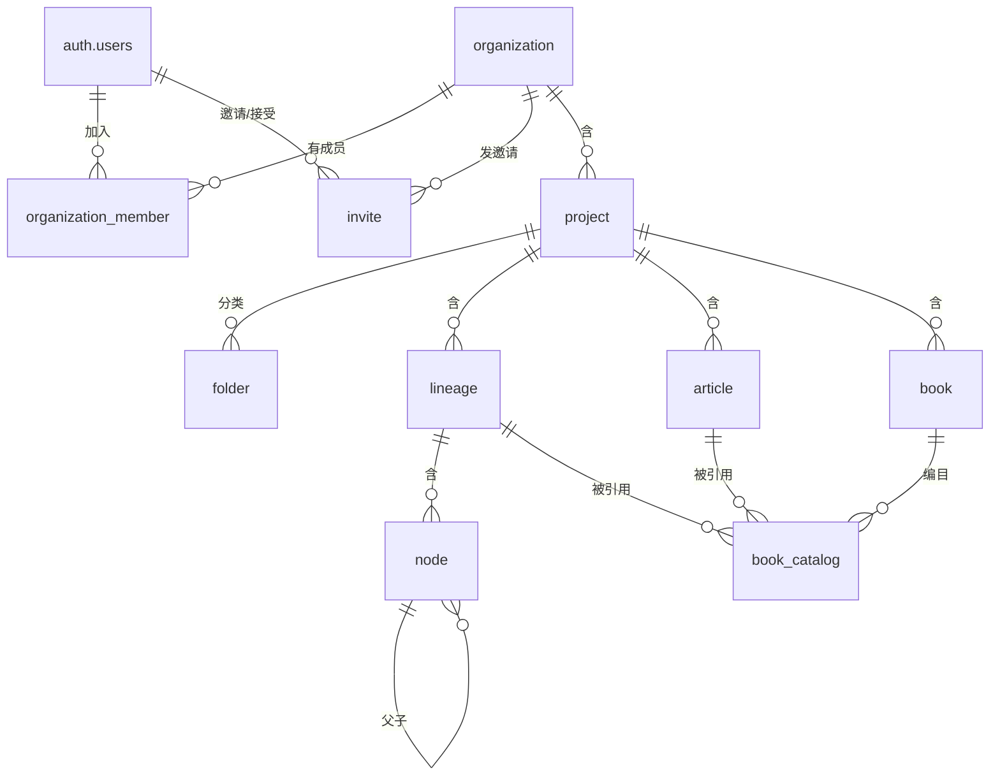

# 数据模型

| 项 | 值 |
|---|---|
| 文档版本 | 1.6 |
| 最后更新 | 2026-10-23 |
| 数据库 | Neon PostgreSQL 18+（生产）/ Docker PostgreSQL 18+（本地） |
| 驱动 | 本地 `postgres.js`；生产 `pg` + `attachDatabasePool` |
| 部署 | Vercel + 自定义域名 + Neon；本地 Docker 只跑 PostgreSQL + `next dev` |
| 字符集 / 时区 | UTF-8 / 所有时间列 `timestamptz` |
| 表数量 | 11 张组织级业务表（10 张业务表 + `activity_logs`）+ 4 张 `auth.*` 表 |
| 相关文档 | [架构](./architecture/00-overview.md) · [PRD](./prd.md) · [接口](./api.md) · [部署](./ops-target.md) · [实现状态](./implementation-status.md) |

---

## 1. 约定

### 1.1 命名

| 对象 | 规则 | 示例 |
|---|---|---|
| 表 | 单数、`snake_case`、不加前缀 | `lineage`、`book_catalog` |
| 列 | `snake_case` | `organization_id`、`node_count` |
| 主键 | 恒为 `id` | `id` |
| 外键 | `<被引用表单数>_id` | `lineage_id`、`book_id` |
| 布尔 | `is_` / `has_` 前缀 | `is_alive`、`hide` |
| 时间 | `<动作>_at` | `created_at`、`deleted_at` |
| 索引 | `idx_<表>_<列>` / `uk_<表>_<语义>` | `idx_node_lineage`、`uk_project_ref` |
| 约束 | `ck_<表>_<语义>` | `ck_node_sex` |

**禁止**：大小写混用、拼音命名、`tbl_` 前缀、复数表名。

### 1.2 主键

全表使用 `uuid`，**UUIDv7 由数据库原生生成**（时间有序，索引友好）：

```sql
id uuid PRIMARY KEY DEFAULT uuidv7()
```

`uuidv7()` 是 PostgreSQL 18 内置函数，不再依赖应用层生成或随机 UUID。部署前置为 PostgreSQL 18+；迁移前先执行 `SELECT uuidv7();` 自检。

10 张业务表、`activity_logs` 与 4 张 `auth.*` 表的主键都使用上面的默认值。

### 1.3 公共列

**8 张软删业务实体表**（organization/project/folder/lineage/node/article/book/book_catalog）统一包含：

| 列 | 类型 | 说明 |
|---|---|---|
| `organization_id` | `uuid NOT NULL` | 隔离键，**每张业务实体表必须有** |
| `created_at` | `timestamptz NOT NULL DEFAULT now()` | |
| `created_by` | `uuid NOT NULL` | 创建人，不设外键（用户可能被删除） |
| `updated_at` | `timestamptz` | 首次写入为 `NULL` |
| `deleted_at` | `timestamptz` | 软删除标记，见 §11 |

`auth.*` 位于独立 schema，不使用上述公共列，只保留 Better Auth 所需字段（§4.1）。`organization_member` 与 `invite` 是硬删除，不含软删列；`activity_logs` 是产品活动流，不含 `deleted_at`，账号级事件 `organization_id` 为空。

M1 **没有乐观锁列**。并发写入是 last-write-wins，见 PRD §5.5 与 §6.3 缺口 3。

### 1.4 类型选择

| 场景 | 用 | 不用 | 理由 |
|---|---|---|---|
| 枚举 | `text` + `CHECK` | PG `enum` | 加值要 `ALTER TYPE`，且 Drizzle 支持弱 |
| 短整型枚举 | `smallint` + `CHECK` | `int` | 语义明确、省空间 |
| 结构化配置 | `jsonb` | `json` | 可索引 |
| 富文本 | `jsonb`（ProseMirror） | `text` HTML | 结构可校验、可迁移 |
| 树路径 | `ltree` | `text` 逗号分隔 | 原生祖先/后代查询 |

---

## 2. 实体关系



### 2.1 层级与隔离

```
auth.*                            ← Better Auth 表，独立 auth schema，不参与组织隔离
organization                      ← 隔离边界（RLS 生效范围）
├── organization_member           ← 成员关系，RLS 的根
├── invite
├── activity_logs                 ← 产品活动流；账号级事件 org 为空
└── project                       ← 云谱空间（组织内分组，不独立隔离）
    ├── folder
    ├── lineage ── node
    ├── article
    └── book ── book_catalog
```

**只有 `organization` 是隔离边界。** `project` 是分组，没有独立的权限或 RLS 策略。

### 2.2 表归属

| # | 表 | 中文 | 所属模块 |
|---|---|---|---|
| 1 | `organization` | 组织 | `organization` |
| 2 | `organization_member` | 组织成员 | `organization` |
| 3 | `invite` | 邀请 | `organization` |
| 4 | `project` | 云谱空间 | `project` |
| 5 | `folder` | 分类 | `project` |
| 6 | `lineage` | 谱系 | `lineage` |
| 7 | `node` | 人丁 | `lineage` |
| 8 | `article` | 谱文 | `content` |
| 9 | `book` | 谱书 | `publishing` |
| 10 | `book_catalog` | 编目 | `publishing` |
| 11 | `activity_logs` | 产品活动流 | `organization` |

每张表有且只有一个 owner 域。跨域读取调用 owner 域导出的查询函数，不直接 join 别人的表。

上表是 **10 张业务表**；加上 `activity_logs` 共 **11 张组织级业务表**。另有 4 张 `auth.*` 表，位于独立的 `auth` schema，由 Better Auth 管理，不属于业务表计数，也不参与组织的三层隔离。

**M2 会增加的表**：`share_link`（分享）、`delete_batch`（回收站批次）、`resource_lock`（编辑锁）、`media`（媒体）。**M3** 增加 `edition`（排版版本）。M1 不建，避免空表。

---

## 3. 组织域

### 3.1 organization

```sql
-- 20 位公开 ID：取 UUIDv4 的 32 位 hex 前 20 位（约 80 bit 随机）
CREATE FUNCTION public.generate_public_id() RETURNS text
LANGUAGE sql VOLATILE AS $$
  SELECT substr(replace(gen_random_uuid()::text, '-', ''), 1, 20);
$$;

CREATE TABLE organization (
  id         uuid PRIMARY KEY DEFAULT uuidv7(),
  slug       text NOT NULL DEFAULT public.generate_public_id(),
  name       text NOT NULL,
  logo       text,
  metadata   text,
  status     text NOT NULL DEFAULT 'active'
             CHECK (status IN ('active','suspended','closed')),
  created_at timestamptz NOT NULL DEFAULT now(),
  updated_at timestamptz NOT NULL DEFAULT now(),
  deleted_at timestamptz
);

CREATE UNIQUE INDEX uk_organization_slug ON organization (slug)
  WHERE deleted_at IS NULL;
```

| 列 | 说明 |
|---|---|
| `slug` | URL 第一段。20 位 `[0-9a-z]` 随机公开 ID（列默认值 `public.generate_public_id()`），全局唯一（部分索引，排除软删），**不可修改**。不是授权凭证；解析时必须同时按当前用户成员关系过滤 |
| `name` | 显示名。注册时默认取邮箱前缀 |
| `logo` | 组织图标 URL，Better Auth organization 插件字段；当前 UI 未使用 |
| `metadata` | Better Auth 组织元数据。适配器写入前 `JSON.stringify()`，只有字符串才解析回来，因此列类型是 `text` 而非 `jsonb` |
| `updated_at` | 由 Better Auth 组织更新写入；应用层不直接写该表 |
| `status` | `suspended` 时全部写操作拒绝（`ORG_SUSPENDED`），只读放行 |

`organization.slug` 与 `project.ref` 共用 `public.generate_public_id()`。函数返回 20 位 hex（`[0-9a-z]` 的子集），碰撞概率可忽略，由唯一索引兜底；客户端永远不传入公开 ID。`app_rw` 需要该函数的 `EXECUTE` 权限；默认 PUBLIC 权限即可，收紧权限时必须显式授予。

---

## 4. 身份域

### 4.1 auth.users / auth.session / auth.account / auth.verification

自托管 Better Auth 的表，位于独立 `auth` schema，不属于 10 张业务表。它们不参与组织隔离；业务运行时角色 `app_rw` 没有表权限，认证连接固定 `role=auth_service`。

```sql
CREATE TABLE auth.users (
  id             uuid PRIMARY KEY DEFAULT uuidv7(),
  email          text NOT NULL,
  name           text NOT NULL,
  email_verified boolean NOT NULL DEFAULT false,
  image          text,
  created_at     timestamptz NOT NULL DEFAULT now(),
  updated_at     timestamptz NOT NULL DEFAULT now()
);

CREATE UNIQUE INDEX uk_auth_users_email ON auth.users (lower(email));
```

| 表 | 说明 |
|---|---|
| `auth.users` | 账号、邮箱、显示名；邮箱唯一且只读（无验证、无改邮箱） |
| `auth.session` | 数据库会话；`expires_at` 7 天、`updateAge` 1 天；`active_organization_id` 记录当前组织 |
| `auth.account` | 登录凭据；邮箱密码账号的 `provider_id = 'credential'`，`password` 为 Better Auth 的 scrypt 哈希 |
| `auth.verification` | Better Auth 通用验证记录；M1 未启用邮箱验证与找回密码 |

**为什么叫 `users` 而不是 `user`**：`user` 是 PostgreSQL 保留字，未加引号无法作为表名。

**注意**：`auth.users` 没有 `deleted_at` 与 `token_version`。删除账号会真实删除用户并级联删除会话；撤销其他设备会话由 Better Auth 的 `revokeOtherSessions` 或删除 `auth.session` 完成。

### 4.2 organization_member（硬删除）

```sql
CREATE TABLE organization_member (
  id              uuid PRIMARY KEY DEFAULT uuidv7(),
  organization_id uuid NOT NULL REFERENCES organization(id) ON DELETE CASCADE,
  user_id         uuid NOT NULL REFERENCES auth.users(id) ON DELETE CASCADE,
  role            text NOT NULL CHECK (role IN ('owner','admin','editor','viewer')),
  created_at      timestamptz NOT NULL DEFAULT now()
);

CREATE UNIQUE INDEX uk_org_member_organization_user
  ON organization_member (organization_id, user_id);

CREATE UNIQUE INDEX uk_org_member_single_owner
  ON organization_member (organization_id)
  WHERE role = 'owner';

CREATE INDEX idx_org_member_user ON organization_member (user_id);
```

成员由 Better Auth organization 插件管理，使用**硬删除**：移除成员或离开组织会直接删行，不保留 `deleted_at`。重新邀请同一用户是新的成员行。`idx_org_member_user` 是**全库最热的索引**：每次请求的组织解析都要用它。`organization_member` 同时也是 RLS 策略的根，见 §12.4。

`trg_org_member_last_owner_delete` / `trg_org_member_last_owner_update` 在数据库层阻止删除或降级最后一个 owner。

### 4.3 invite（Better Auth invitation，硬删除）

```sql
CREATE TABLE invite (
  id              uuid PRIMARY KEY DEFAULT uuidv7(),
  organization_id uuid NOT NULL REFERENCES organization(id) ON DELETE CASCADE,
  email           text NOT NULL,
  role            text NOT NULL CHECK (role IN ('admin','editor','viewer')),
  status          text NOT NULL DEFAULT 'pending'
                    CHECK (status IN ('pending','accepted','rejected','canceled')),
  expires_at      timestamptz NOT NULL,
  created_at      timestamptz NOT NULL DEFAULT now(),
  inviter_id      uuid NOT NULL REFERENCES auth.users(id) ON DELETE CASCADE
);

CREATE UNIQUE INDEX uk_invite_pending_email
  ON invite (organization_id, lower(email))
  WHERE status = 'pending';

CREATE INDEX idx_invite_expiry ON invite (expires_at) WHERE status = 'pending';
```

| 列 | 说明 |
|---|---|
| `id` | 邀请 ID，直接出现在链接 `/sign-up?invite=<id>` 中；7 天过期、一次性 |
| `email` | 被邀请邮箱；同一组织同一邮箱在 pending 状态下唯一 |
| `status` | `pending` / `accepted` / `rejected` / `canceled`；重新邀请会取消旧的 pending |
| `inviter_id` | 邀请人；禁止邀请 `owner` |

邀请由 Better Auth organization 插件创建与接受；链接只在创建时返回一次，不发邮件。过期判断由 Better Auth 与查询共同完成。

### 4.4 注册触发器：默认组织

FR-ORG-1 要求「注册成功后就有默认组织」。实现方式是在 `auth.users` 插入后自动建组织；注册入口不直接写 `organization` / `organization_member`。

```sql
CREATE OR REPLACE FUNCTION public.handle_new_user()
RETURNS trigger
LANGUAGE plpgsql
SECURITY DEFINER
SET search_path = public, auth, pg_temp
AS $$
DECLARE
  v_org_id     uuid;
  v_local_part text;
BEGIN
  v_local_part := nullif(split_part(coalesce(new.email, ''), '@', 1), '');

  INSERT INTO organization (name)
  VALUES (coalesce(nullif(new.name, ''), v_local_part, '我的家族'))
  RETURNING id INTO v_org_id;

  INSERT INTO organization_member (organization_id, user_id, role)
  VALUES (v_org_id, new.id, 'owner');

  RETURN new;
END;
$$;

CREATE TRIGGER trg_auth_user_created
  AFTER INSERT ON auth.users
  FOR EACH ROW EXECUTE FUNCTION public.handle_new_user();
```

| 设计点 | 说明 |
|---|---|
| `SECURITY DEFINER` | 触发器需要写入 `organization` / `organization_member`，这两张表开了 `FORCE RLS`。函数 owner 是 `auth_service`，可绕过 RLS |
| `SET search_path = public, auth, pg_temp` | 防止 `search_path` 注入，SECURITY DEFINER 函数的强制要求 |
| `slug` 用 20 位随机公开 ID | 由列默认值 `public.generate_public_id()` 生成；约 80 bit 随机，唯一索引兜底碰撞；不可读但稳定 |
| `name` 取用户显示名或邮箱前缀 | 用户看到的是可读名称而不是随机 slug，降低困惑 |
| 主键默认值 | 组织的 `id` 与成员行的 `id` 都由 `DEFAULT uuidv7()` 生成，触发器不手写 ID |
| 同一事务 | 触发器在 `auth.users` 插入的同一事务内执行。组织建失败 → 注册失败，不会出现「有账号没组织」的半残状态 |
| 用户可改 | `name` 可由 owner 修改；`slug` 是 URL 标识，不可修改（FR-ORG-7） |

**为什么不在应用层做**：注册入口未来可能增加邀请接受、第三方登录回调等路径；把「有账号必有默认组织」放在触发器里，任何写入 `auth.users` 的路径都会自动满足，且不需要调用方记得多写两条 INSERT。

**M1 无验证邮件**：`auth.users` 插入后即可登录，不存在「等待确认」的中间状态，触发器只需处理账号与组织。

**测试要求**：注册后立即查询 `organization_member`，必须有且仅有 1 行 `role = 'owner'`。这条要在集成测试里断言。

---

## 5. 项目域

### 5.1 project

```sql
CREATE TABLE project (
  id                uuid PRIMARY KEY DEFAULT uuidv7(),
  organization_id   uuid NOT NULL REFERENCES organization(id) ON DELETE RESTRICT,
  ref               text NOT NULL DEFAULT public.generate_public_id(),
  name              text NOT NULL,
  surname           text,
  theme_name        text,
  countries_regions text,
  hall_code         text,
  status            text NOT NULL DEFAULT 'in_progress',
  importance        smallint NOT NULL DEFAULT 1,
  notes             text,
  created_at        timestamptz NOT NULL DEFAULT now(),
  created_by        uuid NOT NULL,
  updated_at        timestamptz,
  deleted_at        timestamptz,
  UNIQUE (organization_id, id),
  CHECK (status in ('planning', 'in_progress', 'completed')),
  CHECK (importance between 1 and 5)
);

CREATE UNIQUE INDEX uk_project_ref ON project (ref)
  WHERE deleted_at IS NULL;
CREATE INDEX idx_project_organization ON project (organization_id)
  WHERE deleted_at IS NULL;
```

| 列 | 说明 |
|---|---|
| `ref` | URL 第二段（`/dashboard/project/[projectRef]`）。20 位 `[0-9a-z]` 随机公开 ID，全局唯一、不可修改。展示用 `name`；目标模型不保存可读项目 slug |
| `name` | 项目名，创建时 ≤24 字符 |
| `surname` | 姓氏「陈」，创建后不可修改；历史行可空 |
| `theme_name` | 主题名「陈氏族谱」，创建后不可修改；历史行可空 |
| `status` | 项目状态：`planning`（筹备中）/ `in_progress`（进行中）/ `completed`（已完成） |
| `importance` | 重要等级 1–5，默认 1 |
| `notes` | 备注，可空 |
| `hall_code` | 郡望堂号「颍川堂」，仅在设置页维护 |

**M1 没有 `settings`**。版式配置（FR-PROJ-4）不在范围内，没有渲染就没有消费者。M2 加 `settings jsonb`，纯加法。

`UNIQUE (organization_id, id)` 是冗余约束，唯一作用是让子表能用复合外键 `(organization_id, project_id)`，从 schema 层杜绝跨组织引用。

### 5.2 folder

```sql
CREATE TABLE folder (
  id              uuid PRIMARY KEY DEFAULT uuidv7(),
  organization_id uuid NOT NULL,
  project_id      uuid NOT NULL,
  kind            smallint NOT NULL CHECK (kind IN (0,1,2)),
  parent_id       uuid,
  name            text NOT NULL,
  sort            int NOT NULL DEFAULT 0,
  created_at      timestamptz NOT NULL DEFAULT now(),
  created_by      uuid NOT NULL,
  deleted_at      timestamptz,
  FOREIGN KEY (organization_id, project_id) REFERENCES project (organization_id, id)
    ON DELETE RESTRICT
);

CREATE INDEX idx_folder_project ON folder (organization_id, project_id, kind)
  WHERE deleted_at IS NULL;
```

`kind`：`0`=谱系、`1`=谱文、`2`=谱书。一个 project 下三种分类树互相独立。

`parent_id` **不设外键**：分类树深度不超过 3 层，删除时由事务服务统一处理，加自引用外键会让删除顺序约束变复杂。这是已登记缺口（评审 P0-1）：跨 project 的父节点在 DB 层合法，不要声称 schema 层已完全阻断跨组织引用。

**删除分类不删内容**：子分类一并软删，直属内容置 `folder_id = NULL` 变成「未分类」。

---

## 6. 谱系域

### 6.1 lineage

```sql
CREATE TABLE lineage (
  id               uuid PRIMARY KEY DEFAULT uuidv7(),
  organization_id  uuid NOT NULL,
  project_id       uuid NOT NULL,
  folder_id        uuid,
  name             text NOT NULL,
  surname          text NOT NULL,
  hall_code        text,
  generation_words jsonb,
  region           text,
  notes            text,
  hang_rule        jsonb,
  node_count       int NOT NULL DEFAULT 0,
  created_at       timestamptz NOT NULL DEFAULT now(),
  created_by       uuid NOT NULL,
  updated_at       timestamptz,
  deleted_at       timestamptz,
  FOREIGN KEY (organization_id, project_id) REFERENCES project (organization_id, id)
    ON DELETE RESTRICT,
  UNIQUE (organization_id, id)
);

CREATE UNIQUE INDEX uk_lineage_name ON lineage (organization_id, project_id, name)
  WHERE deleted_at IS NULL;
CREATE INDEX idx_lineage_project ON lineage (organization_id, project_id)
  WHERE deleted_at IS NULL;
```

| 列 | 说明 |
|---|---|
| `generation_words` | 字辈，`["元","亨","利","贞"]` |
| `region` | 谱系地区，自由文本，≤100 字；可空（历史数据） |
| `notes` | 谱系备注，≤500 字；可空 |
| `hang_rule` | 世次编号规则 `{start, step, format}` |
| `node_count` | 人丁数冗余计数，供列表展示；不做任何限制判断 |

`node_count` 的一致性由 service 层维护：所有增删人丁的操作在同一事务内 `UPDATE lineage SET node_count = node_count ± n`。CI 有一条对账测试，比对 `node_count` 与真实 `COUNT(*)`。

### 6.2 node（人丁）

```sql
CREATE TABLE node (
  id              uuid PRIMARY KEY DEFAULT uuidv7(),
  organization_id uuid NOT NULL,
  lineage_id      uuid NOT NULL,

  -- 关系
  parent_id       uuid REFERENCES node(id) ON DELETE RESTRICT,
  mother_id       uuid REFERENCES node(id) ON DELETE RESTRICT,
  spouse_of_id    uuid REFERENCES node(id) ON DELETE RESTRICT,
  role            text NOT NULL DEFAULT 'blood' CHECK (role IN ('blood','spouse')),
  path            ltree,
  depth           int NOT NULL DEFAULT 0,
  generation      int NOT NULL,
  sort            int NOT NULL DEFAULT 0,

  -- 姓名
  name            text NOT NULL,
  surname         text NOT NULL,
  full_name       text NOT NULL,
  sex             smallint NOT NULL CHECK (sex IN (0,1)),
  courtesy        text,
  name_prefix     text,

  -- 生平
  is_alive        boolean NOT NULL DEFAULT true,
  birth_text      text,
  death_text      text,
  birth_year      int,
  death_year      int,
  burial_place    text,
  biography       text,
  attributes      jsonb NOT NULL DEFAULT '{}',

  created_at      timestamptz NOT NULL DEFAULT now(),
  created_by      uuid NOT NULL,
  updated_at      timestamptz,
  deleted_at      timestamptz,
  FOREIGN KEY (organization_id, lineage_id) REFERENCES lineage (organization_id, id)
    ON DELETE RESTRICT,
  UNIQUE (organization_id, id),
  CONSTRAINT ck_node_spouse_has_no_path CHECK (
    (role = 'spouse' AND path IS NULL AND spouse_of_id IS NOT NULL)
    OR (role = 'blood' AND path IS NOT NULL)
  )
);

CREATE INDEX idx_node_lineage_path  ON node USING gist (organization_id, lineage_id, path);
CREATE INDEX idx_node_lineage_depth ON node (organization_id, lineage_id, depth);
CREATE INDEX idx_node_parent        ON node (organization_id, parent_id);
-- no trigram index on node: person search matches in memory, see ADR 0011
CREATE INDEX idx_node_alive         ON node (organization_id, lineage_id)
  WHERE deleted_at IS NULL;
```

**`path` 与 `role` 的关系**是这张表最关键的约束：

| role | `path` | `spouse_of_id` | 含义 |
|---|---|---|---|
| `blood` | 非空 | `NULL` | 血亲，`path` 表达世代路径 |
| `spouse` | `NULL` | 非空 | 配偶，**不进血亲路径** |

配偶不参与 `path` 的原因：`ltree` 路径是单亲（父系）世代链，若配偶入路径，`path` 会分叉，祖先/后代查询退化成图遍历。配偶通过 `spouse_of_id` 挂在血亲节点上，渲染时与配偶节点并排显示。

`sex`：`0`=男、`1`=女。`attributes` 存自定义字段（`{"字":"子美"}`），不建 EAV 表。

**M1 没有 `avatar_media_id`**。媒体上传不在范围内。

**边约束的已知缺口**：`parent_id` / `mother_id` / `spouse_of_id` 目前只引用 `node(id)`，没有带 `(organization_id, lineage_id)` 的复合外键。复合外键覆盖的是 node→lineage 这一层，不是 node→node 的边。评审 P0-1 已给出补丁；在迁移落地前，不要把“三层防护”表述成“每条边都被 schema 完全约束”。

---

## 7. 内容域

### 7.1 article（谱文）

```sql
CREATE TABLE article (
  id              uuid PRIMARY KEY DEFAULT uuidv7(),
  organization_id uuid NOT NULL,
  project_id      uuid NOT NULL,
  folder_id       uuid,
  title           text NOT NULL,
  kind            text,
  content         jsonb NOT NULL,
  plain_text      text,
  created_at      timestamptz NOT NULL DEFAULT now(),
  created_by      uuid NOT NULL,
  updated_at      timestamptz,
  deleted_at      timestamptz,
  FOREIGN KEY (organization_id, project_id) REFERENCES project (organization_id, id)
    ON DELETE RESTRICT,
  UNIQUE (organization_id, id)
);

CREATE INDEX idx_article_project ON article (organization_id, project_id)
  WHERE deleted_at IS NULL;
CREATE INDEX idx_article_search ON article USING gin (plain_text gin_trgm_ops);
```

| 列 | 说明 |
|---|---|
| `content` | ProseMirror JSON，**不是 HTML**。渲染走统一序列化器 |
| `plain_text` | 从 `content` 提取的纯文本，只用于检索 |
| `kind` | 自由文本：像赞 / 谱序 / 凡例 / 传记 |

**M1 没有 `version`**。自动保存是 last-write-wins，两人同时编辑会互相覆盖。这是 PRD §6.3 缺口 3，M2 加编辑锁后解决。

---

## 8. 出版域

### 8.1 book（谱书）

```sql
CREATE TABLE book (
  id              uuid PRIMARY KEY DEFAULT uuidv7(),
  organization_id uuid NOT NULL,
  project_id      uuid NOT NULL,
  folder_id       uuid,
  name            text NOT NULL,
  title           text NOT NULL,
  surname         text NOT NULL,
  hall_code       text,
  volume_no       text,
  author          text,
  compiled_at     text,
  cover_spec      jsonb NOT NULL,
  back_cover_spec jsonb,
  sort            int NOT NULL DEFAULT 0,
  created_at      timestamptz NOT NULL DEFAULT now(),
  created_by      uuid NOT NULL,
  updated_at      timestamptz,
  deleted_at      timestamptz,
  FOREIGN KEY (organization_id, project_id) REFERENCES project (organization_id, id)
    ON DELETE RESTRICT,
  UNIQUE (organization_id, id)
);

CREATE UNIQUE INDEX uk_book_name ON book (organization_id, project_id, name)
  WHERE deleted_at IS NULL;
```

| 列 | 说明 |
|---|---|
| `cover_spec` | `{templateId, vars}`，**不是 HTML**。模板在代码里，数据只存变量 |
| `compiled_at` | 编撰时间，存原文（「乾隆三十年」），不强制日期格式 |

**谱书不存内容**。书的正文由 `book_catalog` 引用谱系和谱文构成，改一次谱系，多本书同时更新。M1 不渲染，但这个结构现在就建对。

### 8.2 book_catalog（编目）

```sql
CREATE TABLE book_catalog (
  id              uuid PRIMARY KEY DEFAULT uuidv7(),
  organization_id uuid NOT NULL,
  book_id         uuid NOT NULL REFERENCES book(id) ON DELETE CASCADE,
  parent_id       uuid REFERENCES book_catalog(id) ON DELETE CASCADE,
  name            text NOT NULL,
  section         smallint NOT NULL CHECK (section IN (1,2,3)),
  article_id      uuid,
  lineage_id      uuid,
  sort            int NOT NULL DEFAULT 0,
  hide            boolean NOT NULL DEFAULT false,
  created_at      timestamptz NOT NULL DEFAULT now(),
  created_by      uuid NOT NULL,
  deleted_at      timestamptz,
  FOREIGN KEY (organization_id, article_id) REFERENCES article (organization_id, id)
    ON DELETE RESTRICT,
  FOREIGN KEY (organization_id, lineage_id) REFERENCES lineage (organization_id, id)
    ON DELETE RESTRICT,
  CONSTRAINT ck_catalog_one_target CHECK (num_nonnulls(article_id, lineage_id) <= 1)
);

CREATE INDEX idx_catalog_book ON book_catalog (organization_id, book_id, sort)
  WHERE deleted_at IS NULL;
CREATE INDEX idx_catalog_article ON book_catalog (organization_id, article_id)
  WHERE article_id IS NOT NULL;
CREATE INDEX idx_catalog_lineage ON book_catalog (organization_id, lineage_id)
  WHERE lineage_id IS NOT NULL;
```

| 列 | 说明 |
|---|---|
| `section` | `1`=开篇、`2`=正文、`3`=附录 |
| `article_id` / `lineage_id` | 两个**可空真外键**，替代多态 `object_id` |

**为什么不用多态 `(target_type, target_id)`**：多态外键无法被数据库校验，删掉谱系后编目会留悬空引用。两个真外键 + `CHECK` 保证最多挂一个目标，`ON DELETE RESTRICT` 保证被引用的谱系/谱文不能删。

---

## 9. 审计与追溯

M1 **不建独立审计表**。写操作的可追溯性由三部分组成：

| 机制 | 提供什么 | 边界 |
|---|---|---|
| 结构化日志 | `request_id`、`organization_id`、`user_id`、动作与结果码 | 只用于运维排查，有保留期，不是业务查询接口 |
| 软删除 | `deleted_at` 保留整行，可按事务时间整组恢复 | 没有恢复 UI；恢复走运维工单（§11.3） |
| 备份 | Neon PITR + 逻辑备份 | 灾难恢复手段，不替代逐条追溯 |

**为什么去掉 `audit_event`**：它需要额外一张表、写入路径、权限收紧与查询界面；M1 的用户是小团队，误删有软删兜底，越权有 RLS 与集成测试。审计表带来的复杂度高于收益。若后续出现合规或纠纷追溯需求，再作为独立模块引入，不阻塞 M1。

**代价**：日志保留期外的「谁在什么时候改了什么」无法逐条回答；需要时只能从 PITR 或备份恢复到临时分支后比对。这条限制写入 PRD §6.3 缺口 6。

---

## 10. 关键索引（非穷举）

完整索引以 0000/0001 迁移为准。

| 表 | 索引 | 类型 | 服务的查询 |
|---|---|---|---|
| `auth.users` | `uk_auth_users_email` | 唯一（`lower(email)`） | 登录邮箱解析 |
| `auth.session` | `uk_auth_session_token` / `idx_auth_session_user` | 唯一 / B-tree | 会话查找与撤销 |
| `organization` | `uk_organization_slug` | 唯一部分 | URL 解析 |
| `invite` | `uk_invite_pending_email` | 唯一部分（pending） | 同一组织同一邮箱仅一个待处理邀请 |
| `organization_member` | `idx_org_member_user` | B-tree | **每次请求**的组织解析 |
| `organization_member` | `uk_org_member_organization_user` | 唯一 | 同一用户在同一组织只有一条成员行 |
| `organization_member` | `uk_org_member_single_owner` | 唯一部分 | 保证单 owner |
| `project` | `uk_project_ref` | 唯一部分 | URL 解析 |
| `folder` | `idx_folder_project` | B-tree（部分） | 分类树加载 |
| `lineage` | `uk_lineage_name` | 唯一部分 | 同名检查 |
| `node` | `idx_node_lineage_path` | **GiST** | 祖先 / 后代 / 子树 |
| `node` | `idx_node_lineage_depth` | B-tree | 按代加载（视口分段） |
| `node` | `idx_node_parent` | B-tree | 父节点查找 |
| `node` | `idx_node_alive` | B-tree（部分） | 未删除节点列表 |
| `node` | `idx_node_spouse_sort` | B-tree `(organization_id, spouse_of_id)`，部分（`deleted_at IS NULL`）（`0014`） | 配偶排序 `max(sort)` 查询，避免谱系内扫描 |
| `node` | ~~`idx_node_search`~~ | ~~GIN trgm~~ | **已删除**（`0013`）：人丁搜索在客户端全量匹配，见 [ADR 0011](./decisions/0011-search-boundary-node-client-article-trgm.md) |
| `article` | `idx_article_search` | **GIN trgm** | 全文检索（FR-ART-5） |
| `book` | `uk_book_name` | 唯一部分 | 同项目书名检查 |
| `book_catalog` | `idx_catalog_book` | B-tree | 编目树加载 |

### 10.1 检索

检索按表分成两条路，见 [ADR 0011](./decisions/0011-search-boundary-node-client-article-trgm.md)：

- **人丁（`node`）在客户端搜索**：`getNodes` 按谱系全量载入，`matchLineagePerson` 在内存里按姓名等字段做子串匹配（FR-LIN-11）。`node` 上**没有** trigram 索引；这是当前实现的事实，不是待办。
- **谱文（`article`）用 `pg_trgm` + GIN**：`idx_article_search`（FR-ART-5），不用 `to_tsvector`：

| 方案 | 中文支持 | 依赖 |
|---|---|---|
| `to_tsvector('simple', ...)` | 整句当一个 token，子串匹配失效 | 无 |
| `pg_trgm` + GIN | trigram 对中文子串可用 | 内置扩展 |
| 外部搜索引擎 | 好 | 多一个服务 |

数据量在十万级，`pg_trgm` 足够。触发条件：`node` 单表超 500 万行或搜索 p95 > 300ms，才考虑引入外部索引；单谱系人丁超约 5000 或 `getNodes` 全量载入不再可行时，先改 ADR 0011 再把服务端查询与索引一起加回。

---

## 11. 软删除

### 11.1 机制

业务实体表带 `deleted_at`，非空即已删除；`organization_member` 与 `invite` 由 Better Auth 管理，是硬删除。**业务实体不做物理删除。**

| 表类别 | 表 | 软删 |
|---|---|---|
| 8 张业务实体表 | `organization`、`project`、`folder`、`lineage`、`node`、`article`、`book`、`book_catalog` | ✅ 有 `deleted_at` |
| 关系/邀请表 | `organization_member`、`invite` | ❌ **硬删除**（由 Better Auth 管理） |
| 活动流 | `activity_logs` | ❌ 无 `deleted_at`；账号级事件 org 为空 |

`auth.*` 是独立 schema 的认证表，不属于 11 张组织级业务表（§4.1），没有软删。

`app_rw` 不授予 `DELETE` 权限；软删统一走 `UPDATE ... SET deleted_at = now()`。`organization_member` 与 `invite` 的删除由 `auth_service` 执行，是真实删除。

M1 **没有回收站界面**（PRD §6.2），但软删保留，原因是：软删是零成本的保险，硬删是不可逆的灾难。

| 场景 | 行为 |
|---|---|
| 用户删除人丁 | 节点及其全部子孙置 `deleted_at`，从界面消失 |
| 用户删除谱系 / 谱文 / 谱书 | 置 `deleted_at` |
| 恢复 | **无界面**。由运维按 §11.3 在数据库层面处理 |

### 11.2 唯一约束必须是部分索引

```sql
-- ❌ 软删后再建同名会撞唯一键
CREATE UNIQUE INDEX uk_book_name ON book (organization_id, project_id, name);

-- ✅ 只约束未删除的行
CREATE UNIQUE INDEX uk_book_name ON book (organization_id, project_id, name)
  WHERE deleted_at IS NULL;
```

每张有软删的表都要检查这一条。漏一个就会在「删了再建同名」时报 23505。

认证与邀请的当前唯一约束：

```sql
-- 邮箱全局唯一（账号删除是硬删除，无需部分索引）
CREATE UNIQUE INDEX uk_auth_users_email ON auth.users (lower(email));

-- 同一组织同一邮箱同时只能有一个 pending 邀请
CREATE UNIQUE INDEX uk_invite_pending_email
  ON invite (organization_id, lower(email))
  WHERE status = 'pending';
```

### 11.3 整组恢复（运维手册）

同一次删除操作的所有行共享**完全相同的 `deleted_at`**——因为 `now()` 返回事务开始时间，一个事务内的多行写入拿到的是同一个值。运维可据此整组恢复：

```sql
-- 1. 先查：这次删除涉及哪些表、多少行
SELECT 'node' AS tbl, count(*) FROM node WHERE deleted_at = $1
UNION ALL SELECT 'lineage', count(*) FROM lineage WHERE deleted_at = $1
UNION ALL SELECT 'article', count(*) FROM article WHERE deleted_at = $1
UNION ALL SELECT 'book',    count(*) FROM book    WHERE deleted_at = $1;

-- 2. 确认无误后恢复
BEGIN;
UPDATE node    SET deleted_at = NULL WHERE deleted_at = $1;
UPDATE lineage SET deleted_at = NULL WHERE deleted_at = $1;
COMMIT;

-- 3. 恢复后重算 node_count
UPDATE lineage l SET node_count = (
  SELECT count(*) FROM node n
  WHERE n.lineage_id = l.id AND n.deleted_at IS NULL
) WHERE l.id = $2;
```

**这个操作必须走工单**，不允许开发直接在生产库执行。恢复前先 `pg_dump` 相关表。

### 11.4 已发布内容不受删除影响

M1 没有分享，这条暂不适用。M2 引入 `share_link` 后需重新设计：编目条目保留、预览页显示占位、分享页对已删内容返回 410。

---

## 12. 隔离与 RLS

### 12.1 三层防护

| 层 | 机制 | 防什么 |
|---|---|---|
| 1 | 应用层 `WHERE organization_id = $1` | 查错组织 |
| 2 | RLS 按表 SELECT/INSERT/UPDATE 策略（`auth.has_org_role`） | 参数注入跨组织 |
| 3 | 复合外键 `(organization_id, project_id)` | 跨组织引用 |

三层都要有。只靠第 1 层，一个被篡改的 `organizationId` 就能跨组织；只靠第 2 层，用户会同时看到自己所有组织的数据。

### 12.2 运行期必须降权

迁移/管理连接用所有者角色执行 DDL；运行期必须降权到 `app_rw`（业务）或 `auth_service`（认证/租户）。所有业务查询必须在事务内切到受限角色：

```typescript
export async function withOrg<T>(userId: string, fn: (tx: DbTransaction) => Promise<T>) {
  return db.transaction(async (tx) => {
    await tx.execute(sql`SET LOCAL ROLE app_rw`);
    await tx.execute(sql`
      SELECT set_config('request.jwt.claims',
        ${JSON.stringify({ sub: userId, role: 'authenticated' })}, true)
    `);
    return fn(tx);
  });
}
```

> **运行前提不是 BYPASSRLS。** `auth_service` 通过显式 `FOR ALL USING (true)` 策略写 `auth.*` 与组织/成员/邀请；`app_rw` 仍受 RLS 约束。迁移角色只用于 DDL。详见 [ADR 0006](./decisions/0006-rls-isolation.md) 的 2026-10-24 修订。

`app_rw` 建库时创建：`CREATE ROLE app_rw NOLOGIN NOSUPERUSER NOBYPASSRLS`。

运行期登录角色 `app` 由平台侧一次性创建（`LOGIN NOSUPERUSER NOBYPASSRLS NOCREATEDB NOCREATEROLE`），再 `GRANT app_rw TO app`；密码只写入 Neon 与 Vercel 环境变量，不进入迁移文件。生产不要用 Neon 控制台创建该角色——控制台创建的角色会加入 `neon_superuser`。`POSTGRES_URL` 使用 `app`，`POSTGRES_URL_DIRECT` 使用迁移角色，两者分离。

**必须 `SET LOCAL` 不能用 `SET`**：连接是池化的，`SET` 会污染下一个借用该连接的请求，造成角色残留越权。

自定义 `auth.uid()` 从会话变量读取当前用户，不依赖外部认证服务：

```sql
CREATE OR REPLACE FUNCTION auth.uid() RETURNS uuid
LANGUAGE sql STABLE AS $$
  SELECT nullif(current_setting('request.jwt.claims', true)::jsonb ->> 'sub', '')::uuid
$$;
```

`auth` schema 的访问边界：

- `app_rw` 没有 `auth.*` 的表权限，不能直接读密码哈希；
- Better Auth 只通过 `AUTH_POSTGRES_URL`（登录角色 `auth_runtime`，连接固定 `role=auth_service`）读写 `auth.*` 与组织/成员/邀请；
- 业务查询只通过 `APP_POSTGRES_URL`（`app` → `withOrg` 内 `SET LOCAL ROLE app_rw`）访问业务表；`auth.has_org_role()` 是 RLS 的成员判断入口。

### 12.3 策略：基于成员关系，不是 token claim

```sql
CREATE POLICY node_select ON node
  AS PERMISSIVE FOR SELECT TO app_rw
  USING (
    auth.has_org_role(
      organization_id,
      ARRAY['owner', 'admin', 'editor', 'viewer']
    )
  );
```

`auth.has_org_role()` 是 `SECURITY DEFINER` 函数，从 `organization_member` 按 `auth.uid()` 判断成员关系。组织**不写进会话**；当前组织由 `/dashboard/org/[orgSlug]` 或项目 scope 决定。切换组织不需要重签会话；查 `organization_member` 的代价是一次哈希半连接（每用户 1–5 行），换来「切组织零成本」和「改权限立即生效」。

### 12.4 `organization_member` 的策略是 RLS 的根

`organization_member` 的策略如果直接子查询自身会递归（`infinite recursion detected in policy`）；实际用 `auth.has_org_role` 打破递归。`organization_member` 对 `app_rw` 只开 SELECT；写由 `auth_service` 的 `FOR ALL` 策略执行。`organization` 的 SELECT 额外带 `deleted_at IS NULL`。

> 集成测试覆盖：非成员 0 行、viewer 写入被拒、admin 可管理成员、跨组织引用被复合外键拒绝、`app_rw` 无法读取 `auth.users`。详见 [ADR 0001 §3](./decisions/0001-foundation-reset.md)。

**这条策略一旦写错，所有表都会递归报错。** 改动前必须在真库跑一遍 §12.6 的隔离测试。

### 12.5 策略清单

**策略的权威定义在迁移，不在本文。** `project` 是特例（INSERT/UPDATE 只 owner/admin）；`folder`、`lineage`、`node`、`article`、`book`、`book_catalog` 用同一 DO 块（SELECT 四角色，INSERT/UPDATE 三写角色）；`activity_logs` 另有 `user_id = auth.uid() AND (organization_id IS NULL OR has_org_role(...))` 的 SELECT/INSERT 策略。新增表复制 `lib/db/migrations/0001_auth_rls.sql` 的三段式策略，不要手写 `FOR ALL` 裸子查询。

**单独写的表**：

| 表 | 策略 |
|---|---|
| `organization` | `deleted_at IS NULL AND auth.has_org_role(id, ARRAY['owner','admin','editor','viewer'])` |
| `organization_member` | `app_rw` 仅 SELECT：`auth.has_org_role(organization_id, …)`；写权限只属于 `auth_service` |
| `invite` | `app_rw` 无策略、无表权限；读写只属于 `auth_service` |
| `activity_logs` | `app_rw` 只 SELECT/INSERT：`user_id = auth.uid()` 且（`organization_id IS NULL` 或 `has_org_role(...)`） |

**`public` schema 的 11 张组织级业务表全部开启并强制 RLS。** `auth.*` 不在 `public` schema，不参与组织隔离；`app_rw` 没有它的表权限，读写只经 Better Auth 的 `auth_service` 连接。

### 12.6 防漏机制

| # | 机制 | 实现 |
|---|---|---|
| 1 | CI 断言每张业务表都开了 RLS | 查 `public` schema 的 `pg_class.relrowsecurity`；白名单只有 `_drizzle_migrations` |
| 2 | 隔离测试 | 用 `app_rw` 且不设 claims 执行查询，必须返回 0 行 |
| 3 | 查询层唯一入口 | 当前评审；Biome `noRestrictedImports` 待接入（评审 P1-12），禁止 `lib/db/drizzle` 被查询层之外的文件导入 |
| 4 | 复合外键 | 跨组织引用在 schema 层不成立 |
| 5 | 注册触发器测试 | 注册后必须有且仅有 1 条 `role = 'owner'` 的成员关系 |

---

## 13. 迁移规范

| 规则 | 说明 |
|---|---|
| Schema 来源 | Drizzle Schema（TypeScript）是表、列、索引与关系的**落地单一来源**；类型由 `$inferSelect` / `$inferInsert` 推导，不手写行类型 |
| 工具 | Drizzle Kit，`drizzle-kit generate` 产出 SQL，**人工 review 后提交**；扩展、角色、RLS、授权、触发器用 `--custom` 空迁移手写 |
| 命名 | `NNNN_<动词>_<对象>.sql`，如 `0002_add_lineage_slug.sql` |
| 可回滚 | 不维护 down 迁移；破坏性变更用“加列（可空）→ 回填 → 加约束/删旧列”三段式，异常时用 Neon 分支或 PITR 恢复 |
| 禁止 | 在迁移里写数据修复逻辑（另开 `data/` 脚本，可重复执行）；生产禁用 `drizzle-kit push` |
| 顺序 | 先加列（可空）→ 回填 → 加约束，三步不合并成一个迁移 |
| 生产 | `drizzle-kit migrate` 对 `POSTGRES_URL_DIRECT` 执行，在部署前由 CI 受保护步骤单独运行，不与应用启动或 Vercel 构建耦合 |

### 13.1 扩展

当前 `0000_baseline` 一次性安装：

```sql
CREATE EXTENSION IF NOT EXISTS ltree;      -- node.path
CREATE EXTENSION IF NOT EXISTS pg_trgm;    -- 中文模糊检索
CREATE EXTENSION IF NOT EXISTS btree_gist; -- GiST 组合索引中的 uuid 等值列
```

`btree_gist` 只用于需要把 UUID 等值条件与范围/搜索条件放进同一 GiST 索引的场景；没有它，此类索引创建会报 `data type uuid has no default operator class for access method "gist"`。

UUIDv7 由 PostgreSQL 18 的 `uuidv7()` 内置函数提供，不需要额外扩展。Neon 项目创建时选择 18+，本地使用 `postgres:18-alpine`；建库后先执行 `SELECT uuidv7();` 确认版本满足要求。

### 13.2 M2 的加法迁移（预告，M1 不执行）

| 加什么 | 迁移类型 |
|---|---|
| `project.settings` | 加列（`jsonb DEFAULT '{}'`） |
| `article.version` | 加列（默认 0） |
| `node.avatar_media_id` | 加列（可空） |
| `share_link` / `delete_batch` / `resource_lock` / `media` | 新建表 |

全部是加法，不需要改 M1 已有的列。`edition`（排版版本）跟随 M3 的 PDF 排版能力引入，不在 M2 预告内。

---

## 14. 数据字典

| 字段 | 取值 | 含义 |
|---|---|---|
| `auth.session.expires_at` | `timestamptz` | 数据库会话过期时间；7 天，`updateAge` 1 天滑动 |
| `auth.account.password` | scrypt 哈希 | Better Auth 管理的密码凭据；应用不读取、不回显 |
| `organization.status` | `active` / `suspended` / `closed` | 组织状态 |
| `organization_member.role` | `owner` / `admin` / `editor` / `viewer` | 组织角色 |
| `invite.role` | `admin` / `editor` / `viewer` | 邀请角色（不能邀 owner） |
| `invite.status` | `pending` / `accepted` / `rejected` / `canceled` | 邀请状态；pending 7 天过期 |
| `folder.kind` | `0` / `1` / `2` | 谱系 / 谱文 / 谱书 |
| `node.role` | `blood` / `spouse` | 血亲 / 配偶 |
| `node.sex` | `0` / `1` | 男 / 女 |
| `book_catalog.section` | `1` / `2` / `3` | 开篇 / 正文 / 附录 |