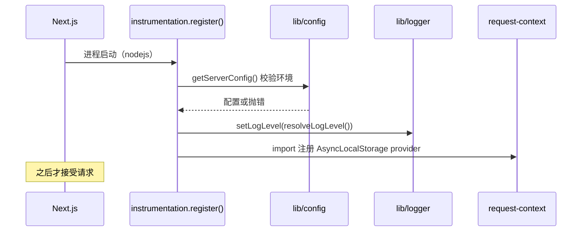

# 基础设施（Infrastructure）

> **回答什么问题**：配置从哪读、业务与认证如何分连接、权限守卫、日志、缓存、限流与安全头怎么落地。
> **读者**：平台 / 后端开发 · 值班　**长度上限**：5 页
> **不写什么**：系统分层（`docs/architecture.md`）、表结构（`docs/data-model.md`）、接口契约（`docs/api.md`）、本地启动步骤（`docs/development.md`）、发布流程（`docs/runbooks/`）。

本文件描述所有领域共享的横切能力：配置、数据库连接与事务、权限守卫、错误识别、日志、缓存、限流、ID、HTTP 安全头。

## 1. 配置（F7 单一入口）

[`lib/config.ts`](../lib/config.ts) 是全项目**唯一**允许读取 `process.env` 的模块（由 `scripts/check-env-access.mjs` 强制）。

### 1.1 环境变量

变量名、必填性、取值格式与默认值只写一次：模板见 [`.env.example`](../.env.example)，解析与校验见 [`lib/config.ts`](../lib/config.ts)（全项目唯一读 `process.env` 的模块）。本文件不复制第二份清单；下面两节只写校验时机与媒体模式——那是配置本身不表达的机制。

### 1.2 校验时机

- 由 [`instrumentation.ts`](../instrumentation.ts) 在进程启动时调用 `getServerConfig()`；
- 跳过 `NEXT_RUNTIME !== 'nodejs'`（边缘运行时）与 `phase-production-build`；
- 校验失败直接抛错，让错误部署**启动即失败**，而不是首个请求 500；
- `AUTH_POSTGRES_URL` 在非构建阶段禁止 pooled endpoint（`-pooler.` 主机名），因为认证连接用启动参数固定 `role=auth_service`，PgBouncer 不接受。

### 1.3 媒体模式

```ts
getMediaMode(): 'blob' | 'fs'   // 只看 BLOB_READ_WRITE_TOKEN
```

空串被预处理为 `undefined`，因此 E2E 可以用空串把服务钉回 fs 驱动。

## 2. 双数据库连接

| 连接 | 模块 | 角色 | 用途 |
| --- | --- | --- | --- |
| 业务 | `lib/db/drizzle.ts` 的 `db` | `genealogy_app` | RLS 下的业务读写 |
| 认证 | `lib/db/auth-db.ts` 的 `getAuthDb()` | `auth_service` | Better Auth 用户/会话/账号 |

为什么必须分离：`auth.*` 四张表**没有 RLS**，如果业务连接使用共享角色，就能直接读 `auth.account.password` 与 session token。

### 2.1 驱动选择

| 环境 | 驱动 | 说明 |
| --- | --- | --- |
| 本地 / CI | `postgres.js` | `drizzle-orm/postgres-js` |
| Vercel | `pg.Pool`（max 5）+ `attachDatabasePool` | Fluid Compute 冻结/恢复连接池，避免跨请求泄漏 |

`db` 通过 `Proxy` 延迟初始化：导入模块不连接，首次查询才连接。这让 typecheck / build / 单测在无 `POSTGRES_URL` 时也能运行。

### 2.2 事务与 RLS

```ts
withOrg<T>(userId, fn): Promise<T>
  → BEGIN
  → SET LOCAL role genealogy_app
  → SELECT set_config('app.user_id', userId, true)
  → fn(tx)
```

- 必须 `SET LOCAL`：session 级设置会随连接池泄漏到下一个请求；
- GUC 名必须是 `app.user_id`（`app.current_user_id()` 读取它）；旧实现的 `request.jwt.claims` 会让 `visible_org_array()` 恒为空，查询静默返回 0 行；
- `DbTransaction` 类型从 Drizzle 事务推导，服务层共享。

### 2.3 写事务

```ts
withOrgWrite<T>(userId, orgId, permission, fn)
  → withOrg(userId, async tx => {
      if (!await requireOrgPermission(tx, userId, orgId, permission))
        return { ok: false, reason: 'forbidden' };
      return fn(tx);
    })
```

返回 `T | { ok:false; reason:'forbidden' }`，而不是抛异常，保持 Action 的 `ActionState` 契约。

### 2.4 结果归一化

```ts
queryRows<T>(executor, query): Promise<T[]>
```

- postgres.js 返回数组；
- node-postgres 返回 `{ rows }`；
- 认证相关原生 SQL 用它抹平差异。

## 3. 权限守卫

[`lib/db/guards.ts`](../lib/db/guards.ts)：

```ts
requireOrgPermission(tx, userId, orgId, permission): Promise<boolean>
```

- 在**同一事务**内读取角色并应用权限矩阵；
- 调用方传业务权限字符串（`project.write` 等），不比较角色名，矩阵只存在于 `lib/auth/access-control.ts`。

## 4. 错误识别

[`lib/db/errors.ts`](../lib/db/errors.ts) 解决三个现实问题：

1. Drizzle / Better Auth 会把驱动异常多层包裹，SQLSTATE 在 `cause` / `body.cause` 深处；
2. postgres.js 与 node-postgres 的字段名不同（`constraint_name` vs `constraint`）；
3. `ON DELETE RESTRICT` 在 PG18 报 `23001`，而不是很多人以为的 `23503`。

| 函数 | 用途 |
| --- | --- |
| `isUniqueViolation(error)` | `23505` → 冲突 |
| `isForeignKeyViolation(error)` | `23503` / `23001` → 外键 |
| `isForeignKeyViolationOf(error, constraints)` | 按约束名精确匹配，删除操作必须用这个 |
| `sqlStateOf(error, state)` | 任意 SQLSTATE 判断 |
| `foreignKeyConstraintOf(error)` | 取约束名，供日志 |
| `isRaisedException(error, name)` | `P0001` + 消息包含函数 `RAISE EXCEPTION` 的语义名 |

## 5. 日志与请求上下文

### 5.1 Logger

[`lib/logger.ts`](../lib/logger.ts)：

- 输出**单行 JSON**：`{ level, time, message, ...context }`；
- 级别：debug 10 / info 20 / warn 30 / error 40；
- 默认级别：生产 `info`，开发 `debug`；`error` 路径会附 `name/message/stack`；
- 模块同时被打包到浏览器，因此**不能** import `lib/config`；级别由 `instrumentation.ts` 调 `setLogLevel()` 注入。

### 5.2 请求上下文

[`lib/server/request-context.ts`](../lib/server/request-context.ts)：

```ts
runWithRequestContext({ request_id, method, path }, fn)
addLogContext({ user_id, org_id })
getRequestContext()
```

- 基于 `AsyncLocalStorage`；
- 注册 `setLogContextProvider()` 后，所有日志自动携带 `request_id / method / path`；
- 在服务层可 `addLogContext({ user_id, org_id })`，无需层层传参。

### 5.3 API 包装

```ts
withApiLogging(name, handler)
```

- 读取或生成 `x-request-id`；
- 建立请求上下文；
- 成功：设置响应头 + 记录 `status` / `duration_ms`；
- 异常：记录堆栈，返回 JSON `{ error: 'Internal Server Error' }` + 500 + `x-request-id`。

## 6. 缓存与失效

| 机制 | 位置 | 行为 |
| --- | --- | --- |
| `revalidateWholeConsole()` | `lib/console/revalidate.ts` | `revalidatePath('/dashboard', 'layout')` |
| 不失效白名单 | 谱文页保存/加页/删页/重排 | 防止服务端快照覆盖未保存输入 |
| `cache()` | `lib/auth/context.ts`、`lib/lineage/nav.ts`、`lib/article/nav.ts` | 单请求内去重 |
| TanStack Query | `components/query-provider.tsx` | RSC `initialData` + 客户端缓存 |
| `queryKeys` | `lib/query-keys.ts` | `user / orgs / projects(orgId)` |

## 7. 限流

[`lib/auth/rate-limit.ts`](../lib/auth/rate-limit.ts)：

- 内存滑动窗口（单实例有效，Vercel 多实例不共享）；
- 用于登录、改密码等敏感动作；
- 超限返回 `RATE_LIMITED`，文案面向用户。

> 这是开发/单实例级别的保护，不是分布式限流；要跨实例需外部存储。

## 8. ID

[`lib/ids.ts`](../lib/ids.ts)：

| 函数 | 说明 |
| --- | --- |
| `generatePublicId()` | 20 位 `[a-z0-9]`，用于 org slug / project ref |
| `isPublicId(value)` | 路由参数预校验 |
| `isUuid(value)` | 内部 UUID 预校验，避免把非法参数送进 SQL |

数据库侧 `public.generate_public_id()` 同为 20 位；应用侧生成只用于重试与测试。

## 9. 客户端数据获取

```ts
fetcher<T>(url): Promise<T>   // 非 2xx 抛 Error & { status }
```

- 仅用于 Route Handler 的客户端读取；
- 服务端组件不使用它，直接调用查询层。

## 10. HTTP 安全头

[`next.config.ts`](../next.config.ts) 对所有路径设置：

| 头 | 值 |
| --- | --- |
| `Content-Security-Policy-Report-Only` | 先观察不拦截（Tailwind/RSC 内联样式） |
| `Strict-Transport-Security` | `max-age=63072000; includeSubDomains` |
| `X-Frame-Options` | `DENY` |
| `X-Content-Type-Options` | `nosniff` |
| `Referrer-Policy` | `strict-origin-when-cross-origin` |
| `Permissions-Policy` | 关闭 camera/microphone/geolocation |

`poweredByHeader: false`；`allowedDevOrigins: ['127.0.0.1']` 供 Playwright 本地驱动。

## 11. 启动顺序



## 12. 关键基础设施文件

| 文件 | 职责 |
| --- | --- |
| `lib/config.ts` | 环境校验、媒体模式、日志级别 |
| `lib/db/drizzle.ts` | 业务连接、`withOrg`、`queryRows`、`closeDb` |
| `lib/db/auth-db.ts` | 认证连接（`role=auth_service`） |
| `lib/db/write.ts` | `withOrgWrite` |
| `lib/db/guards.ts` | `requireOrgPermission` |
| `lib/db/errors.ts` | PG 错误链识别 |
| `lib/logger.ts` | JSON 日志 |
| `lib/server/request-context.ts` | AsyncLocalStorage 上下文 |
| `lib/api.ts` | `withApiLogging` |
| `lib/console/revalidate.ts` | 控制台缓存失效 |
| `lib/auth/rate-limit.ts` | 内存限流 |
| `lib/ids.ts` | 公开/内部 ID 校验 |
| `instrumentation.ts` | 启动校验 |
| `proxy.ts` | 边缘 cookie 乐观检查 |
| `next.config.ts` | 安全头、开发源 |
