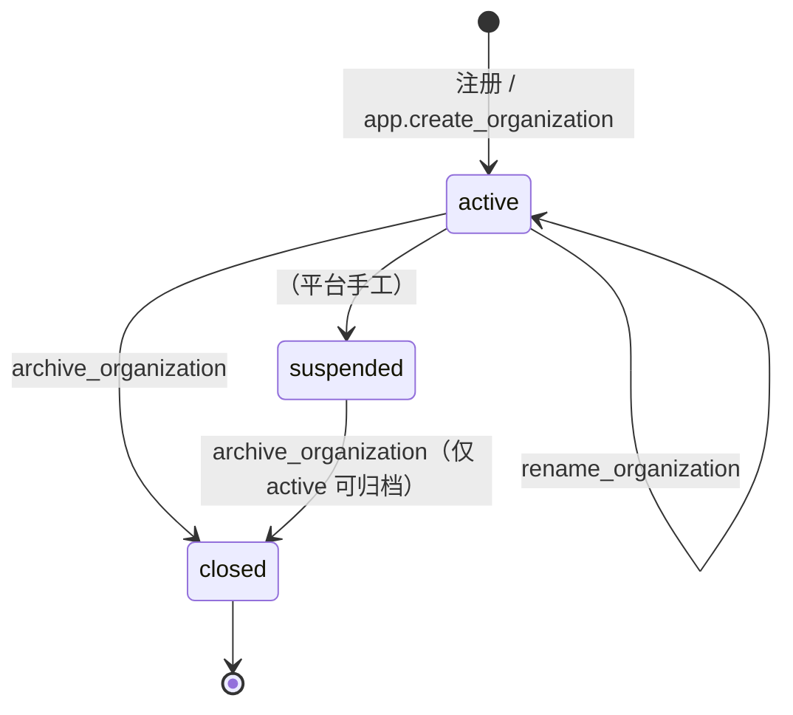
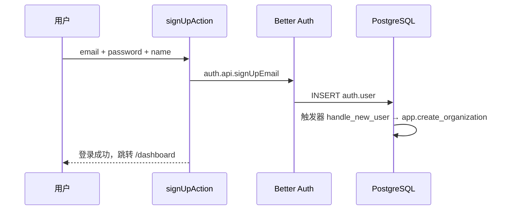
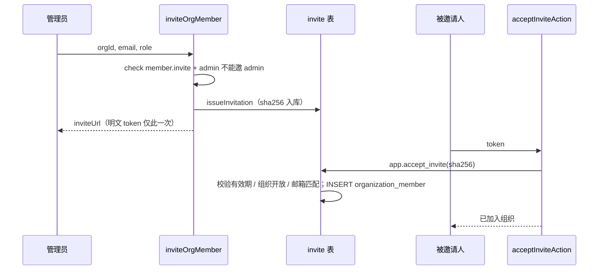
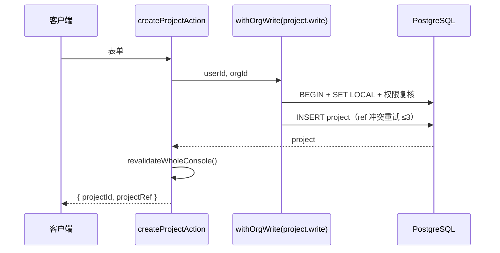

# 认证、组织、云谱空间与分类

本域解决「谁在用、属于哪个组织、能做什么、数据放在哪个云谱空间」。

## 1. 认证与会话

### 1.1 Better Auth 配置

[`lib/auth/better-auth.ts`](../../lib/auth/better-auth.ts) 创建 Better Auth 实例：

- `appName: '云谱'`；
- Drizzle adapter，表映射使用 `lib/db/auth-schema.ts`；
- `emailAndPassword` 开启，密码最小长度 8；
- session 有效期 7 天，`updateAge` 1 天；
- cookie 前缀 `better-auth`；
- `plugins: [nextCookies()]`，让 Server Action 能写 cookie；
- `validateSchema: false`，因为 schema 由基线迁移显式管理。

认证连接使用独立角色（`lib/db/auth-db.ts`），与业务连接 `genealogy_app` 分离，避免业务代码读取凭据表。

### 1.2 会话读取

[`lib/auth/context.ts`](../../lib/auth/context.ts)：

```ts
getSessionUser(): Promise<SessionUser | null>   // cache() 包装，单请求只查一次
requireUser(): Promise<SessionUser>             // 未登录 redirect('/sign-in')
requireOrgContext(slug): Promise<OrgContext>    // 校验组织成员身份
requireProjectContext(ref): Promise<ProjectContext> // 校验项目属于该组织
```

`SessionUser` 只包含 `id / name / email`，由 `lib/auth/types.ts` 定义，可安全序列化到客户端。

### 1.3 边缘检查

[`proxy.ts`](../../proxy.ts) 只对 `/dashboard` 做 **cookie 是否存在** 的乐观判断：

- 没有 session cookie → 重定向登录；
- 有 cookie 也**不校验真实性**，真实校验一律在 RSC / Action 中完成。

这样可以避免边缘运行时加载 Node 依赖，也避免把鉴权逻辑分散到两处。

### 1.4 Server Action 认证包装

[`lib/auth/middleware.ts`](../../lib/auth/middleware.ts)：

```ts
validatedActionWithUser(schema, handler)
validatedActionWithUserObject(schema, handler)
```

流程：

1. `getSessionUser()`；失败 → `{ code: 'UNAUTHORIZED', error: '登录状态已失效，请重新登录。' }`；
2. Zod `safeParse`；失败 → `{ code: 'VALIDATION', fieldErrors }`；
3. 调用 `handler(data, formData, user)`。

### 1.5 登录 / 注册 / 登出

[`lib/auth/actions/session.ts`](../../lib/auth/actions/session.ts)：

| Action | 行为 |
| --- | --- |
| `signInAction` | `auth.api.signInEmail`，成功后跳转组织 |
| `signUpAction` | `auth.api.signUpEmail`；数据库触发器 `handle_new_user` 自动创建个人组织；支持邀请 token 自动加入 |
| `signOutAction` | `auth.api.signOut` + 重定向 |

账号资料/改密码在 `lib/auth/actions/account.ts`，使用 `rate-limit.ts` 的滑动窗口防止暴力尝试。

## 2. RBAC 权限模型

### 2.1 角色矩阵

权限声明在 [`lib/auth/access-control.ts`](../../lib/auth/access-control.ts)，业务权限与资源动作的映射在 `PERMISSION_REQUESTS`：

| 业务权限 | 资源动作 | owner | admin | editor | viewer |
| --- | --- | :--: | :--: | :--: | :--: |
| `content.read` | `content:read` | ✅ | ✅ | ✅ | ✅ |
| `lineage.write` | `lineage:write` | ✅ | ✅ | ✅ | — |
| `lineage.delete` | `lineage:delete` | ✅ | ✅ | — | — |
| `article.write` | `article:write` | ✅ | ✅ | ✅ | — |
| `book.write` | `book:write` | ✅ | ✅ | ✅ | — |
| `project.write` | `project:write` | ✅ | ✅ | — | — |
| `member.invite` | `invitation:create/cancel` | ✅ | ✅ | — | — |
| `member.manage` | `member:create/update/delete` | ✅ | ✅ | — | — |
| `org.settings` | `organization:update` | ✅ | — | — | — |
| `org.transfer` | `organization:transfer` | ✅ | — | — | — |

### 2.2 判断入口

```ts
hasPermission(role, permission): boolean
getOrgRole(userId, orgId): Promise<OrgRole | null>
getOrgRoleInTx(tx, userId, orgId): Promise<OrgRole | null>
checkOrgPermission(userId, orgId, permission): Promise<string | null> // 返回中文错误
```

- 页面 / Action 前置检查用 `checkOrgPermission`；
- 写事务内用 `requireOrgPermission(tx, ...)`，防止「检查后被降权」；
- 拒绝文案集中在 `PERMISSION_DENIED_MESSAGES`。

## 3. 组织

### 3.1 生命周期



- 创建：`createOrgAction` 调用 `SELECT app.create_organization(name)`，该 SECURITY DEFINER 函数在**同一事务**写入 `organization` + owner 成员行，`created_by` 取自 `app.current_user_id()`；
- slug 冲突：最多重试 3 次（`SLUG_ATTEMPTS`），仍失败返回友好错误；
- 重命名：`renameOrgAction` → `app.rename_organization`，要求 `org.settings`（仅 owner）；
- 归档：`deleteOrgAction` → `app.archive_organization`，要求 `org.settings`；重复归档映射 SQLSTATE `22023`。

### 3.2 成员列表

`listOrgMembers(actorId, organizationId)` 两段读取：

1. 业务连接读 `organization_member`（RLS 限定）；
2. 认证连接按 user id 批量补 `auth.user.name/email`。

这是拆掉 Better Auth organization 插件后的唯一成员列表路径。

## 4. 邀请

### 4.1 签发

```ts
issueInvitation({ actorId, organizationId, email, role })
  → { ok: true, invitation: { token, expiresAt } }
  | { ok: false, reason: 'accepted' | 'token_collision' }
```

- token：32 字节随机 → base64url（43 字符），数据库只存 **sha256**；
- 有效期 7 天；
- 同一组织同一邮箱只有一行：`INSERT ... ON CONFLICT (organization_id, email) DO UPDATE`；
- 重发**不改 role**（避免静默提权），且 `WHERE accepted_at IS NULL`；
- `token_hash` 唯一冲突单独重试 3 次。

明文 token 只在 `inviteOrgMember` 的返回值中出现一次：

```ts
inviteUrl: `${BETTER_AUTH_URL}/join?token=${token}`
```

### 4.2 预览与接受

- `previewInvitation(actorId, token)` → `app.invite_join_preview`，只返回组织名/角色/过期时间；无效统一 `null`，不区分原因（防探测）；
- `acceptInviteAction`：明文 token → sha256 → `app.accept_invite`，函数内原子完成「token 有效 / 组织开放 / 邮箱匹配」；
- 错误映射：
  - `22023` → 邀请无效或已过期；
  - `42501` → 邀请不属于当前账号；
  - `23505` → 已是成员。

### 4.3 撤销

`revokeInvitation` 只把 `status` 置 `revoked`，不删行 —— 保留行才能区分「已撤销」与「不存在」。

## 5. 云谱空间（project）

### 5.1 服务层

[`lib/project/services.ts`](../../lib/project/services.ts)：

```ts
createProjectInTransaction({ userId, orgId, input })
updateProjectInTransaction({ userId, orgId, projectId, updates })
deleteProjectInTransaction({ userId, orgId, projectId })
```

所有方法都通过 `withOrgWrite(userId, orgId, 'project.write', ...)` 进入。

- **创建**：校验组织存在；`ref` 每次尝试重新生成（`generatePublicId()`），`onConflictDoNothing`，最多 3 次；
- **更新**：白名单字段（`name / countriesRegions / hallCode / status / importance / notes`），按 `(id, orgId)` 双条件更新；`themeName` 创建后不可变；
- **删除**：在 `SAVEPOINT delete_project` 内直接 `DELETE ... RETURNING`；子表 `RESTRICT` 违约（`23001` / `23503`）时先 `ROLLBACK TO SAVEPOINT` 恢复事务再返回 `not_empty`，空项目则 `RELEASE SAVEPOINT`。约束交给数据库判定，不预先探查子表、不维护约束名清单，新增子表无需登记。

### 5.2 Action 与文案

[`lib/project/actions.ts`](../../lib/project/actions.ts)：

| Action | 成功载荷 |
| --- | --- |
| `createProjectAction` | `projectId`、`projectRef` |
| `updateProjectAction` | 同时 `revalidatePath('/dashboard/project/:ref', 'layout')` |
| `deleteProjectAction` | — |

错误映射：

```ts
forbidden  → 你没有管理云谱空间的权限
not_found  → 云谱空间不存在
conflict   → 项目创建失败，请重试。
not_empty  → 云谱空间里还有谱系、谱文或谱书，请先清空再删除
```

### 5.3 公开寻址

- URL：`/dashboard/project/[projectRef]`；
- `requireProjectContext(ref)` 通过 `getProjectScopeByRef(userId, ref)` 解析，校验项目属于用户可见组织；
- 项目列表通过 `getProjects(userId, orgId)` 读取，供布局与切换器使用。

## 6. 分类（folder）

分类是**扁平单层**的，谱系 / 谱文 / 谱书共享同一套分类；同一项目内名称唯一。

[`lib/folder/services.ts`](../../lib/folder/services.ts)：

| 方法 | 行为 |
| --- | --- |
| `createFolderInTransaction` | 校验项目属于组织；`seq = max(seq)+1`；`onConflictDoNothing` 撞名返回 `conflict` |
| `renameFolderInTransaction` | 先查目标是否存在；再查同项目重名（排除自身）；更新 |
| `deleteFolderInTransaction` | 把 `lineage/article/book` 的 `folder_id` 置空，统计 `unfiledContent`，再删除分类 |

Action 层：

```ts
createFolderAction / renameFolderAction / deleteFolderAction
```

- 权限使用 `project.write`（owner/admin）；
- 删除成功文案会带上「N 项内容已移入未分类」；
- 所有操作 `revalidateWholeConsole()`。

## 7. 关键调用链

### 7.1 注册并自动获得组织



### 7.2 邀请并加入



### 7.3 创建云谱空间


