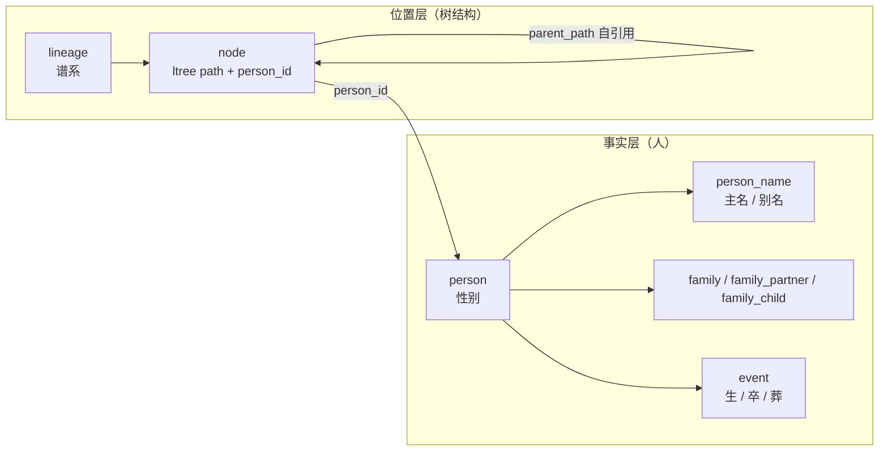
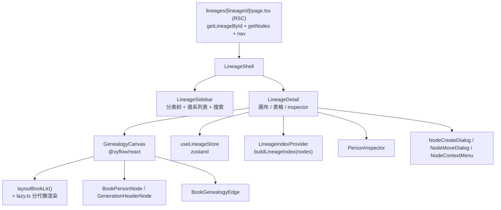
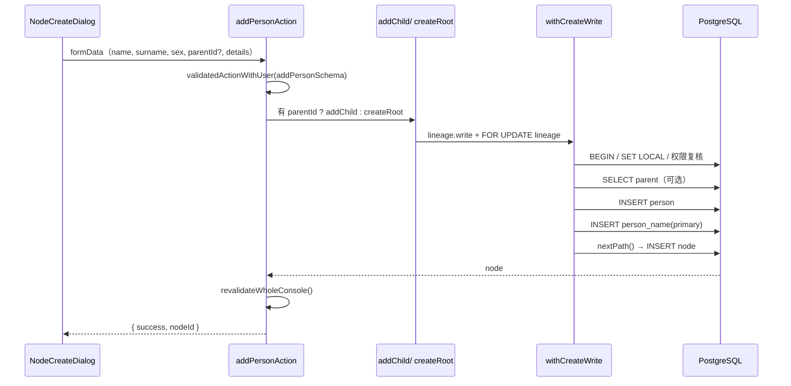

# 谱系域

谱系域负责「一棵世系树」的创建、人丁录入、编辑、删除与可视化。它是全项目最复杂的域，核心设计是**事实层（person/family/event）与位置层（node）分离**。

## 1. 领域模型



- `node` 只表达「在树中的位置」，没有姓名、性别、生辰等身份列；
- `person` 表达人物身份，`person_name` 表达姓名，`event` 表达事实；
- 同一个人理论上可挂在多个 node 上，但 `node_one_primary` 保证每个 lineage 内每人只有一个 `primary` 节点。

## 2. 写入入口

### 2.1 谱系 CRUD

[`lib/lineage/services.ts`](../../lib/lineage/services.ts)：

```ts
createLineageInTransaction(params)
updateLineageInTransaction(params)
deleteLineageInTransaction(params)
```

- 创建：`withOrgWrite(..., 'lineage.write')`，校验项目属于组织、分类属于项目；分类为空时 `ensureDefaultFolderInTx`（`lib/folder/services.ts`）找/建默认分类；同名返回 `conflict`；
- 更新：白名单字段 `folderId / name / description / poemText / baseGeneration / seq`；
- 删除：`lineage.delete`（owner/admin）；先查 `book_catalog` 是否引用，引用则 `referenced`；然后先删节点、再删谱系，返回删除节点数。

> 表单仍会提交 `姓氏 / 堂号 / 地区 / 字辈 / 人丁数` 等字段，但目标态 `lineage` 已无这些列，Action 层**刻意丢弃**。

### 2.2 人丁创建

[`lib/lineage/node-services.ts`](../../lib/lineage/node-services.ts)：

```ts
createRootNodeInTransaction(params)      // 始祖
addChildInTransaction(params)            // 子女
addSiblingInTransaction(params)          // 兄弟
addSpouseInTransaction(params)           // 直接返回 not_supported
updateNodeInTransaction(params)
deleteNodeInTransaction(params)
moveNodeInTransaction(params)            // 直接返回 not_supported
reorderSiblingsInTransaction(params)     // 直接返回 not_supported
```

所有创建路径共用两段前置：

```ts
withCreateWrite(params, async (tx, lineage) => { ... })
// = withOrgWrite('lineage.write') + SELECT lineage FOR UPDATE
```

行锁是并发安全的关键：两个并发请求在同一个父节点下分配路径时，`FOR UPDATE` 串行化 `nextPath()`，避免拿到同一个尾段。

### 2.3 路径分配算法

```ts
const PATH_STEP = 10;
segment(v) = String(v).padStart(4, '0');

nextPath(tx, orgId, lineageId, parentPath):
  max = SELECT max(split_part(path::text, '.', nlevel(path)))
        WHERE parent_path = parentPath （根节点用 IS NULL）
  leaf = segment(max + 10)
  return parentPath ? `${parentPath}.${leaf}` : leaf
```

示例：

```text
始祖            0010
├─ 长子          0010.0010
│  ├─ 长孙      0010.0010.0010
│  └─ 次孙      0010.0010.0020
└─ 次子          0010.0020
```

- 段固定 4 位，超过 9999 抛 `node path segment overflow`；
- 稀疏步长 10 为后续中间插入留空间；
- 世次派生公式只在 `docs/data-model.md` §3 定义，本模块不复制第二份。

### 2.4 三表写入

`recordNode()` 在**同一事务**内：

1. `INSERT person (sex)`；
2. `INSERT person_name (kind='given', value=姓+名, is_primary=true)`；
3. `writePersonFacts()`：字号写 `person_name(kind='courtesy')`，生辰/忌辰写 `event(birth|death)`，葬地写 `event(burial)`；
4. `INSERT node (path, kind='primary', display_name)`。

任一步失败整体回滚，不会留下「有 person 没有 node」的孤儿。

### 2.5 编辑

`updateNodeInTransaction`：

- 锁定谱系；
- 更新 `person.sex`；
- 更新该 person 的 primary `person_name.value`；
- 调用 `writePersonFacts()` 写入 `courtesy / isAlive / birthText / deathText / birthYear / deathYear / burialPlace`；
- 更新 `node.display_name`。

`isAlive` 由是否存在 `event(kind='death')` 派生：取消“在世”会记录一条死亡事件，即使日期未知。`namePrefix / biography` 没有目标态列，已从表单与 `NodeUpdates` 契约移除。

### 2.6 删除

```ts
deleteNodeInTransaction({ userId, orgId, lineageId, nodeId })
```

- 始祖（`parentPath === null`）禁止删除 → `root_forbidden`；
- 删除条件 `path <@ target.path`，一次删除整棵子树；
- 只删除 `node` 位置行；`person / person_name / event` 事实行不会被级联清理（`node_person_fk` 为 RESTRICT，方向是 node → person）；
- 返回 `deletedNodes`，前端确认文案见 `lib/lineage/subtree.ts` 的 `buildDeleteConfirmMessage()`。

### 2.7 移动与重排（已知限制）

```ts
moveNodeInTransaction(...)          // 直接返回 not_supported
reorderSiblingsInTransaction(...)   // 直接返回 not_supported
```

原因：`node_parent_fk` 是**非 deferrable** 自引用复合外键。移动子树需要同时重写所有后代的 `path`，事务中途会短暂违反父引用。正确实现需要三阶段临时前缀交换与 Phase-B DDL，因此当前不做任何读取或校验，直接返回明确的“暂不支持”，避免把系统限制误报成目标无效。

## 3. Server Actions

[`lib/lineage/actions.ts`](../../lib/lineage/actions.ts)：

| Action | Service | 成功载荷 |
| --- | --- | --- |
| `createLineageAction` | `createLineageInTransaction` | `lineageId` |
| `updateLineageAction` | `updateLineageInTransaction` | — |
| `deleteLineageAction` | `deleteLineageInTransaction` | 删除人丁数文案 |
| `createRootNodeAction` | `createRootNodeInTransaction` | `nodeId`（+ `spouseId` 预留） |
| `addChildAction` | `addChildInTransaction` | `nodeId` |
| `addSiblingAction` | `addSiblingInTransaction` | `nodeId` |
| `addPersonAction` | 有 `parentId` → child，否则 root | `nodeId` |
| `addSpouseAction` | `addSpouseInTransaction` | 失败（`not_supported`） |
| `updateNodeAction` | `updateNodeInTransaction` | — |
| `deleteNodeAction` | `deleteNodeInTransaction` | 删除节点数 |
| `moveNodeAction` | `moveNodeInTransaction` | 失败（`not_supported`） |

失败原因由 `lib/lineage/lineage-errors.ts` 统一映射为中文，如：

| reason | 文案倾向 |
| --- | --- |
| `root_exists` | 谱系已有始祖 |
| `root_sibling` | 始祖没有兄弟 |
| `root_forbidden` | 不能删除始祖 |
| `cycle` | 不能移动到自己的后代下 |
| `not_supported` | 当前版本暂不支持该操作 |

## 4. 查询与投影

[`lib/db/queries/nodes.ts`](../../lib/db/queries/nodes.ts) 的 `getNodes(userId, orgId, lineageId)`：

1. 先解析 `projectId`（因为 `(project_id, id)` 才是完整 scope）；
2. `node LEFT JOIN person LEFT JOIN person_name(is_primary)`；
3. 批量读取 `event(kind in birth/death/burial)`，补生辰、忌辰、葬地与年份；
4. 批量读取 `person_name(kind='courtesy')`，补字号；
5. 按 `path ASC, createdAt ASC, id ASC` 排序；
6. `toNodeViewRows()` 投影为客户端 22 字段 `NodeView`。

投影规则：

| 字段 | 来源 |
| --- | --- |
| `generation` | `path.split('.').length` |
| `sort` | 路径最后一段的整数值 |
| `parentId` | 用 `parentPath` 在同树 path→id 映射中反查 |
| `fullName` | `person_name.value`，回退 `node.display_name` |
| `surname` / `name` | 全名的「末字为名」显示启发式 |
| `sex` | `person.sex` 原值（`male` / `female` / `other` / `unknown`），缺失时 `unknown` |
| `courtesy` | `person_name(kind='courtesy').value` |
| `birthText` / `deathText` | `event(birth|death).date_text`，`birthYear` / `deathYear` 取自 `date_sort` 前四位 |
| `burialPlace` | `event(burial).place_text` |
| `isAlive` | 是否存在 `event(kind='death')` |
| `spouseOfId` | 恒 `null`（目标态无配偶边） |
| `role` | 恒 `'blood'`（画布仍按该字段遍历子树） |
| `namePrefix` / `biography` | 恒 `null`（目标态无对应列，表单已移除） |

## 5. 前端架构



### 5.1 视图状态：`useLineageStore`

[`components/lineage/lineage-store.ts`](../../components/lineage/lineage-store.ts) 使用 Zustand 保存：

| 字段 | 含义 |
| --- | --- |
| `lineageId` | 当前谱系，切换时重置视图 |
| `view` | `canvas` / `table` |
| `selectedNodeId` | 选中节点 |
| `collapsedNodeIds` | 折叠节点 |
| `personQuery` | 跨画布/表格共享的搜索词 |
| `generationLimit` | 用户显式限制的世次 |
| `renderGenerationLimit` | 懒渲染当前渲染到第几代 |
| `minimapVisible` | 小地图开关 |
| `notice` | 画布内提示 |
| `focus` | `{ nodeId, nonce }`，用于重复定位同一节点 |
| `collapsedFolderIds` | 侧边栏分类折叠 |
| `sidebarWidth` | 220–420 拖拽宽度 |

`initializeForLineage(id)` 在切换谱系时清空选中、折叠、搜索与渲染窗口。

### 5.2 派生索引：`buildLineageIndex`

[`components/lineage/derived.ts`](../../components/lineage/derived.ts) 把节点数组变成：

```ts
type LineageIndex = {
  nodes: NodeView[];
  blood: NodeView[];                 // 深度优先先序遍历（长房整支在前）
  byId: Map<string, NodeView>;
  spousesByBlood: Map<string, NodeView[]>;
  childrenByParent: Map<string, NodeView[]>;
  roots: NodeView[];
  maxGeneration: number;
  descendantCounts: Map<string, number>;
};
```

- **唯一显示顺序来源**：画布纵向堆叠、世系表、搜索首匹配、打印都继承 `index.blood`；
- 排序不是 `generation → sort`，而是从根开始的 **DF preorder**（长房整支在前、次房整支在后）；
- 用显式栈而非递归，避免万人谱爆栈；
- 环状父链的兜底节点按 `generation → sort → 全名` 追加，保证不丢人且结果稳定。

其他派生函数：`generationWord()`（字辈）、`rankLabel()`（伯仲叔季）、`lifeSpan()`、`ancestorsOf()`、`matchesNode()`、`listLineagePersonMatches()`。

### 5.3 画布布局：`layoutBookLtr`

[`components/lineage/canvas/layout/book-ltr.ts`](../../components/lineage/canvas/layout/book-ltr.ts)：

- 横向为世次（generation），纵向为同代分支；
- 常量：节点宽 112、表头宽 84、列宽 196、行高 64、起点 `(60, 110)`；
- `xForGeneration(g) = 60 + (g-1)*196 + 98 - 56`；
- 深度优先分配 Y：长子继承父 Y，后续子节点从 `currentLeafY` 继续；
- 折叠节点会隐藏整棵后代；
- 输出 `positions`、世代表头、边路径。

### 5.4 懒渲染

[`components/lineage/canvas/layout/lazy.ts`](../../components/lineage/canvas/layout/lazy.ts)：

- 节点数 > 500 时，首屏只渲染前 5 代（`LAZY_GENERATION_STEP`）；
- 当视口横向滚动到总宽 75% 以上时追加 5 代；
- 新增后代时，如果当前已渲染到最大代，会自动扩展窗口，保证新节点可见。

### 5.5 节点、边与交互

- `BookPersonNode`：显示姓名、世次、生卒、折叠按钮；`memo` 包裹；
- `GenerationHeaderNode`：世代表头；
- `BookGenealogyEdge`：父子连线，按布局给出的路径绘制；
- `GenealogyCanvas` props：`lineageId / generationWords / canWrite / onCreateChild / onCreateSpouse / onCreatePerson / onSelectNode / onEditNode / onNodeContextMenu / onMoveNode / onPrint`；
- 交互：点击选中、双击编辑、右键菜单（`NodeContextMenu` + `NODE_COMMANDS`）、拖拽移动（当前会提示未支持）、画布工具栏（缩放/适配/小地图/打印/导图例）。

### 5.6 检视与命令

- `PersonInspector`：右侧人物详情 + 编辑入口；
- `useInspectorSelection`：未保存修改时的丢弃确认；
- `node-commands.ts`：命令定义与 `enabledCommands()`（按是否始祖、是否可写过滤）。

## 6. 端到端调用链

### 6.1 录入一个人丁



### 6.2 画布渲染

```text
getNodes() → NodeViewRow[]
  → LineageIndexProvider: buildLineageIndex()
  → layoutBookLtr(index, { collapsedIds, generationLimit })
  → ReactFlow nodes/edges
  → BookPersonNode / BookGenealogyEdge
```

## 7. 文件速查

| 文件 | 职责 |
| --- | --- |
| `lib/lineage/actions.ts` | 谱系与人丁 Server Actions |
| `lib/lineage/services.ts` | 谱系 CRUD 事务 |
| `lib/lineage/node-services.ts` | 人丁创建/更新/删除/移动/重排（后两者限制） |
| `lib/lineage/lineage-write.ts` | `withLineageWrite` / `withCreateWrite`：权限 + 行锁 |
| `lib/lineage/subtree.ts` | 子树 ID 收集、删除确认文案 |
| `lib/lineage/auto-root.ts` | 空谱系是否自动打开始祖录入 |
| `lib/lineage/nav.ts` | 侧边栏分类/谱系数据（`cache()`） |
| `lib/db/queries/nodes.ts` | 节点投影与事实层 join |
| `components/lineage/derived.ts` | 派生索引、排序、检索、世次字辈 |
| `components/lineage/canvas/*` | 画布、布局、懒加载、节点、边 |
| `components/lineage/lineage-store.ts` | 画布视图状态 |
